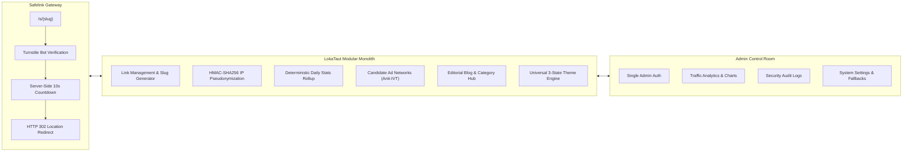

<div align="center">

# LokaTaut

### Private Link Management & High-Security Safelink Platform

[](https://www.php.net/)
[](https://laravel.com/)
[](https://www.mysql.com/)
[-success.svg?style=flat-square&logo=githubactions&logoColor=white)](#automated-testing-suite)
[](https://www.cloudflare.com/products/turnstile/)
[-007acc.svg?style=flat-square)](#deployment-guide)
[](LICENSE)

<p align="center">
  <strong>LokaTaut</strong> adalah platform utilitas pengelolaan tautan digital dan pengalihan safelink privat yang dibangun dengan arsitektur <em>Modular Monolith</em> di atas <strong>Laravel 13</strong>, <strong>Native CSS</strong>, dan <strong>Vanilla JavaScript ES6+</strong>.
</p>

[Fitur Utama](#fitur-utama) •
[Arsitektur & Keamanan](#arsitektur--prinsip-keamanan) •
[Instalasi Lokal](#instalasi-dan-pengembangan-lokal) •
[Panduan Deployment](#panduan-deployment-warnahost-shared-hosting) •
[Pengujian Otomatis](#automated-testing-suite) •
[Dokumentasi Teknis](#suite-dokumentasi-teknis-v122)

---

</div>

## Gambaran Umum

LokaTaut dirancang khusus untuk kebutuhan pemilik tunggal (*Private Single-Owner Platform*) dalam mendistribusikan, merapikan, dan melindungi tautan berkas digital (seperti installer perangkat lunak, modul edukasi, dokumen PDF, dan aset template kreatif) dari perayapan bot liar (*scraping*) dan penyalahgunaan bandwidth.

> **Pernyataan Positioning Produk:**  
> LokaTaut **BUKAN** platform shortlink multi-user publik, bukan bursa periklanan terbuka, dan bukan SaaS berlangganan. Platform ini tidak menyediakan pendaftaran publisher umum, sistem dompet digital, atau bagi hasil komisi (*revenue sharing*). Seluruh tautan dikontrol secara terpusat oleh administrator tunggal demi menjaga reputasi domain dan keandalan tautan.

---

## Fitur Utama



### 1. Manajemen Shortlink & Slug Kustom
- Pemendekan URL panjang ke format canonical `/s/{slug}` yang rapi dan mudah dibagikan.
- Generator slug acak otomatis berbasis Base62 atau slug kustom deskriptif (misal `/s/panduan-2026`).
- Dukungan tanggal kedaluwarsa tautan (*expiration date*) dan *source tracking* (penanda website sumber).
- Fitur *Soft Delete* untuk mempertahankan riwayat statistik dan *Hard Delete* dengan penanganan null-cascade aman.

### 2. Safelink Engine Berkeamanan Tinggi
- **Zero URL Leakage:** URL tujuan asli tersimpan dalam bentuk terenkripsi **AES-256** di database dan **tidak pernah dikirim ke browser** sebelum seluruh verifikasi selesai. Pengalihan diserahkan langsung melalui HTTP 302 header dari server.
- **Validasi Hitung Mundur Sisi Server:** Timer jeda divalidasi langsung di server menggunakan perbandingan *epoch timestamp* sesi nyata (`visitor_sessions`). Usaha mempercepat waktu via JavaScript di client akan otomatis ditolak.
- **Proteksi Bot Cerdas Cloudflare Turnstile:** Memverifikasi pengunjung manusia secara halus tanpa teka-teki gambar rumit. Dilengkapi *Emergency Bypass Switch* via pengaturan admin.
- **Sesi Kriptografis Unik:** Token sesi 32-byte acak disimpan dalam bentuk hash SHA-256 (`token_hash`) dengan transisi status atomik untuk mencegah *race condition*.

### 3. Analitik Trafik & Privasi Data Pengunjung
- **Pseudonimisasi IP NIST SP 800-57:** Alamat IP pengunjung disamarkan menggunakan `hash_hmac('sha256', $ip, $salt)` dengan garam rahasia (`ANALYTICS_SALT`) yang terisolasi dari `APP_KEY`. Alamat IP mentah langsung dibuang dari memori server.
- **Agregasi Harian Idempoten:** Perhitungan statistik harian (`daily_stats`) dieksekusi secara deterministik menggunakan *compound unique index* `(aggregate_key, date)` pada MySQL InnoDB, aman dijalankan ulang (*retry-safe*) tanpa duplikasi metrik.
- **Kebijakan Retensi Ketat:** Baris mentah kunjungan (`visits`) disimpan maksimal 90 hari, dan sesi sementara (`visitor_sessions`) otomatis dibersihkan tiap 24 jam.

### 4. Manajemen Penempatan Iklan (Anti-IVT)
- Pengelolaan 4 slot iklan sponsor terpisah: `header`, `above_timer`, `below_timer`, dan `footer`.
- Mematuhi standar kenyamanan navigasi dan batas aman jarak 30px (WCAG 2.5.5) antara tombol navigasi `#proceed-btn` dan materi sponsor, tanpa tombol jebakan atau klik paksa.
- Teruji kompatibel dengan kandidat jaringan iklan seperti Adsterra / Monetag (bersih dari skrip Google AdSense demi kepatuhan kebijakan konten tipis & timer tunggu).

### 5. Pusat Edukasi & Blog Editorial (E-E-A-T)
- Rubrik artikel dan kategori lengkap yang terindeks rapi untuk membangun otoritas domain.
- Dilengkapi estimasi waktu baca (*reading time*), filter kategori interaktif, dan pencarian cepat.
- Metadata SEO lengkap: OpenGraph, Twitter Cards, Canonical Tags, dan Schema.org JSON-LD `BlogPosting` terstruktur.
- Kotak transparansi editorial (*Editorial Trust Box*) dan tautan berbagi satu klik ke WhatsApp, X (Twitter), dan papan klip.

### 6. Universal 3-State Theme Engine (Zero FOUT)
- Dukungan penuh mode terang (**Light**), mode gelap (**Dark**), dan otomatis sistem (**System / OS sync**) di seluruh halaman publik, safelink, blog, formulir login, dan panel admin.
- Komponen `<x-theme-script />` di `<head>` mengeliminasi *Flash of Unstyled Theme* (FOUT) secara sinkron sebelum render CSS.
- Komponen tersegmentasi `<x-theme-toggle />` yang aksesibel (`aria-pressed`, keyboard navigable) dan tersimpan di `localStorage`.

---

## Arsitektur & Prinsip Keamanan

| Parameter Teknis | Kebijakan Implementasi |
|---|---|
| **Framework & Versi** | Laravel 13.x (PHP 8.3+) |
| **Arsitektur Sistem** | Modular Monolith (Service Layer + Form Requests + Blade Components) |
| **Penyimpanan URL Tujuan** | AES-256-CBC via Laravel Encryption Services |
| **Penyimpanan Token Sesi** | SHA-256 Hash di tabel `visitor_sessions` (Raw token hanya di browser) |
| **Transisi Token** | Atomik via `UPDATE visitor_sessions SET completed = 1 WHERE token_hash = ? AND completed = 0` |
| **Validasi Countdown** | Server-Side Epoch Timestamp Evaluation (`session_start_time + countdown_seconds <= now`) |
| **Pseudonimisasi IP** | HMAC-SHA256 bergaram rahasia (`ANALYTICS_SALT`) tanpa fallback |
| **Batas Retensi Log** | 90 Hari untuk log mentah (`visits`), 24 Jam untuk `visitor_sessions` |
| **Constraint Agregasi** | Unique Composite Key `(aggregate_key, date)` NOT NULL pada `daily_stats` |
| **Frontend Runtime** | 100% Native CSS3 (Tokens) + Vanilla JS (ES6+) — Bebas React, Vue, Inertia, Tailwind |
| **Ukuran Bundle Publik** | Total CSS + JS < 40 KB mentah (~10 KB gzipped) |

---

## Struktur Direktori

```
lokataut/
├── app/
│   ├── Console/Commands/       # Cron: AggregateDailyStats & PruneOldData
│   ├── Helpers/helpers.php     # Helper formatting & utility
│   ├── Http/
│   │   ├── Controllers/        # Admin, Blog, Safelink, Public Controllers
│   │   ├── Middleware/         # Authenticate, EncryptCookies, SecurityHeaders
│   │   └── Requests/           # Strict Form Requests Validation
│   ├── Models/                 # Admin, Link, Article, Category, Visit, DailyStat, AdSlot
│   └── Services/               # SafelinkService, AnalyticsService, LinkService
├── bootstrap/app.php           # Laravel 13 application bootstrap & middleware
├── config/                     # Application, Database, Services (Turnstile) config
├── database/
│   ├── migrations/             # 11 clean migrations with InnoDB constraints
│   └── seeders/                # DatabaseSeeder, AdminSeeder, DemoLinkSeeder, ArticleSeeder
├── public/
│   ├── css/                    # Native CSS: site.css, admin.css, safelink.css
│   ├── js/                     # Vanilla JS: theme.js, site.js, admin.js, safelink.js
│   └── robots.txt              # Production robots.txt with sitemap reference
├── resources/views/
│   ├── admin/                  # Dashboard, Links, Articles, Categories, Ads, Analytics, Settings
│   ├── blog/                   # Index, Category archive, Article detail
│   ├── components/             # ThemeScript, ThemeToggle, Admin layout parts
│   ├── layouts/                # site.blade.php, admin.blade.php, public.blade.php
│   └── public/                 # Home, About, Help, Contact, Safelink, Privacy, Terms
├── routes/
│   ├── web.php                 # Public, Blog, Safelink, and Admin routing
│   └── console.php             # Scheduled tasks (Cron)
├── tests/
│   └── Feature/                # 7 Comprehensive Feature Test Suites (53 tests)
├── lokataut-documentation-v1.2.2/ # Master Documentation & Architecture Decisions (ADR)
├── AGENTS.md                   # Operational guidelines for AI coding agents
├── LICENSE                     # MIT License
└── README.md                   # Repositori Entry Point (Dokumen ini)
```

---

## Instalasi dan Pengembangan Lokal

### Prasyarat Lingkungan
- **PHP:** Versi 8.3 atau lebih baru
- **Ekstensi PHP:** `openssl`, `pdo_mysql`, `mbstring`, `tokenizer`, `xml`, `ctype`, `json`, `bcmath`, `curl`
- **Database:** MySQL 8.0+ atau MariaDB 10.5+
- **Composer:** Versi 2.x
- **Web Server:** Laravel Herd (rekomendasi macOS) atau `php artisan serve`

### Langkah-Langkah Instalasi

1. **Clone Repositori:**
   ```bash
   git clone https://github.com/dmsda/lokataut.git
   cd lokataut
   ```

2. **Pasang Dependensi Composer:**
   ```bash
   composer install --optimize-autoloader
   ```

3. **Salin File Konfigurasi Environment:**
   ```bash
   cp .env.example .env
   ```

4. **Generate Application Key:**
   ```bash
   php artisan key:generate
   ```

5. **Konfigurasi Database & Environment:**
   Buka file `.env` dan sesuaikan kredensial database lokal serta garam analitik:
   ```env
   APP_NAME=LokaTaut
   APP_ENV=local
   APP_DEBUG=true
   APP_URL=http://lokataut.test

   DB_CONNECTION=mysql
   DB_HOST=127.0.0.1
   DB_PORT=3306
   DB_DATABASE=lokataut
   DB_USERNAME=root
   DB_PASSWORD=

   # Salt rahasia untuk pseudonimisasi IP pengunjung (HMAC-SHA256)
   ANALYTICS_SALT=lokataut_local_secure_analytics_salt_random_32_chars

   # Cloudflare Turnstile (Gunakan dummy testing key untuk lokal)
   TURNSTILE_SITE_KEY=1x00000000000000000000AA
   TURNSTILE_SECRET_KEY=1x0000000000000000000000000000000AA
   ```

6. **Jalankan Migrasi dan Database Seeder:**
   ```bash
   php artisan migrate --seed
   ```
   *Seeder akan membuat data bawaan: 1 akun admin, 3 kategori artikel, 8 artikel edukatif, 4 slot iklan sponsor, dan 2 link demo.*

7. **Kredensial Login Administrator Lokal:**
   - **URL Login:** `http://lokataut.test/login`
   - **Email:** `dimas@lokataut.com`
   - **Password:** `AdminSecure2026!`

8. **Tautan Uji Coba Demo Safelink:**
   - Buka browser ke: `http://lokataut.test/s/demo-download`

---

## Automated Testing Suite

LokaTaut dilengkapi pengujian otomatis berbasis PHPUnit yang mencakup seluruh skenario fungsional P0 dan P1:

```bash
php artisan test
```

### Hasil Eksekusi Test:
```
   PASS  Tests\Feature\AdminContentTest              10 tests, 42 assertions
   PASS  Tests\Feature\AnalyticsAggregationTest       7 tests, 20 assertions
   PASS  Tests\Feature\AuthTest                       3 tests, 12 assertions
   PASS  Tests\Feature\BlogTest                       8 tests, 28 assertions
   PASS  Tests\Feature\LinkManagementTest             8 tests, 30 assertions
   PASS  Tests\Feature\PublicPagesTest                7 tests, 22 assertions
   PASS  Tests\Feature\SafelinkEngineTest            10 tests, 42 assertions

  Tests:    53 passed (196 assertions)
  Duration: 0.84 seconds
```

---

## Panduan Deployment (WarnaHost Shared Hosting)

LokaTaut dioptimalkan untuk berjalan di lingkungan **Shared Hosting cPanel (WarnaHost Starter Unlimited: 1 Core, 2 GB RAM, LiteSpeed Web Server, PHP 8.3+)**.

### 1. Struktur Pemisahan Direktori (Keamanan cPanel)
Demi keamanan data, file inti aplikasi Laravel ditempatkan **di luar** direktori `public_html`:

```
/home/username/
├── lokataut/               <-- Inti project Laravel (app, config, routes, vendor, .env)
└── public_html/            <-- HANYA isi folder public/ (index.php, css, js, robots.txt)
```

### 2. Modifikasi `public_html/index.php`
Arahkan autoloader dan bootstrap ke lokasi direktori induk:
```php
require __DIR__.'/../lokataut/vendor/autoload.php';
$app = require_once __DIR__.'/../lokataut/bootstrap/app.php';
```

### 3. Konfigurasi Cron Job cPanel
Jalankan penjadwalan Laravel setiap menit untuk memproses agregasi statistik harian dan pembersihan sesi berkala:
```bash
* * * * * cd /home/username/lokataut && /usr/local/bin/php artisan schedule:run >> /dev/null 2>&1
```

### 4. Checklist Keamanan Pra-Produksi
- [x] Pastikan `APP_DEBUG=false` di `.env` production.
- [x] Pastikan `ANALYTICS_SALT` diisi string acak minimal 32 karakter dan terisolasi dari `APP_KEY`.
- [x] Masukkan API Key resmi Cloudflare Turnstile domain produksi.
- [x] Ganti password bawaan administrator segera setelah migrasi data.
- [x] Pastikan SSL Cloudflare berada pada mode *Full (Strict)*.

---

## Suite Dokumentasi Teknis (v1.2.2)

Spesifikasi lengkap, desain skema database, aturan operasional, dan riwayat keputusan teknis terdokumentasi rapi pada direktori [`lokataut-documentation-v1.2.2/`](./lokataut-documentation-v1.2.2/):

- [`DOC-01: Product Vision & Scope`](./lokataut-documentation-v1.2.2/01-product/01-product-vision.md)
- [`DOC-02: Product Requirements Document (PRD)`](./lokataut-documentation-v1.2.2/01-product/02-prd.md)
- [`DOC-05: System Architecture Specification`](./lokataut-documentation-v1.2.2/03-architecture/05-system-architecture.md)
- [`DOC-06: Database Design & InnoDB Schemas`](./lokataut-documentation-v1.2.2/03-architecture/06-database-design.md)
- [`DOC-09: Security & Privacy Specification (HMAC / AES-256)`](./lokataut-documentation-v1.2.2/05-security-monetization/09-security-privacy.md)
- [`DOC-10: Monetization & Ad Slot Specification (Anti-IVT)`](./lokataut-documentation-v1.2.2/05-security-monetization/10-monetization-specification.md)
- [`DOC-15: Architecture Decision Records (ADR-001 s/d ADR-017)`](./lokataut-documentation-v1.2.2/09-decisions/15-architecture-decisions.md)
- [`AGENTS.md: AI Coding Guidelines & Operational Directives`](./AGENTS.md)

---

## Lisensi & Kontributor

- **Pengembang & Pemilik:** [Dimas Aditya](https://github.com/dmsda) (`dimas@lokataut.com`)
- **Lisensi:** Open-source di bawah lisensi [MIT License](LICENSE).

---
<div align="center">
  <sub>Dibangun dengan dedikasi untuk efisiensi, privasi, dan integritas pengelolaan tautan digital modern. © 2026 LokaTaut.</sub>
</div>
