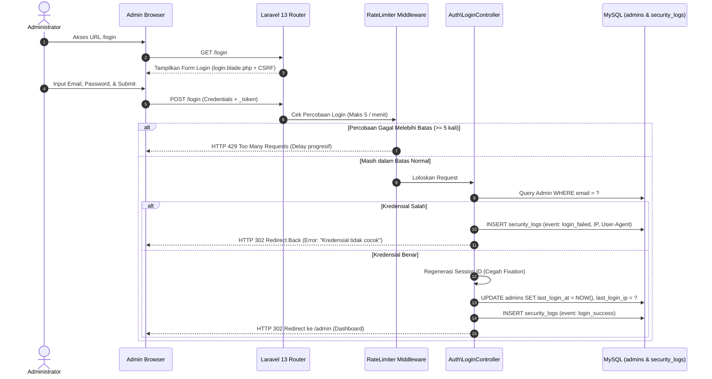
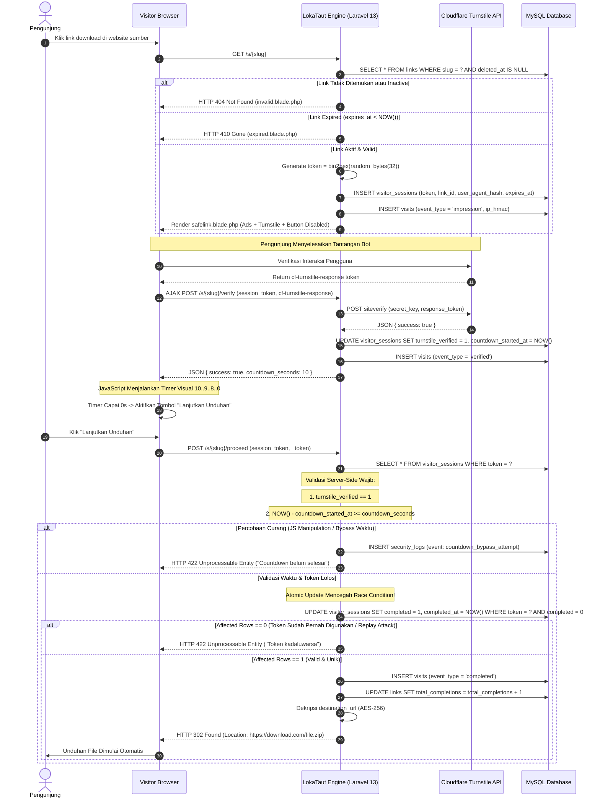
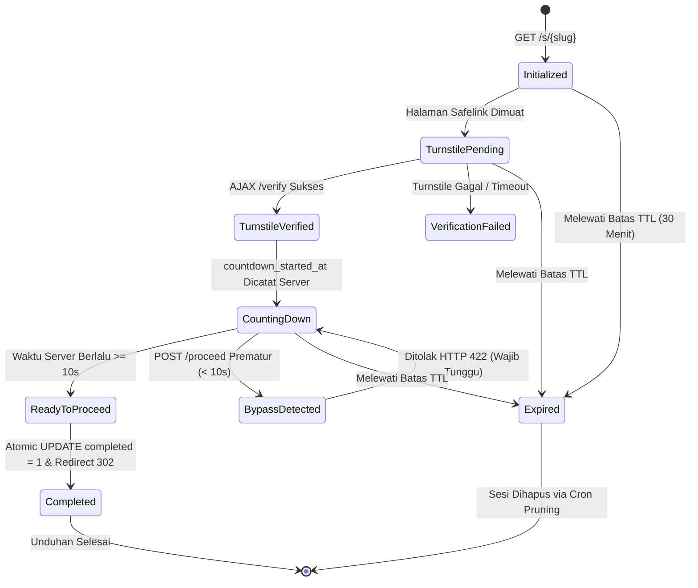
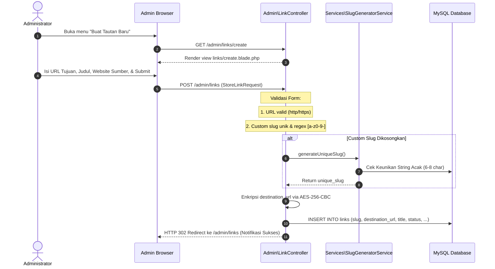
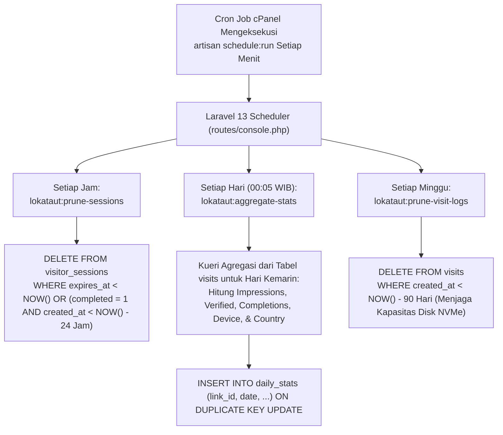

# User Flow & System Flow — LokaTaut

| Atribut | Nilai |
|---|---|
| **Document ID** | DOC-04 |
| **Versi** | 1.1 |
| **Status** | UNDER REVIEW |
| **Terakhir Diperbarui** | 30 Oktober 2026 |
| **Penulis** | Senior Systems Analyst & Lead Software Architect |
| **Target Pembaca** | AI Coding Agent, Frontend/Backend Engineer, QA Tester |
| **Tujuan** | Mendokumentasikan alur interaksi pengguna (user flow) dan logika internal sistem (system flow) menggunakan diagram Mermaid yang presisi dan implementable. |

---

## Dependensi Dokumen

| Dokumen | ID | Keterangan |
|---|---|---|
| [Product Requirements Document](../01-product/02-prd.md) | DOC-02 | Referensi ID kebutuhan fungsional (FR) dan aturan bisnis (BR) |
| [Scope & Requirements Specification](../01-product/03-scope-requirements.md) | DOC-03 | Batasan fitur MVP dan dependensi komponen |
| [Software Architecture](../03-architecture/05-system-architecture.md) | DOC-05 | Arsitektur modular monolith dan request lifecycle Laravel 13 |
| [Database Design](../03-architecture/06-database-design.md) | DOC-06 | Skema persistensi data sesi dan kunjungan |
| [Security & Privacy](../05-security-monetization/09-security-privacy.md) | DOC-09 | Protokol keamanan kriptografis dan pencegahan bypass |

---

## 1. Admin Login & Authentication Flow

Alur autentikasi administrator tunggal dengan perlindungan brute-force (maksimal 5 percobaan gagal per menit) dan proteksi single session:

---

## 2. Alur Pengunjung Safelink (Visitor Journey — Core Flow)

Alur terpenting platform yang menjamin bahwa URL tujuan tidak terekspos sebelum pengunjung menyelesaikan verifikasi Turnstile dan hitung mundur 10 detik di sisi server:

---

## 3. Safelink State Machine Diagram

Status siklus hidup sesi pengunjung pada tabel `visitor_sessions`:

---

## 4. Alur Manajemen Tautan Admin (Create Shortlink Flow)

---

## 5. Alur Agregasi Analitik & Pruning Berkala (Cron Flow)

