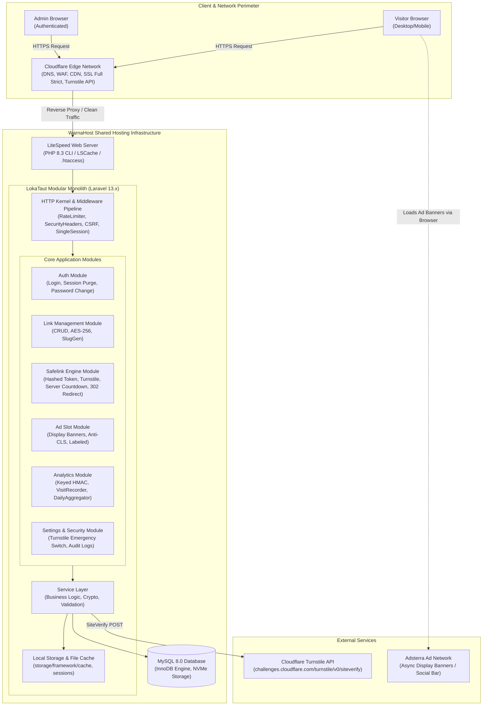

# Software Architecture Specification — LokaTaut

| Atribut | Nilai |
|---|---|
| **Document ID** | DOC-05 |
| **Versi** | 1.2.2 |
| **Status** | UNDER REVIEW (Ready for Product Owner Final Review) |
| **Terakhir Diperbarui** | 31 Oktober 2026 |
| **Penulis** | Principal Software Architect & Senior Laravel Architect |
| **Target Pembaca** | AI Coding Agent, DevOps Engineer, Technical Lead |
| **Tujuan** | Menetapkan arsitektur perangkat lunak Modular Monolith berbasis Laravel 13, dekomposisi layer aplikasi, strategi caching, logging, dan mitigasi batasan shared hosting. |

---

## Dependensi Dokumen

| Dokumen | Relasi |
|---|---|
| [DOC-01 — Product Vision & Strategy](../01-product/01-product-vision.md) | Visi produk dan batasan biaya operasional |
| [DOC-02 — Product Requirements Document](../01-product/02-prd.md) | Spesifikasi fungsional dan aturan bisnis (BR) |
| [DOC-03 — Scope & Requirements](../01-product/03-scope-requirements.md) | Batasan scope dan matriks keterlacakan |
| [DOC-04 — User Flow & System Flow](../02-analysis/04-user-system-flow.md) | Alur interaksi sistem dan transisi state |
| [DOC-06 — Database Design](./06-database-design.md) | Skema data dan strategi indexing MySQL 8 |
| [DOC-07 — Technical Specification](./07-technical-specification.md) | Standar teknis implementasi kode |
| [DOC-09 — Security & Privacy](../05-security-monetization/09-security-privacy.md) | Proteksi keamanan arsitektural |
| [DOC-15 — Architecture Decision Records](../09-decisions/15-architecture-decisions.md) | Rekam keputusan ADR-001 s/d ADR-010 |

---

## 1. Architecture Overview & High-Level Topology

LokaTaut dirancang menggunakan gaya arsitektur **Modular Monolith** berbasis framework **Laravel 13.x (PHP 8.3+)**. Sistem ini ditargetkan untuk berjalan di atas infrastruktur **Shared Hosting WarnaHost Starter Unlimited (1 vCPU Core, 2 GB RAM, cPanel/LiteSpeed Web Server)** dengan integrasi **Cloudflare** di layer terdepan sebagai reverse proxy, DNS, CDN, dan edge WAF.

> **Catatan Status Verifikasi Infrastruktur:**  
> Spesifikasi hardware hosting (1 Core, 2 GB RAM, LiteSpeed) berstatus **`PROVIDER CLAIM VERIFIED`** (berdasarkan penawaran resmi paket WarnaHost Starter). Ketersediaan CLI PHP 8.3, Composer v2, modul ekstensi, dan akses SSH pada akun pengguna aktual berstatus **`ACCOUNT ENVIRONMENT VERIFIED: PENDING PRE-FLIGHT TEST`** (wajib diuji melalui cPanel Terminal/SSH sebelum deployment awal).

Arsitektur ini sengaja menghindari kompleksitas berlebih (microservices, Docker di produksi, Redis wajib) untuk menjamin prinsip **Zero License Cost, Low Resource Footprint, dan High Maintainability**.



---

## 2. Application Layers & Responsibilities

1. **Presentation Layer (Blade Views & Native Assets):**
   - Menghasilkan markup HTML5 semantik murni.
   - Menggunakan Native CSS3 (CSS Custom Properties) dan Vanilla JavaScript ES6+.
   - Tidak menggunakan framework JavaScript reaktif (React/Vue/SPA) pada antarmuka publik demi menjaga skor Core Web Vitals dan kecepatan eksekusi iklan.
2. **HTTP Layer (Controllers, Form Requests, Middleware):**
   - Menerapkan *Thin Controllers* (maksimal 25 baris per method).
   - Validasi data masukan dikapsulkan 100% pada Form Request classes.
   - Middleware menangani rate limiting (60 req/min untuk publik), keamanan CSRF, dan injeksi security headers (`X-Robots-Tag: noindex`, `CSP`).
3. **Service Layer (Domain Business Logic):**
   - Mengkapsulasi seluruh aturan bisnis dan interaksi pihak ketiga (`SafelinkService`, `TokenService`, `TurnstileService`, `SlugGeneratorService`, `VisitRecorderService`).
   - Bebas dari keterikatan HTTP Request langsung (menggunakan DTO atau parameter primitif ter-type-hint).
4. **Data Access Layer (Eloquent Models & Query Builder):**
   - Memanfaatkan fitur attribute casting Laravel 13 untuk enkripsi/dekripsi transparan `destination_url`.
   - Menggunakan kueri berbasis PDO parameter binding murni untuk proteksi SQL Injection 100%.
5. **Storage & Persistence Layer:**
   - Database MySQL 8.0 berbasis InnoDB dengan indexing komposit yang presisi.
   - File-based cache untuk konfigurasi sistem global (`storage/framework/cache`).

---

## 3. Session & Token Architecture

Terdapat pemisahan fundamental antara sesi administrator dan sesi pengunjung safelink:

```
┌────────────────────────────────────────────────────────────────────────┐
│                        Session Architecture Matrix                     │
├────────────────────┬─────────────────────┬─────────────────────────────┤
│ Karakteristik      │ Sesi Administrator  │ Sesi Pengunjung Safelink    │
├────────────────────┼─────────────────────┼─────────────────────────────┤
│ Media Penyimpanan  │ File System Laravel │ Database (visitor_sessions) │
│ Durasi Masa Aktif  │ 120 Menit           │ 30 Menit (TTL)              │
│ Format Token DB    │ Session ID Terenkrip│ SHA-256 Digest (token_hash) │
│ Token di Browser   │ Encrypted Cookie    │ Raw Hex (64 hex characters) │
│ Mekanisme Binding  │ Laravel Session ID  │ token_hash + UA Hash        │
│                    │ + Single Session    │ + IP Subnet (/24 fallback)  │
│ Replay Protection  │ Session ID Regen.   │ Atomic One-Time Flag        │
│                    │ saat Login & Pwd    │ (UPDATE WHERE token_hash=?  │
│                    │ Change              │  AND completed = 0)         │
│ Pembersihan Data   │ Bawaan Laravel      │ Cron Pruning Setiap Jam     │
└────────────────────┴─────────────────────┴─────────────────────────────┘
```

---

## 4. Caching & Scaling Strategy pada Shared Hosting

Untuk menjamin performa stabil pada trafik 10.000–50.000 kunjungan per hari tanpa Redis:

1. **System Settings Caching:** Seluruh nilai tabel `settings` disimpan dalam file cache lokal selama 24 jam. Cache otomatis di-flush seketika saat admin memperbarui pengaturan.
2. **Active Ad Slots Caching:** Konfigurasi slot iklan banner aktif di-cache selama 1 jam untuk menghemat query basis data pada setiap request safelink.
3. **No Dynamic Safelink Page Caching & LiteSpeed Protection:** Halaman `/s/{slug}` **wajib dinamis**. Middleware menyematkan header `Cache-Control: private, no-cache, no-store, must-revalidate, max-age=0` dan header khusus `X-LiteSpeed-Cache-Control: no-cache` untuk mencegah LiteSpeed Web Server menyajikan token sesi pengunjung terdahulu kepada pengunjung baru.
4. **Cache Inode Pruning Management:** Penggunaan `CACHE_STORE=file` untuk rate limiting berpotensi mengakumulasi ribuan file lock di `storage/framework/cache/data`. Sistem menjadwalkan artisan cronjob mingguan (`lokataut:prune-cache`) untuk menghapus file cache yang telah kedaluwarsa, menjaga kuota inode cPanel tetap aman.
5. **Static Assets Caching:** File CSS, JavaScript, dan logo di-cache di Cloudflare edge network selama 30 hari dengan query string versioning (misal: `safelink.css?v=1.2.1`).
6. **Database Query Optimization & Deletion Integrity:** Seluruh kueri lookup link (`slug`) dieksekusi melalui index B-Tree unik dengan kompleksitas O(log N). Kueri dashboard dieksekusi dari tabel ringkasan `daily_stats`, bukan tabel mentah `visits`. Query agregasi harian didasarkan pada snapshot identitas immutable (`link_id_snapshot`, `link_slug_snapshot`) dan constraint unik NOT NULL `(aggregate_key, date)` pada `daily_stats` untuk menjamin idempotesi upsert, retry tanpa duplikasi, dan persistensi analitik bahkan jika tautan di-hard-delete sebelum agregasi nightly dijalankan. Relasi `ON DELETE SET NULL` pada `visits.link_id` dan `daily_stats.link_id` menjaga integritas referensial Eloquent.

---

## 5. Logging & Audit Architecture

- **Application Logs:** Menggunakan channel `daily` (`storage/logs/laravel-YYYY-MM-DD.log`) dengan rotasi 14 hari. Level produksi diatur ke `warning` dan `error`. Kunci rahasia seperti `ANALYTICS_SALT`, `APP_KEY`, dan kredensial database disanitasi agar tidak pernah muncul dalam log file atau exception stack trace.
- **Security Audit Trail:** Disimpan ke tabel `security_logs` pada basis data untuk peristiwa kritis (login gagal berulang, manipulasi parameter countdown, penggantian kata sandi admin, dan modifikasi kode iklan `ad_code`). Sesi darurat bypass Turnstile juga dicatat secara lengkap.

