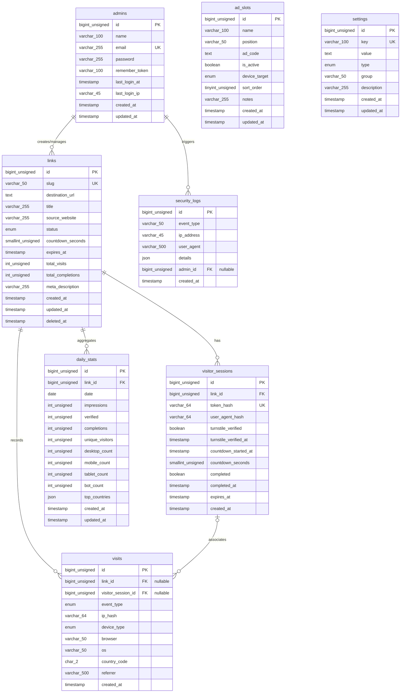

# Database Design & Data Dictionary — LokaTaut

| Atribut | Nilai |
|---|---|
| **Document ID** | DOC-06 |
| **Versi** | 1.2 |
| **Status** | UNDER REVIEW |
| **Terakhir Diperbarui** | 31 Oktober 2026 |
| **Penulis** | Senior Database Architect |
| **Target Pembaca** | AI Coding Agent, Backend Engineer, DBA |
| **Tujuan** | Merancang skema basis data MySQL 8 yang teroptimasi, efisien dalam penggunaan ruang disk, memiliki performa indexing tinggi, dan mematuhi batasan shared hosting. |

---

## Dependensi Dokumen

| Dokumen | Relasi |
|---|---|
| [DOC-02 — Product Requirements Document](../01-product/02-prd.md) | Kebutuhan data fitur (FR-*) dan aturan bisnis (BR-*) |
| [DOC-03 — Scope & Requirements](../01-product/03-scope-requirements.md) | Batasan data retention dan scope MVP |
| [DOC-05 — Software Architecture](./05-system-architecture.md) | Pola akses data dan layer persistensi Laravel 13 |
| [DOC-07 — Technical Specification](./07-technical-specification.md) | Konvensi penamaan model dan casting data |
| [DOC-09 — Security & Privacy](../05-security-monetization/09-security-privacy.md) | Enkripsi kolom sensitif dan pseudonimisasi IP via HMAC |

---

## 1. Entity Relationship Diagram (ERD)

---

## 2. Kamus Data & Definisi Tabel (Data Dictionary)

### 2.1 Tabel `admins`
Menyimpan akun administrator tunggal pemilik platform.

| Kolom | Tipe Data | Nullable | Default | Keterangan & Aturan |
|---|---|---|---|---|
| `id` | BIGINT UNSIGNED | NO | AUTO_INCREMENT | Primary Key |
| `name` | VARCHAR(100) | NO | - | Nama lengkap / tampilan admin |
| `email` | VARCHAR(255) | NO | - | Alamat email login (Unique Index) |
| `password` | VARCHAR(255) | NO | - | Bcrypt / Argon2id password hash |
| `remember_token` | VARCHAR(100) | YES | NULL | Token Laravel "Remember Me" |
| `last_login_at` | TIMESTAMP | YES | NULL | Waktu terakhir login sukses |
| `last_login_ip` | VARCHAR(45) | YES | NULL | Alamat IP login admin (Disimpan atas dasar Legitimate Security Interest) |
| `created_at` | TIMESTAMP | YES | NULL | Timestamp pembuatan record |
| `updated_at` | TIMESTAMP | YES | NULL | Timestamp pembaruan record |

- **Indexes:** `PRIMARY KEY (id)`, `UNIQUE KEY admins_email_unique (email)`

---

### 2.2 Tabel `links`
Menyimpan data tautan unduhan dan konfigurasi safelink.

| Kolom | Tipe Data | Nullable | Default | Keterangan & Aturan |
|---|---|---|---|---|
| `id` | BIGINT UNSIGNED | NO | AUTO_INCREMENT | Primary Key |
| `slug` | VARCHAR(50) | NO | - | Identifier unik URL (`/s/{slug}`) |
| `destination_url` | TEXT | NO | - | URL tujuan unduhan (Terenkripsi AES-256-CBC) |
| `title` | VARCHAR(255) | YES | NULL | Judul / label file unduhan untuk admin |
| `source_website` | VARCHAR(255) | YES | NULL | Domain web asal (misal: `softwaredown.id`) |
| `status` | ENUM('active','inactive') | NO | 'active' | Status ketersediaan tautan |
| `countdown_seconds` | SMALLINT UNSIGNED | NO | 10 | Durasi hitung mundur halaman safelink |
| `expires_at` | TIMESTAMP | YES | NULL | Tanggal & waktu kedaluwarsa tautan |
| `total_visits` | INT UNSIGNED | NO | 0 | Counter denormalisasi tayangan |
| `total_completions` | INT UNSIGNED | NO | 0 | Counter denormalisasi redirect selesai |
| `meta_description` | VARCHAR(255) | YES | NULL | Deskripsi meta tag HTML |
| `created_at` | TIMESTAMP | YES | NULL | Timestamp pembuatan link |
| `updated_at` | TIMESTAMP | YES | NULL | Timestamp pembaruan terakhir |
| `deleted_at` | TIMESTAMP | YES | NULL | Soft delete flag |

- **Indexes:**
  - `PRIMARY KEY (id)`
  - `UNIQUE KEY links_slug_unique (slug)`
  - `KEY links_status_deleted_at_index (status, deleted_at)`
  - `KEY links_source_website_index (source_website)`
  - `KEY links_expires_at_index (expires_at)`
  - `KEY links_created_at_index (created_at)`

---

### 2.3 Tabel `visitor_sessions`
Mencatat sesi aktif pengunjung di halaman safelink untuk validasi keamanan server-side.

| Kolom | Tipe Data | Nullable | Default | Keterangan & Aturan |
|---|---|---|---|---|
| `id` | BIGINT UNSIGNED | NO | AUTO_INCREMENT | Primary Key |
| `link_id` | BIGINT UNSIGNED | NO | - | Foreign Key ke `links.id` (ON DELETE CASCADE) |
| `token_hash` | VARCHAR(64) | NO | - | **Hash SHA-256** dari raw token kriptografis 32-byte (`hash('sha256', $rawToken)`). Raw token hanya dipegang browser. |
| `user_agent_hash` | VARCHAR(64) | YES | NULL | Hash SHA-256 User-Agent untuk session binding |
| `turnstile_verified` | BOOLEAN | NO | FALSE | Status kelulusan Cloudflare Turnstile |
| `turnstile_verified_at`| TIMESTAMP | YES | NULL | Timestamp verifikasi bot disetujui |
| `countdown_started_at` | TIMESTAMP | YES | NULL | Timestamp resmi dimulainya hitung mundur di server |
| `countdown_seconds` | SMALLINT UNSIGNED | NO | 10 | Durasi countdown yang wajib dipenuhi |
| `completed` | BOOLEAN | NO | FALSE | Status redirect (One-time token flag) |
| `completed_at` | TIMESTAMP | YES | NULL | Timestamp saat redirect 302 dieksekusi |
| `expires_at` | TIMESTAMP | NO | - | Batas waktu validitas sesi (created_at + 30m) |
| `created_at` | TIMESTAMP | YES | NULL | Waktu inisiasi sesi |

- **Indexes:**
  - `PRIMARY KEY (id)`
  - `UNIQUE KEY visitor_sessions_token_hash_unique (token_hash)`
  - `KEY visitor_sessions_link_id_created_at_index (link_id, created_at)`
  - `KEY visitor_sessions_expires_at_completed_index (expires_at, completed)`: Digunakan oleh cron pruning.

---

### 2.4 Tabel `visits` (Event Logs Kunjungan)
Mencatat event interaksi pengunjung untuk keperluan analitik. **Disimpan maksimal 90 hari.**

| Kolom | Tipe Data | Nullable | Default | Keterangan & Aturan |
|---|---|---|---|---|
| `id` | BIGINT UNSIGNED | NO | AUTO_INCREMENT | Primary Key |
| `link_id` | BIGINT UNSIGNED | YES | NULL | Foreign Key ke `links.id` (`ON DELETE SET NULL` untuk mencegah terhapusnya data analitik historis saat link dihapus) |
| `visitor_session_id` | BIGINT UNSIGNED | YES | NULL | Foreign Key ke `visitor_sessions.id` (`ON DELETE SET NULL`) |
| `event_type` | ENUM | NO | - | `impression`, `verified`, `completed`, `error` |
| `ip_hash` | VARCHAR(64) | NO | - | **Keyed HMAC-SHA256** dari IP pengunjung via `config('services.analytics.salt', config('app.key'))` |
| `device_type` | ENUM | NO | 'unknown' | `desktop`, `mobile`, `tablet`, `bot`, `unknown` |
| `browser` | VARCHAR(50) | YES | NULL | Nama peramban (Chrome, Firefox, Safari, dll.) |
| `os` | VARCHAR(50) | YES | NULL | Sistem operasi (Android, Windows, iOS, macOS, dll.) |
| `country_code` | CHAR(2) | YES | NULL | Kode ISO 2-huruf dari header Cloudflare `CF-IPCountry` |
| `referrer` | VARCHAR(500) | YES | NULL | URL perujuk (truncated) |
| `created_at` | TIMESTAMP | YES | NULL | Timestamp kejadian |

- **Indexes:**
  - `PRIMARY KEY (id)`
  - `KEY visits_link_event_created_index (link_id, event_type, created_at)`
  - `KEY visits_created_at_index (created_at)`
  - `KEY visits_country_code_index (country_code)`
  - `KEY visits_device_type_index (device_type)`

---

### 2.5 Tabel `daily_stats` (Agregat Analitik Harian)
Tabel ringkasan performa link per hari untuk menyajikan grafik dashboard instan. **Disimpan permanen.**

| Kolom | Tipe Data | Nullable | Default | Keterangan & Aturan |
|---|---|---|---|---|
| `id` | BIGINT UNSIGNED | NO | AUTO_INCREMENT | Primary Key |
| `link_id` | BIGINT UNSIGNED | NO | - | Foreign Key ke `links.id` |
| `date` | DATE | NO | - | Tanggal rekap data (YYYY-MM-DD) |
| `impressions` | INT UNSIGNED | NO | 0 | Total tayangan halaman safelink |
| `verified` | INT UNSIGNED | NO | 0 | Total lolos verifikasi Turnstile |
| `completions` | INT UNSIGNED | NO | 0 | Total redirect sukses ke destination URL |
| `unique_visitors` | INT UNSIGNED | NO | 0 | Estimasi pengunjung unik harian (variasi `ip_hash`) |
| `desktop_count` | INT UNSIGNED | NO | 0 | Kunjungan desktop |
| `mobile_count` | INT UNSIGNED | NO | 0 | Kunjungan smartphone |
| `tablet_count` | INT UNSIGNED | NO | 0 | Kunjungan tablet |
| `bot_count` | INT UNSIGNED | NO | 0 | Kunjungan terdeteksi bot |
| `top_countries` | JSON | YES | NULL | Rekap 10 negara teratas, format: `{"ID": 450, "US": 50}` |
| `created_at` | TIMESTAMP | YES | NULL | Timestamp pembuatan record |
| `updated_at` | TIMESTAMP | YES | NULL | Timestamp pembaruan record |

- **Indexes:**
  - `PRIMARY KEY (id)`
  - `UNIQUE KEY daily_stats_link_date_unique (link_id, date)`: **Mencegah duplikasi data rekap harian.**
  - `KEY daily_stats_date_index (date)`

---

### 2.6 Tabel `ad_slots`
Mengelola slot penempatan kode iklan banner dari ad network kandidat.

| Kolom | Tipe Data | Nullable | Default | Keterangan & Aturan |
|---|---|---|---|---|
| `id` | BIGINT UNSIGNED | NO | AUTO_INCREMENT | Primary Key |
| `name` | VARCHAR(100) | NO | - | Nama pengenal slot (misal: "Banner Atas Timer") |
| `position` | VARCHAR(50) | NO | - | `header`, `above_timer`, `below_timer`, `footer` |
| `ad_code` | TEXT | YES | NULL | Kode tag script iklan dari ad network |
| `is_active` | BOOLEAN | NO | TRUE | Status aktif slot |
| `device_target` | ENUM | NO | 'all' | `all`, `desktop`, `mobile` |
| `sort_order` | TINYINT UNSIGNED | NO | 0 | Urutan render |
| `notes` | VARCHAR(255) | YES | NULL | Catatan admin |
| `created_at` | TIMESTAMP | YES | NULL | Timestamp pembuatan |
| `updated_at` | TIMESTAMP | YES | NULL | Timestamp pembaruan |

- **Indexes:** `PRIMARY KEY (id)`, `KEY ad_slots_pos_active_dev_index (position, is_active, device_target)`

---

### 2.7 Tabel `settings` & `security_logs`
- `settings`: Tabel key-value konfigurasi global (`site_name`, `default_countdown`, `turnstile_site_key`, `turnstile_mode` [enabled/disabled/emergency_bypass], `analytics_salt`, `session_ttl_minutes`, dsb.) dengan index unik pada kolom `key`.
- `security_logs`: Mencatat audit insiden (`login_failed`, `password_change_success`, `password_change_failed`, `turnstile_emergency_bypass_used`, `countdown_bypass_attempt`, `ad_code_modified`) dengan kolom `event_type`, `ip_address` (raw IP untuk audit investigasi forensik), `user_agent`, `details` (JSON), dan `created_at`.

