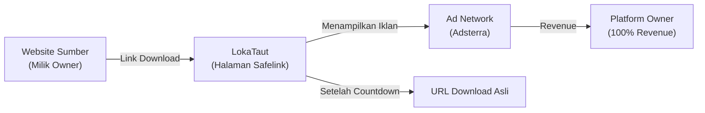
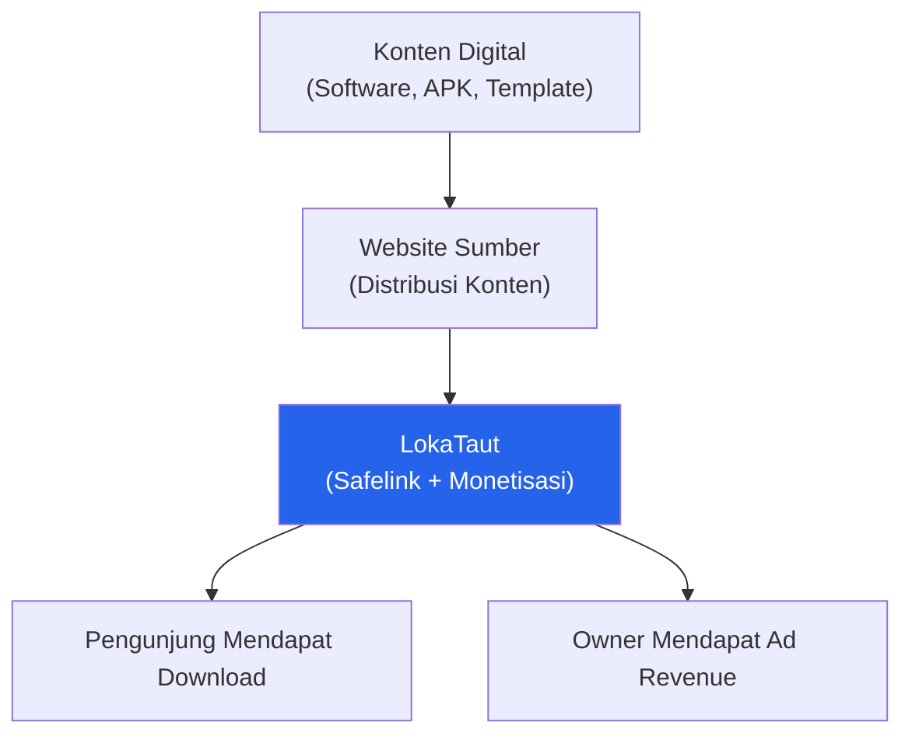
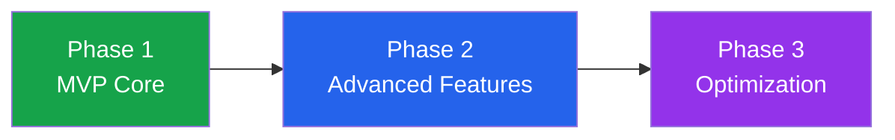

# Product Vision & Strategy — LokaTaut

| Atribut | Detail |
|---|---|
| **Document ID** | DOC-01 |
| **Versi** | 1.0 |
| **Status** | DRAFT |
| **Terakhir Diperbarui** | 2026-10-30 |
| **Penulis** | Platform Owner |
| **Tujuan** | Mendefinisikan visi produk, strategi bisnis, dan arah pengembangan LokaTaut sebagai platform safelink privat untuk manajemen dan monetisasi link download. |
| **Cakupan** | Visi, misi, model bisnis, target pengguna, use case utama, metrik keberhasilan, batasan, dan roadmap produk. |

---

## Daftar Isi

1. [Product Overview](#1-product-overview)
2. [Product Vision](#2-product-vision)
3. [Product Mission](#3-product-mission)
4. [Problem Statement](#4-problem-statement)
5. [Target Audience](#5-target-audience)
6. [Primary Use Cases](#6-primary-use-cases)
7. [Business Model](#7-business-model)
8. [Value Proposition](#8-value-proposition)
9. [Product Positioning](#9-product-positioning)
10. [Competitive Landscape](#10-competitive-landscape)
11. [Product Principles](#11-product-principles)
12. [Business Objectives](#12-business-objectives)
13. [Success Metrics](#13-success-metrics)
14. [Product Constraints](#14-product-constraints)
15. [Long-term Product Direction](#15-long-term-product-direction)
16. [Dokumen Terkait](#16-dokumen-terkait)

---

## 1. Product Overview

**LokaTaut** adalah platform **privat** untuk manajemen link dan safelink yang dirancang khusus untuk satu pemilik (single owner). Platform ini bukan layanan publik, bukan SaaS, dan bukan sistem multi-tenant.

### Definisi Inti

| Aspek | Deskripsi |
|---|---|
| **Apa** | Platform manajemen link & safelink privat untuk mengelola link download dari website milik pemilik |
| **Untuk Siapa** | Satu pemilik platform (single administrator) |
| **Mengapa** | Monetisasi penuh traffic download melalui ad revenue tanpa berbagi pendapatan dengan pihak ketiga |
| **Bagaimana** | Self-hosted pada shared hosting, dibangun dengan Laravel 11, PHP 8.3+, MySQL 8, Blade templating |
| **Di mana** | Shared hosting WarnaHost Starter Unlimited, di balik Cloudflare + SSL |

### Fungsi Utama

1. **Link Management** — Membuat, mengelola, dan memantau shortlink untuk URL download.
2. **Safelink Generation** — Menghasilkan halaman safelink dengan countdown timer dan verifikasi bot (Cloudflare Turnstile).
3. **Traffic Monetization** — Menampilkan iklan dari ad network (Adsterra sebagai utama) pada halaman safelink.
4. **Analytics** — Melacak performa setiap link: jumlah klik, completion rate, sumber traffic, dan data pengunjung.
5. **Multi-Website Support** — Mendukung link dari berbagai website milik pemilik secara fleksibel.

### Bukan LokaTaut

Untuk menghindari kesalahpahaman, berikut hal-hal yang **bukan** termasuk cakupan LokaTaut:

| Bukan | Alasan |
|---|---|
| URL shortener publik (seperti bit.ly) | LokaTaut adalah alat privat, bukan layanan publik |
| Platform SaaS multi-tenant | Hanya untuk satu pemilik, tanpa registrasi pengguna |
| Plugin WordPress | Standalone application, independen dari CMS manapun |
| Content Management System | Tidak mengelola konten, hanya link download |
| Affiliate link manager | Fokus pada safelink monetisasi, bukan affiliate tracking |

---

## 2. Product Vision

> **Menyediakan sistem safelink self-hosted yang hemat biaya, sepenuhnya terkontrol, dan berkinerja tinggi untuk memaksimalkan monetisasi traffic download tanpa ketergantungan pada layanan safelink pihak ketiga.**

### Elaborasi Visi

LokaTaut dibangun dengan keyakinan bahwa pemilik website seharusnya memiliki **kendali penuh** atas infrastruktur monetisasi traffic mereka. Setiap kunjungan download adalah aset yang nilainya seharusnya 100% dimiliki oleh pemilik platform — bukan dibagi dengan layanan safelink pihak ketiga yang mengambil porsi pendapatan atau membebankan biaya lisensi.

**Pilar Visi:**

1. **Kepemilikan Penuh** — Source code, database, dan seluruh data analytics dimiliki sepenuhnya oleh pemilik platform. Tidak ada vendor lock-in.
2. **Efisiensi Biaya** — Beroperasi pada shared hosting dengan biaya operasional minimal (< Rp 100.000/bulan), tanpa biaya lisensi berulang.
3. **Kontrol Total** — Pemilik dapat mengkustomisasi setiap aspek: tampilan halaman safelink, penempatan iklan, countdown timer, mekanisme keamanan, dan flow pengunjung.
4. **Skalabilitas Terukur** — Mampu menangani 10.000–50.000 kunjungan harian pada infrastruktur shared hosting.

---

## 3. Product Mission

> **Memungkinkan pemilik platform untuk mengelola, melindungi, dan memonetisasi link download secara terpusat dari berbagai website melalui sistem safelink yang aman, berperforma tinggi, dan hemat biaya.**

### Dekomposisi Misi

| Komponen Misi | Tujuan Spesifik |
|---|---|
| **Mengelola** | Dashboard admin terpusat untuk membuat, mengedit, mengaktifkan/menonaktifkan, dan mengatur masa berlaku link |
| **Melindungi** | Mencegah akses langsung ke URL download asli melalui enkripsi link, verifikasi bot (Turnstile), dan countdown timer |
| **Memonetisasi** | Menampilkan iklan dari ad network pada setiap halaman safelink yang dikunjungi pengunjung |
| **Terpusat** | Satu platform untuk mengelola link dari semua website milik pemilik |
| **Aman** | Proteksi terhadap bot, scraping, dan bypass; URL asli tidak pernah terekspos di client-side |
| **Berperforma tinggi** | Halaman safelink dimuat dalam < 2 detik, dengan optimasi query dan caching |
| **Hemat biaya** | Berjalan pada shared hosting standar tanpa memerlukan VPS, Redis, Docker, atau Node.js |

---

## 4. Problem Statement

### Konteks Masalah

Pemilik website yang mendistribusikan konten digital (software, APK, template, dokumen) membutuhkan cara untuk memonetisasi traffic download. Safelink adalah metode umum di mana pengunjung melewati halaman berisi iklan sebelum mendapatkan link download asli. Namun, solusi yang tersedia saat ini memiliki keterbatasan signifikan.

### Masalah yang Diidentifikasi

#### Masalah A: Solusi Berbayar dengan Kontrol Terbatas

Plugin dan script safelink berbayar (contoh: WP Safelink) mengharuskan biaya lisensi berulang, terikat pada ekosistem tertentu (WordPress), dan memberikan kontrol terbatas atas source code. Update dan dukungan bergantung sepenuhnya pada developer plugin.

- **Dampak:** Biaya lisensi tahunan, ketergantungan vendor, keterbatasan kustomisasi.
- **Risiko:** Plugin berhenti dikembangkan, inkompatibilitas dengan update WordPress, celah keamanan yang tidak diperbaiki.

#### Masalah B: Jaringan Safelink Publik dengan Revenue Sharing

Platform safelink publik (contoh: ShrinkMe, Shorte.st) menawarkan kemudahan penggunaan, tetapi mengambil porsi signifikan dari pendapatan iklan. Pemilik link hanya menerima sebagian kecil dari total revenue yang dihasilkan oleh traffic mereka.

- **Dampak:** Kehilangan 30–70% potensi pendapatan, tidak ada kontrol atas tampilan halaman dan jenis iklan.
- **Risiko:** Platform menutup layanan, perubahan kebijakan pembayaran, kualitas iklan yang tidak terkontrol.

#### Masalah C: Solusi Manual Tanpa Fitur

Redirect script sederhana (PHP redirect) dapat digunakan, tetapi tidak menyediakan analytics, proteksi keamanan, manajemen link terpusat, atau mekanisme countdown yang proper.

- **Dampak:** Tidak ada data untuk optimasi, rentan terhadap bot dan bypass, manajemen link tidak efisien.
- **Risiko:** URL download terekspos, traffic tidak termonetisasi optimal, tidak ada visibilitas performa.

### Kebutuhan Inti Pemilik

Pemilik membutuhkan sistem yang memberikan:

1. **Kontrol penuh** atas source code, database, dan infrastruktur
2. **100% pendapatan iklan** tanpa revenue sharing
3. **Nol biaya lisensi** berulang
4. **Analytics terpusat** untuk semua website
5. **Keamanan terukur** terhadap bot dan bypass
6. **Biaya operasional minimal** pada shared hosting

---

## 5. Target Audience

### 5.1 Primary: Platform Owner (Single Administrator)

| Atribut | Detail |
|---|---|
| **Profil** | Pemilik tunggal yang mengelola beberapa website distribusi konten digital |
| **Kemampuan Teknis** | Menengah — familiar dengan cPanel, domain, dan manajemen website dasar |
| **Tujuan Utama** | Memaksimalkan pendapatan iklan dari traffic download |
| **Perilaku** | Mengelola link secara harian/mingguan, memantau analytics, mengoptimasi penempatan iklan |
| **Pain Points** | Biaya lisensi plugin, revenue sharing, keterbatasan kustomisasi, kurang analytics |
| **Platform** | Mengakses admin panel dari desktop browser (Chrome/Firefox) |

**Kebutuhan Spesifik Owner:**

- Dashboard ringkas untuk melihat statistik keseluruhan
- Proses pembuatan link yang cepat (< 30 detik per link)
- Kemampuan bulk import link via CSV (post-MVP)
- Manajemen link per website sumber
- Konfigurasi ad placement yang fleksibel
- Laporan analytics yang actionable

### 5.2 Secondary: Pengunjung Website (Visitor)

| Atribut | Detail |
|---|---|
| **Profil** | Pengunjung website milik pemilik yang ingin mengunduh konten digital |
| **Perangkat** | Mayoritas mobile (Android), sebagian desktop |
| **Perilaku** | Klik link download → melewati halaman safelink → verifikasi → tunggu countdown → mendapat link download |
| **Ekspektasi** | Proses yang jelas, waktu tunggu yang wajar (10 detik), halaman yang cepat dimuat |
| **Konten yang Diunduh** | Software, APK, template, dokumen, file digital lainnya |

**Pengalaman Pengunjung yang Diharapkan:**

1. Klik link download di website sumber
2. Diarahkan ke halaman safelink LokaTaut
3. Menyelesaikan verifikasi Cloudflare Turnstile (otomatis untuk pengguna legit)
4. Menunggu countdown 10 detik sambil melihat halaman dengan iklan
5. Tombol/link download muncul setelah countdown selesai
6. Klik untuk diarahkan ke URL download asli

---

## 6. Primary Use Cases

### Ringkasan Use Cases

| ID | Use Case | Aktor | Prioritas |
|---|---|---|---|
| UC-001 | Membuat shortlink untuk URL download | Admin | P0 |
| UC-002 | Mengelola lifecycle link | Admin | P0 |
| UC-003 | Mengakses safelink dan menyelesaikan verifikasi | Visitor | P0 |
| UC-004 | Melihat analytics performa link | Admin | P1 |
| UC-005 | Mengkonfigurasi penempatan iklan | Admin | P1 |
| UC-006 | Mengelola multiple website sources | Admin | P1 |

### UC-001: Admin Membuat Shortlink untuk URL Download

```
Aktor       : Admin (Platform Owner)
Prioritas   : P0 — Critical
Prekondisi  : Admin telah login ke dashboard
Trigger     : Admin memiliki URL download baru yang perlu di-safelink-kan
```

**Flow Utama:**

1. Admin membuka halaman "Buat Link Baru"
2. Admin memasukkan URL download tujuan (destination URL)
3. Admin memilih website sumber (source website)
4. Sistem memvalidasi URL dan menghasilkan shortlink unik
5. Admin (opsional) mengatur: judul link, tanggal kedaluwarsa, status aktif/nonaktif
6. Admin menyimpan link
7. Sistem menampilkan shortlink yang siap digunakan
8. Admin menyalin shortlink untuk dipasang di website sumber

**Flow Alternatif:**

- **URL tidak valid:** Sistem menampilkan pesan error, admin memperbaiki input
- **Slug duplikat:** Sistem auto-generate slug baru atau meminta input manual

**Post-kondisi:** Link tersimpan di database, shortlink aktif dan siap diakses pengunjung.

### UC-002: Admin Mengelola Lifecycle Link

```
Aktor       : Admin (Platform Owner)
Prioritas   : P0 — Critical
Prekondisi  : Minimal satu link sudah dibuat
Trigger     : Admin perlu mengubah status atau detail link
```

**Flow Utama:**

1. Admin membuka daftar link (dengan filter dan search)
2. Admin memilih link yang akan dikelola
3. Admin melakukan salah satu aksi:
   - **Aktivasi/Deaktivasi:** Toggle status aktif/nonaktif
   - **Edit:** Mengubah URL tujuan, judul, atau konfigurasi
   - **Set Expiry:** Mengatur tanggal kedaluwarsa
   - **Hapus:** Menghapus link secara permanen (soft delete)
4. Sistem menyimpan perubahan dan mencatat log

**Post-kondisi:** Status link diperbarui, perubahan berlaku langsung untuk pengunjung.

### UC-003: Visitor Mengakses Safelink

```
Aktor       : Visitor (Pengunjung Website)
Prioritas   : P0 — Critical
Prekondisi  : Link aktif dan belum kedaluwarsa
Trigger     : Visitor mengklik shortlink dari website sumber
```

**Flow Utama:**

1. Visitor mengklik shortlink di website sumber
2. Sistem memvalidasi link (aktif, belum expired)
3. Sistem menampilkan halaman safelink dengan widget Cloudflare Turnstile
4. Visitor menyelesaikan verifikasi Turnstile (biasanya otomatis)
5. Setelah verifikasi berhasil, countdown 10 detik dimulai
6. Halaman menampilkan iklan dari Adsterra selama countdown
7. Setelah countdown selesai, tombol/link "Download" muncul
8. Visitor mengklik tombol download
9. Sistem mencatat klik sebagai "completed" dan mengarahkan ke URL download asli

**Flow Alternatif:**

- **Link tidak ditemukan:** Halaman 404 khusus
- **Link nonaktif/expired:** Halaman informasi bahwa link sudah tidak tersedia
- **Verifikasi Turnstile gagal:** Pesan error, opsi untuk reload/retry
- **Bot terdeteksi:** Akses ditolak, tidak dihitung sebagai traffic valid

**Post-kondisi:** Visitor mendapat akses ke URL download, kunjungan tercatat di analytics.

### UC-004: Admin Melihat Analytics Performa Link

```
Aktor       : Admin (Platform Owner)
Prioritas   : P1 — High
Prekondisi  : Minimal ada data traffic
Trigger     : Admin ingin memantau performa link
```

**Flow Utama:**

1. Admin membuka dashboard analytics
2. Sistem menampilkan ringkasan: total klik, completion rate, top links
3. Admin dapat memfilter berdasarkan: periode waktu, website sumber, status link
4. Admin melihat detail per link: jumlah klik, unique visitors, completion rate
5. Admin menggunakan data untuk optimasi

### UC-005: Admin Mengkonfigurasi Penempatan Iklan

```
Aktor       : Admin (Platform Owner)
Prioritas   : P1 — High
Prekondisi  : Akun ad network (Adsterra) sudah aktif
Trigger     : Admin ingin mengatur atau mengubah penempatan iklan
```

**Flow Utama:**

1. Admin membuka pengaturan iklan di dashboard
2. Admin memasukkan/mengubah kode iklan (ad script/tag) dari Adsterra
3. Admin mengkonfigurasi posisi penempatan (header, sidebar, sebelum/sesudah countdown, footer)
4. Admin menyimpan konfigurasi
5. Sistem menerapkan perubahan pada semua halaman safelink

> **Referensi:** Detail strategi monetisasi dan penempatan iklan dibahas di DOC-10 (Monetization Strategy).

### UC-006: Admin Mengelola Multiple Website Sources

```
Aktor       : Admin (Platform Owner)
Prioritas   : P1 — High
Prekondisi  : Admin memiliki beberapa website sumber
Trigger     : Admin ingin mengorganisir link berdasarkan website sumber
```

**Flow Utama:**

1. Admin membuka halaman manajemen "Website Sumber"
2. Admin menambahkan website sumber baru (nama, domain, deskripsi)
3. Saat membuat link baru, admin memilih website sumber terkait
4. Admin dapat memfilter daftar link dan analytics berdasarkan website sumber

---

## 7. Business Model

### Model Monetisasi

LokaTaut menggunakan model **monetisasi langsung melalui ad revenue** pada halaman safelink. Seluruh pendapatan iklan dimiliki 100% oleh pemilik platform.



### Struktur Pendapatan

| Aspek | Detail |
|---|---|
| **Sumber Pendapatan** | Impression dan klik iklan pada halaman safelink |
| **Ad Network Utama** | Adsterra |
| **Ad Network Alternatif** | Monetag, PropellerAds |
| **Revenue Share** | 100% untuk pemilik platform (zero revenue sharing) |
| **Model Pembayaran** | CPM (Cost Per Mille), CPC (Cost Per Click) — tergantung kebijakan ad network |

### Mengapa Bukan Google AdSense?

> **⚠️ PENTING: Google AdSense DILARANG untuk halaman safelink.**

Google AdSense secara eksplisit melarang penempatan iklan pada halaman yang:
- Mengharuskan pengguna menunggu (countdown timer) sebelum mengakses konten
- Berfungsi sebagai perantara (interstitial) antara pengguna dan konten yang diinginkan
- Menggunakan mekanisme gating untuk konten

Penggunaan AdSense pada halaman safelink akan mengakibatkan **penangguhan akun** dan **kehilangan seluruh pendapatan yang tertahan**. Oleh karena itu, LokaTaut menggunakan Adsterra sebagai ad network utama yang memang mendukung model safelink.

### Struktur Biaya

| Komponen | Estimasi Biaya/Bulan |
|---|---|
| Hosting (WarnaHost Starter Unlimited) | ~Rp 50.000–80.000 |
| Domain | ~Rp 10.000–15.000 (amortisasi) |
| Cloudflare | Rp 0 (free plan) |
| SSL | Rp 0 (via Cloudflare) |
| Cloudflare Turnstile | Rp 0 (free tier) |
| Biaya lisensi software | Rp 0 |
| **Total Estimasi** | **< Rp 100.000/bulan** |

---

## 8. Value Proposition

### Proposisi Nilai Utama

LokaTaut memberikan **kendali penuh atas monetisasi traffic download** dengan **biaya operasional minimal** dan **tanpa ketergantungan pihak ketiga**.

### Detail Proposisi Nilai

| # | Proposisi | Deskripsi | Dibandingkan Solusi Lain |
|---|---|---|---|
| 1 | **Kepemilikan Source Code Penuh** | Seluruh source code dimiliki dan dapat dimodifikasi tanpa batasan | Plugin berbayar: terbatas lisensi. Safelink publik: tidak ada akses source code |
| 2 | **Nol Biaya Lisensi** | Tidak ada biaya lisensi berulang, hanya biaya hosting dan domain | WP Safelink: biaya lisensi tahunan. Safelink publik: revenue sharing |
| 3 | **Kontrol Monetisasi Penuh** | Pemilik memilih ad network, mengatur penempatan, mendapat 100% revenue | Safelink publik: revenue sharing 30–70% |
| 4 | **Implementasi Keamanan Custom** | Cloudflare Turnstile, enkripsi URL, proteksi bot sesuai kebutuhan | Plugin: keamanan standar. Manual: tanpa keamanan |
| 5 | **Kepemilikan Data Analytics** | Seluruh data traffic dan analytics tersimpan di database sendiri | Safelink publik: data milik platform. Plugin: terbatas |
| 6 | **Deployment Shared Hosting** | Berjalan pada shared hosting murah tanpa VPS, Redis, Docker | Solusi modern: butuh VPS/cloud |

### Value Chain



---

## 9. Product Positioning

### Positioning Statement

> LokaTaut diposisikan sebagai **alat infrastruktur privat** (private infrastructure tool) — bukan produk komersial, bukan layanan publik, dan bukan platform multi-pengguna. LokaTaut adalah komponen kustom dalam ekosistem distribusi digital milik pemilik.

### Positioning Map

| Dimensi | LokaTaut | WP Safelink | Safelink Publik | Manual Script |
|---|---|---|---|---|
| **Tipe** | Private tool | WordPress plugin | Public service | DIY |
| **Pengguna** | Single owner | WordPress users | Publik | Developer |
| **Biaya** | Hosting only | Lisensi + Hosting | Gratis (revenue share) | Hosting only |
| **Revenue** | 100% owner | 100% owner | 30–70% owner | 100% owner |
| **Kontrol** | Penuh | Terbatas | Minimal | Penuh tapi tanpa fitur |
| **Analytics** | Built-in | Terbatas | Platform-dependent | Tidak ada |
| **Keamanan** | Custom | Standar plugin | Platform-dependent | Minimal |
| **Skalabilitas** | 10K–50K/hari | Tergantung hosting | Tidak terbatas | Terbatas |
| **Dependensi** | Tidak ada | WordPress | Platform pihak ketiga | Tidak ada |

### Identitas Produk

- **Adalah:** Alat privat untuk manajemen safelink dan monetisasi traffic download
- **Bukan:** Layanan SaaS, platform publik, atau produk komersial
- **Dibangun untuk:** Satu pemilik yang mengelola beberapa website
- **Dioptimalkan untuk:** Shared hosting, biaya rendah, performa tinggi

---

## 10. Competitive Landscape

### Analisis Kompetitif Detail

#### 10.1 WP Safelink (WordPress Plugin, Berbayar)

| Aspek | Detail |
|---|---|
| **Deskripsi** | Plugin WordPress populer untuk membuat halaman safelink |
| **Kelebihan** | Mudah diinstal, terintegrasi WordPress, UI siap pakai |
| **Kekurangan** | Biaya lisensi berulang, terikat WordPress, kustomisasi terbatas, update bergantung developer |
| **Harga** | Lisensi berbayar (bervariasi per versi) |
| **Risiko** | Plugin berhenti dikembangkan, inkompatibilitas WordPress update, celah keamanan |
| **vs LokaTaut** | LokaTaut menawarkan independensi penuh dari WordPress, nol biaya lisensi, dan kustomisasi tanpa batas |

#### 10.2 Safelink Publik (ShrinkMe, Shorte.st, dll.)

| Aspek | Detail |
|---|---|
| **Deskripsi** | Platform safelink/shortlink publik dengan model revenue sharing |
| **Kelebihan** | Gratis, tanpa hosting sendiri, langsung digunakan, skalabilitas tinggi |
| **Kekurangan** | Revenue sharing (hanya 30–70% untuk publisher), tidak ada kontrol tampilan, risiko platform tutup, data milik platform |
| **Harga** | Gratis (dipotong revenue share) |
| **Risiko** | Platform menutup layanan, perubahan rate pembayaran, kualitas iklan tidak terkontrol, banned tanpa alasan jelas |
| **vs LokaTaut** | LokaTaut memberikan 100% revenue, kontrol penuh atas tampilan dan data, tanpa risiko platform pihak ketiga |

#### 10.3 Manual Redirect Script (PHP Redirect)

| Aspek | Detail |
|---|---|
| **Deskripsi** | Script PHP sederhana untuk redirect URL, dibuat sendiri |
| **Kelebihan** | Kontrol penuh, biaya nol (selain hosting), ringan |
| **Kekurangan** | Tanpa analytics, tanpa manajemen link, tanpa keamanan bot, tanpa countdown/monetisasi terstruktur |
| **Harga** | Gratis (DIY) |
| **Risiko** | URL download terekspos, tidak ada proteksi bot, sulit di-maintain untuk banyak link |
| **vs LokaTaut** | LokaTaut menyediakan semua fitur yang tidak dimiliki manual script: analytics, keamanan, monetisasi, dan manajemen terpusat |

#### 10.4 Self-hosted URL Shortener (YOURLS, Kutt)

| Aspek | Detail |
|---|---|
| **Deskripsi** | Platform URL shortener open-source yang di-host sendiri |
| **Kelebihan** | Open-source, self-hosted, analytics dasar, kontrol penuh |
| **Kekurangan** | Tidak dirancang untuk safelink/monetisasi, tidak ada countdown timer, tidak ada integrasi ad network, perlu kustomisasi besar |
| **Harga** | Gratis (open-source) |
| **Risiko** | Effort kustomisasi tinggi untuk mengubahnya menjadi safelink platform |
| **vs LokaTaut** | LokaTaut dirancang khusus untuk use case safelink monetisasi — fitur yang harus ditambahkan sebagai kustomisasi di YOURLS/Kutt sudah built-in di LokaTaut |

### Matriks Perbandingan Ringkas

| Fitur | LokaTaut | WP Safelink | Safelink Publik | Manual Script | YOURLS/Kutt |
|---|---|---|---|---|---|
| Self-hosted | ✅ | ✅ | ❌ | ✅ | ✅ |
| Biaya lisensi | ❌ Tidak ada | ✅ Ada | ❌ Revenue share | ❌ Tidak ada | ❌ Tidak ada |
| 100% revenue | ✅ | ✅ | ❌ | ✅ | N/A |
| Countdown timer | ✅ | ✅ | ✅ | ❌ | ❌ |
| Bot protection | ✅ Turnstile | ⚠️ Dasar | ⚠️ Bervariasi | ❌ | ❌ |
| Analytics | ✅ | ⚠️ Terbatas | ⚠️ Terbatas | ❌ | ✅ Dasar |
| Ad integration | ✅ Native | ✅ | ✅ Platform | ❌ | ❌ |
| Multi-website | ✅ | ❌ | ❌ | ❌ | ❌ |
| Independen CMS | ✅ | ❌ WordPress | ✅ | ✅ | ✅ |
| Kustomisasi penuh | ✅ | ❌ | ❌ | ✅ | ✅ |

---

## 11. Product Principles

Prinsip-prinsip berikut menjadi panduan dalam setiap keputusan desain dan implementasi LokaTaut.

### PRIN-01: Simplicity over Complexity (Kesederhanaan di Atas Kompleksitas)

> Pilih solusi yang paling sederhana yang menyelesaikan masalah. Hindari over-engineering.

- Gunakan Blade templating, bukan SPA/React
- Native CSS + Vanilla JS, bukan framework CSS/JS berat
- Fitur yang tidak dibutuhkan tidak dibangun
- Interface admin yang straightforward, tanpa fitur berlebihan

### PRIN-02: Security by Design (Keamanan Sejak Desain)

> Keamanan bukan fitur tambahan — keamanan tertanam dalam arsitektur.

- URL download asli tidak pernah terekspos di client-side
- Cloudflare Turnstile untuk verifikasi bot sebelum countdown
- Enkripsi parameter URL di safelink
- CSRF protection, input validation, dan output escaping pada semua endpoint
- Rate limiting pada halaman safelink

### PRIN-03: Performance First (Performa Utama)

> Setiap halaman harus dimuat dalam < 2 detik, bahkan pada shared hosting.

- Query database yang dioptimasi dengan indexing yang tepat
- Minimal external resources pada halaman safelink
- Cloudflare caching untuk aset statis
- Tidak ada JavaScript framework berat
- Lazy loading untuk komponen non-kritis

### PRIN-04: Cost Efficiency (Efisiensi Biaya)

> Biaya operasional harus tetap di bawah Rp 100.000/bulan.

- Berjalan pada shared hosting (bukan VPS)
- Tidak memerlukan Redis, Docker, atau Node.js
- Cloudflare free plan untuk CDN dan proteksi
- Turnstile free tier untuk verifikasi bot
- Tidak ada biaya lisensi berulang

### PRIN-05: Maintainability (Kemudahan Pemeliharaan)

> Kode harus mudah dipahami, dimodifikasi, dan di-debug.

- Arsitektur modular monolith — terorganisir tapi tidak over-engineered
- Dokumentasi komprehensif
- Konvensi penamaan yang konsisten
- Separation of concerns yang jelas
- Logging yang memadai untuk debugging

### PRIN-06: Privacy-Respecting Analytics (Analytics yang Menghormati Privasi)

> Kumpulkan data yang dibutuhkan, bukan semua data yang bisa dikumpulkan.

- Hanya simpan data yang diperlukan untuk analytics performa link
- Tidak melacak identitas personal pengunjung
- Data analytics digunakan untuk optimasi, bukan profiling
- Compliance dengan praktik privasi yang wajar

---

## 12. Business Objectives

### Daftar Objektif Bisnis

| ID | Objektif | Target | Prioritas | Metrik Pengukuran |
|---|---|---|---|---|
| OBJ-001 | Monetisasi 100% traffic download melalui safelink sendiri | 100% traffic melewati LokaTaut | P0 | Persentase link yang di-migrate ke LokaTaut |
| OBJ-002 | Menghilangkan ketergantungan pada plugin/layanan safelink berbayar | Zero dependency | P0 | Jumlah layanan safelink pihak ketiga yang masih digunakan |
| OBJ-003 | Menjaga biaya operasional di bawah Rp 100.000/bulan | < Rp 100.000/bulan | P1 | Total biaya bulanan (hosting + domain) |
| OBJ-004 | Menangani 10.000–50.000 kunjungan harian pada shared hosting | 50.000 visits/hari | P0 | Peak daily visits tanpa downtime |
| OBJ-005 | Kontrol penuh atas data dan analytics | 100% data ownership | P0 | Seluruh data tersimpan di database sendiri |

### Detail Objektif

#### OBJ-001: Monetisasi Penuh Traffic Download

**Situasi Saat Ini:** Sebagian traffic download mungkin melewati layanan safelink pihak ketiga yang mengambil porsi revenue.

**Target:** Seluruh link download dari semua website milik pemilik diarahkan melalui LokaTaut, memastikan 100% impression iklan menghasilkan revenue untuk pemilik.

**Tindakan:**
1. Migrasi seluruh link download ke LokaTaut
2. Pasang shortlink LokaTaut di seluruh website sumber
3. Monitor dan pastikan tidak ada link yang bypass LokaTaut

#### OBJ-002: Zero Dependency pada Layanan Pihak Ketiga

**Situasi Saat Ini:** Mungkin menggunakan plugin safelink berbayar atau layanan publik.

**Target:** LokaTaut menjadi satu-satunya sistem safelink, menghilangkan biaya lisensi dan risiko vendor lock-in.

**Tindakan:**
1. Implementasi LokaTaut dengan fitur setara/lebih baik dari solusi yang digantikan
2. Migrasi bertahap dari solusi lama ke LokaTaut
3. Deaktivasi layanan pihak ketiga setelah migrasi selesai

#### OBJ-003: Biaya Operasional Minimal

**Target Breakdown:**

| Komponen | Budget Maksimal |
|---|---|
| Hosting | Rp 80.000 |
| Domain (amortisasi) | Rp 15.000 |
| Layanan tambahan | Rp 0 (Cloudflare free, Turnstile free) |
| **Total** | **< Rp 100.000** |

#### OBJ-004: Kapasitas Traffic Tinggi pada Shared Hosting

**Tantangan:** Shared hosting memiliki resource terbatas (1 Core, 2 GB RAM).

**Strategi:**
1. Optimasi query database (indexing, query efficiency)
2. Cloudflare caching untuk aset statis
3. Minimal resource usage per request
4. Efficient session/state management
5. Database maintenance rutin (cleanup data lama)

> **Referensi:** Detail implementasi performa dibahas di DOC-02 (PRD) dan dokumen arsitektur.

#### OBJ-005: Kepemilikan Data Penuh

**Cakupan Data:**

- Seluruh data link (URL, metadata, konfigurasi)
- Seluruh data analytics (klik, completion, sumber traffic)
- Konfigurasi sistem dan ad placement
- Log aktivitas admin

**Implementasi:** Seluruh data tersimpan di MySQL database pada hosting sendiri. Tidak ada data yang dikirim ke atau disimpan di layanan pihak ketiga (kecuali ad network untuk keperluan serving iklan).

---

## 13. Success Metrics

### Key Performance Indicators (KPI)

| ID | Metrik | Target | Cara Pengukuran | Frekuensi Review |
|---|---|---|---|---|
| KPI-001 | Safelink Completion Rate | > 70% | (Completed visits / Total visits) × 100% | Mingguan |
| KPI-002 | Page Load Time | < 2 detik | Waktu muat halaman safelink (measured via Cloudflare/analytics) | Mingguan |
| KPI-003 | System Uptime | > 99% | (Total waktu aktif / Total waktu) × 100% | Bulanan |
| KPI-004 | Zero URL Exposure | 0 insiden | Jumlah insiden di mana URL asli terekspos ke pengunjung | Ongoing |
| KPI-005 | Ad Revenue Tracking | Tersedia | Kemampuan melacak estimasi revenue bulanan via dashboard ad network | Bulanan |
| KPI-006 | Admin Task Efficiency | < 30 detik per link | Waktu rata-rata untuk membuat satu link baru | Bulanan |

### Definisi Metrik

#### KPI-001: Safelink Completion Rate

- **Definisi:** Persentase pengunjung yang berhasil menyelesaikan seluruh flow safelink (dari klik awal hingga mencapai halaman download).
- **Formula:** `(Jumlah klik "Download" setelah countdown) / (Total kunjungan halaman safelink) × 100%`
- **Target:** > 70%
- **Insight:** Rate di bawah 70% mengindikasikan masalah UX, countdown terlalu lama, atau halaman terlalu berat.

#### KPI-002: Page Load Time

- **Definisi:** Waktu yang dibutuhkan halaman safelink untuk dimuat sepenuhnya (DOMContentLoaded).
- **Target:** < 2 detik pada koneksi 3G/4G standar
- **Faktor:** Ukuran halaman, jumlah request, efisiensi server, Cloudflare caching
- **Insight:** Load time > 3 detik akan meningkatkan bounce rate secara signifikan.

#### KPI-003: System Uptime

- **Definisi:** Persentase waktu di mana sistem dapat diakses dan berfungsi normal.
- **Target:** > 99% (downtime < 7.3 jam/bulan)
- **Monitoring:** Melalui Cloudflare analytics dan/atau monitoring sederhana
- **Faktor:** Stabilitas hosting, efisiensi resource usage, database performance

#### KPI-004: Zero URL Exposure

- **Definisi:** Tidak ada insiden di mana URL download asli terekspos kepada pengunjung sebelum menyelesaikan flow safelink.
- **Vektor risiko:** View page source, network inspector, JavaScript console, URL guessing
- **Implementasi:** Enkripsi URL di database, URL hanya di-resolve server-side saat redirect

#### KPI-005: Ad Revenue Tracking

- **Definisi:** Kemampuan untuk melacak dan mengkorelasikan traffic dari LokaTaut dengan revenue dari ad network.
- **Implementasi:** Analytics internal LokaTaut + dashboard Adsterra
- **Target:** Owner dapat melihat estimasi revenue per website sumber dan per link

#### KPI-006: Admin Task Efficiency

- **Definisi:** Waktu yang dibutuhkan admin untuk menyelesaikan task rutin di dashboard.
- **Target Benchmark:**
  - Membuat link baru: < 30 detik
  - Menemukan link tertentu: < 10 detik (via search)
  - Toggle status link: < 5 detik (1 klik)
  - Melihat statistik link: < 5 detik

---

## 14. Product Constraints

### Batasan Teknis

| ID | Batasan | Dampak | Mitigasi |
|---|---|---|---|
| CON-001 | **Single owner only** — Tidak ada multi-user/multi-tenant | Tidak perlu RBAC, permission management | Simplifikasi arsitektur, single admin auth |
| CON-002 | **Shared hosting** (WarnaHost Starter: 1 Core, 2 GB RAM) | Resource terbatas, tidak ada root access | Optimasi query, Cloudflare caching, efisiensi kode |
| CON-003 | **Tidak ada Google AdSense** | Tidak bisa menggunakan ad network paling populer | Gunakan Adsterra (utama), Monetag, PropellerAds |
| CON-004 | **Tidak ada Redis** | Tidak ada in-memory caching | Gunakan file-based caching Laravel, database query caching |
| CON-005 | **Tidak ada Docker** | Tidak ada containerization | Deploy langsung via cPanel/FTP, environment matching manual |
| CON-006 | **Tidak ada Node.js** | Tidak ada server-side JS, tidak ada npm build tools di server | Build assets secara lokal, upload hasil build |
| CON-007 | **Budget-first approach** | Keputusan harus mengutamakan efisiensi biaya | Evaluasi cost vs benefit untuk setiap fitur/layanan |

### Batasan Fungsional

| ID | Batasan | Alasan |
|---|---|---|
| CON-F01 | Tidak akan menjadi URL shortener publik | Di luar scope — LokaTaut adalah alat privat |
| CON-F02 | Tidak akan mendukung registrasi pengguna | Single owner, tidak ada multi-user |
| CON-F03 | Tidak akan menjadi SaaS atau multi-tenant | Bertentangan dengan visi produk |
| CON-F04 | UI hanya dalam Bahasa Indonesia | Satu owner, satu bahasa. Multi-bahasa tidak diperlukan |
| CON-F05 | Bulk CSV import hanya di post-MVP | Fitur Phase 2, bukan prioritas awal |

### Batasan Infrastruktur (WarnaHost Starter Unlimited)

| Resource | Spesifikasi | Implikasi |
|---|---|---|
| CPU | 1 Core | Proses CPU-intensive harus dihindari; optimasi query critical |
| RAM | 2 GB | Memory usage harus efisien; hindari memory-heavy operations |
| Storage | Unlimited | Tidak ada batasan storage, tapi database harus tetap di-maintain |
| PHP Version | 8.3+ | Mendukung Laravel 11, fitur PHP modern tersedia |
| MySQL | 8.x | Full support untuk JSON columns, CTEs, window functions jika diperlukan |
| cPanel | Ya | Deployment via cPanel file manager/FTP, cron jobs via cPanel |
| SSH | Perlu verifikasi | **NEEDS VERIFICATION** — Ketersediaan SSH access di WarnaHost Starter |
| Composer | Perlu verifikasi | **NEEDS VERIFICATION** — Ketersediaan Composer CLI di shared hosting |

---

## 15. Long-term Product Direction

### Roadmap Fase



### Phase 1: Core Safelink Functionality — MVP

**Fokus:** Membangun fondasi platform yang fungsional dan dapat digunakan untuk monetisasi.

| Fitur | Deskripsi | Prioritas |
|---|---|---|
| Admin Authentication | Login admin single-user | P0 |
| Link CRUD | Buat, baca, edit, hapus link | P0 |
| Safelink Page | Halaman safelink dengan Turnstile + countdown 10 detik | P0 |
| Ad Placement | Integrasi kode iklan Adsterra pada halaman safelink | P0 |
| Basic Analytics | Tracking klik, completion, per link | P1 |
| Website Source Management | Organisasi link per website sumber | P1 |
| Dashboard | Ringkasan statistik di halaman utama admin | P1 |
| Link Expiry | Pengaturan tanggal kedaluwarsa link | P1 |

**Target Deliverable:** Platform yang bisa digunakan untuk memonetisasi traffic download dari minimal satu website sumber.

### Phase 2: Advanced Features

**Fokus:** Meningkatkan efisiensi operasional dan kedalaman analytics.

| Fitur | Deskripsi | Prioritas |
|---|---|---|
| Bulk CSV Import | Import banyak link sekaligus via file CSV | P2 |
| Advanced Analytics | Tren waktu, grafik, breakdown per sumber | P2 |
| QR Code Generation | Generate QR code untuk setiap shortlink | P3 |
| Link Grouping/Tags | Organisasi link dengan tag/kategori | P2 |
| Export Data | Export analytics dan data link ke CSV/Excel | P2 |
| Custom Countdown | Konfigurasi durasi countdown per link atau per website | P2 |

**Target Deliverable:** Platform yang efisien untuk operasi skala besar (ratusan/ribuan link).

### Phase 3: Optimization & Intelligence

**Fokus:** Optimasi revenue dan perlindungan platform lanjutan.

| Fitur | Deskripsi | Prioritas |
|---|---|---|
| A/B Testing Ad Placement | Uji variasi penempatan iklan untuk optimasi CTR | P3 |
| Advanced Bot Detection | Deteksi bot lanjutan di luar Turnstile (fingerprinting, behavior analysis) | P3 |
| Performance Dashboard | Monitoring performa real-time (response time, error rate) | P3 |
| Auto-cleanup | Pembersihan otomatis data analytics lama dan link expired | P3 |
| Notification System | Notifikasi untuk anomali traffic atau link bermasalah | P3 |

**Target Deliverable:** Platform yang self-optimizing dan tahan terhadap ancaman lanjutan.

### Batasan Evolusi Produk

> **⚠️ LokaTaut TIDAK AKAN pernah berevolusi menjadi:**
> - Platform SaaS publik
> - Sistem multi-tenant
> - Layanan URL shortener publik
> - Marketplace atau jaringan publisher
> - Platform dengan registrasi pengguna
>
> LokaTaut akan tetap menjadi **alat privat untuk satu pemilik** — apapun fitur yang ditambahkan di masa depan.

---

## 16. Dokumen Terkait

| Document ID | Nama Dokumen | Hubungan |
|---|---|---|
| **DOC-02** | Product Requirements Document (PRD) | Detail requirements fungsional dan non-fungsional yang mengimplementasikan visi ini |
| **DOC-03** | Scope & Boundaries | Definisi detail scope MVP dan batasan sistem |
| **DOC-10** | Monetization Strategy | Strategi detail monetisasi, penempatan iklan, dan optimasi revenue |

---

## Catatan Revisi

| Versi | Tanggal | Perubahan | Oleh |
|---|---|---|---|
| 1.0 | 2026-10-30 | Dokumen awal — visi, misi, model bisnis, use cases, objectives, constraints, roadmap | Platform Owner |

---

*Dokumen ini adalah fondasi strategis LokaTaut. Seluruh keputusan desain, implementasi, dan pengembangan harus mengacu pada visi, misi, dan prinsip yang ditetapkan di sini.*
