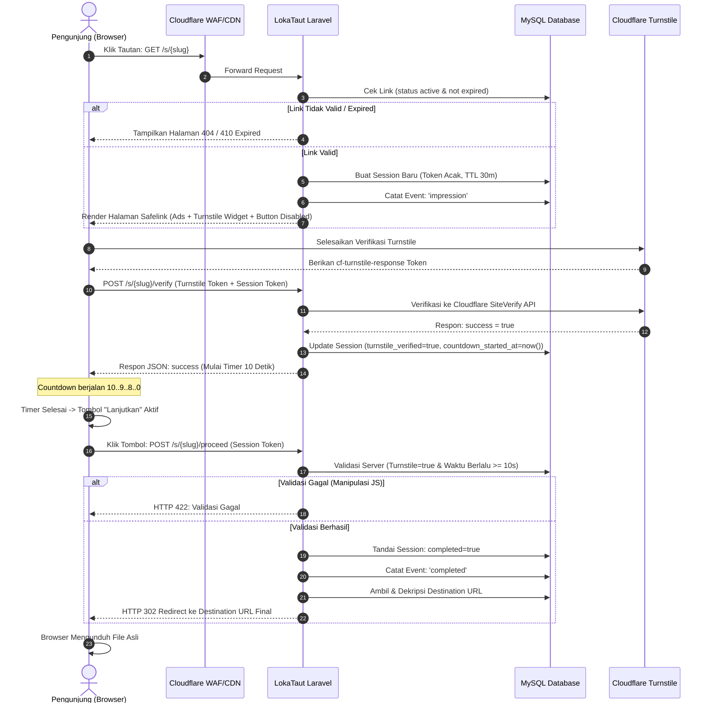

# Product Requirements Document (PRD) — LokaTaut

| Atribut | Nilai |
|---|---|
| **Document ID** | DOC-02 |
| **Versi** | 1.0 |
| **Status** | DRAFT |
| **Terakhir Diperbarui** | 2026-10-30 |
| **Penulis** | Tim Dokumentasi & Analis Sistem LokaTaut |
| **Target Pembaca** | Product Owner, AI Coding Agent, QA Engineer |
| **Tujuan** | Menjadi sumber kebenaran tunggal (*Single Source of Truth*) untuk semua kebutuhan produk, spesifikasi fitur, aturan bisnis, dan batasan fungsional platform LokaTaut. |

---

## Dependensi Dokumen

| Dokumen | Relasi |
|---|---|
| [DOC-01 — Product Vision & Strategy](./01-product-vision.md) | Landasan filosofis, model bisnis, dan tujuan strategis |
| [DOC-03 — Scope & Requirements Specification](./03-scope-requirements.md) | Batasan scope, matriks ketertelusuran (traceability), dan registry rules |
| [DOC-04 — User Flow & System Flow](../02-analysis/04-user-system-flow.md) | Visualisasi diagram alur sistem dan pengguna |
| [DOC-05 — Software Architecture](../03-architecture/05-system-architecture.md) | Realisasi arsitektural dari kebutuhan PRD |
| [DOC-06 — Database Design](../03-architecture/06-database-design.md) | Perancangan skema data dan persistensi data fitur |
| [DOC-09 — Security & Privacy Specification](../05-security-monetization/09-security-privacy.md) | Standar perlindungan keamanan alur safelink |
| [DOC-10 — Monetization Specification](../05-security-monetization/10-monetization-specification.md) | Kebijakan dan arsitektur penempatan iklan |

---

## 1. Product Overview

**LokaTaut** adalah platform privat pengelola tautan dan perantara download (*private link management & safelink*) berbasis web. Platform ini dikembangkan secara custom dan dioperasikan oleh **satu pemilik tunggal (single administrator)** untuk mengamankan, mengontrol, dan memonetisasi trafik unduhan file digital dari jaringan situs web pribadi miliknya.

Konten unduhan yang dialihkan mencakup aplikasi software, file APK Android, template/aset kreatif, dokumen elektronik, dan resource digital lainnya. Sebelum pengunjung mencapai URL download final, mereka melewati halaman safelink yang menampilkan konten informasi, proteksi bot Cloudflare Turnstile, countdown timer, serta penempatan slot iklan dari jaringan periklanan resmi yang mematuhi kebijakan (seperti Adsterra). Seluruh pendapatan iklan 100% menjadi hak pemilik platform.

---

## 2. Problem Statement

1. **Ketergantungan Script & Plugin Pihak Ketiga:** Banyak pengelola web unduhan bergantung pada script atau plugin safelink pihak ketiga yang berbayar, memiliki lisensi terikat (*call-home*), sering mengandung celah keamanan, dan tidak dapat dikustomisasi.
2. **Kehilangan Pendapatan pada Public Shortlink:** Menggunakan layanan public URL shortener publik (seperti Shorte.st, ShrinkMe) memaksa pemilik membagi porsi pendapatan (*revenue share*), rentan penipuan hitungan impresi, dan menampilkan iklan agresif/malware yang merusak reputasi situs utama.
3. **Risiko Pemblokiran Akun AdSense:** Penggunaan Google AdSense pada halaman safelink/countdown adalah pelanggaran keras terhadap *Google Publisher Policies* (masalah *thin content* dan *forced/accidental clicks*), yang berakibat penutupan akun secara permanen. Dibutuhkan arsitektur monetisasi berbasis ad network alternatif yang legal untuk safelink.
4. **Bypass Tautan oleh Bot & Scraper:** Tautan unduhan langsung rentan di-scrape atau di-hotlink tanpa mendatangkan kunjungan halaman, membebani server file tanpa menghasilkan nilai monetisasi.

---

## 3. Product Goals

- **G-001 (Full Ownership):** Memiliki kontrol penuh 100% atas source code, basis data, dan infrastruktur tanpa lisensi berulang.
- **G-002 (Centralized Control):** Mengelola seluruh shortlink dari berbagai website sumber dalam satu dashboard terpusat.
- **G-003 (Compliant Monetization):** Memaksimalkan pendapatan trafik download melalui penempatan iklan yang legal dan didukung oleh ad network terpilih (Adsterra/Monetag).
- **G-004 (Bulletproof Link Protection):** Menyembunyikan destination URL dari sisi client/browser hingga seluruh proses verifikasi dan countdown terpenuhi di server.
- **G-005 (Privacy-Friendly Analytics):** Menyediakan statistik kunjungan, perangkat, dan negara yang akurat tanpa melanggar privasi pengguna (tanpa cookie pihak ketiga, hash IP).
- **G-006 (Extreme Cost Efficiency):** Berjalan optimal pada shared hosting ekonomis (WarnaHost Starter Unlimited: 1 CPU Core, 2 GB RAM) dengan anggaran di bawah Rp 100.000/bulan.

---

## 4. Non-Goals

LokaTaut secara tegas **TIDAK** bertujuan untuk:
- Menyediakan registrasi atau akun bagi pengguna publik/publisher eksternal.
- Menyediakan dashboard publisher, wallet, payout, atau komisi referral.
- Menjadi platform SaaS multi-tenant.
- Menjadi marketplace jual-beli slot iklan publik.
- Menggunakan Google AdSense pada halaman safelink/countdown.
- Mengembangkan aplikasi native mobile (Android/iOS).

---

## 5. Target Users & User Personas

### 5.1 Target Pengguna
Sistem hanya melayani dua entitas:
1. **Administrator (Single Owner):** Pengguna dengan hak penuh mengelola platform melalui panel admin terlindungi.
2. **Pengunjung (Visitor):** Pengguna internet umum yang mengklik link unduhan dari salah satu website milik pemilik.

### 5.2 User Personas

#### Persona 1: Admin / Platform Owner
- **Nama:** Dimas Aditya (30 tahun, Webmaster & Content Creator)
- **Karakteristik:** Mengelola 3 website download file/software dengan volume 10.000–50.000 kunjungan per hari. Membutuhkan efisiensi operasional.
- **Goals:**
  - Membuat shortlink baru dalam waktu kurang dari 30 detik.
  - Memantau tren klik dan completion rate secara berkala.
  - Mengganti script kode iklan atau menonaktifkan slot iklan bermasalah secara instan.
- **Pain Points:** Lelah dengan plugin yang sering error setelah update PHP dan potongan revenue dari platform publik.

#### Persona 2: Pengunjung / Visitor
- **Nama:** Fajar (24 tahun, IT Staff / Tech Enthusiast)
- **Karakteristik:** Mencari software atau file APK dari website milik Dimas menggunakan smartphone Android atau laptop.
- **Goals:** Mengunduh file yang dicari dengan cepat, aman, dan tanpa jebakan link palsu (*deceptive ads*).
- **Pain Points:** Frustrasi dengan safelink yang memiliki redirect berputar-putar, countdown 60 detik palsu, atau pop-up malware agresif.

---

## 6. Business Rules (BR)

| Rule ID | Nama Aturan | Deskripsi & Penegakan |
|---|---|---|
| **BR-001** | Single Administrator | Hanya ada satu akun admin di sistem (`admins` table). Tidak ada mekanisme registrasi publik atau pendaftaran akun baru melalui antarmuka web. |
| **BR-002** | Destination URL Concealment | URL tujuan asli tidak boleh dikirim dalam respon HTML, metadata, atribut data-*, maupun script JS pada halaman safelink sebelum verifikasi selesai. |
| **BR-003** | Server-Side Countdown Validation | Penyelesaian countdown divalidasi di server (`created_at` / `countdown_started_at` + `countdown_seconds` <= `current_time`). Bypass via JS console akan ditolak server dengan HTTP 422. |
| **BR-004** | One-Time Session Token | Token sesi safelink (`visitor_sessions`) bersifat unik secara kriptografis, memiliki masa berlaku (TTL default 30 menit), dan hanya dapat digunakan satu kali untuk memicu redirect HTTP 302. |
| **BR-005** | Mandatory Bot Verification | Cloudflare Turnstile wajib diselesaikan dengan sukses sebelum countdown timer dimulai pada sesi kunjungan. |
| **BR-006** | Inactive Link Policy | Tautan berstatus `inactive` tidak akan menampilkan halaman countdown, melainkan langsung merespon HTTP 404 (Not Found). |
| **BR-007** | Expired Link Policy | Tautan yang telah melewati `expires_at` akan menampilkan halaman informasi khusus (*Expired Link Notice*) dengan HTTP 410 atau 200 berlabel jelas. |
| **BR-008** | Data Privacy & IP Hashing | IP pengunjung tidak disimpan mentah (*plain*) pada tabel analitik `visits`, melainkan di-hash menggunakan algoritma SHA-256 + salt harian/aplikasi. |
| **BR-009** | Strict Slug Syntax | Slug link hanya boleh terdiri dari huruf kecil alfanumerik dan tanda hubung (`[a-z0-9-]`), dengan panjang 4 hingga 50 karakter. |
| **BR-010** | Ad Code Neutrality | Kode iklan disimpan apa adanya (raw HTML/JavaScript) dari dashboard admin tanpa proses filtering sanitasi Blade yang merusak tag `<script>`, namun hanya dapat diubah oleh authenticated admin. |
| **BR-011** | AdSense Prohibition | Sistem secara tegas melarang penempatan unit iklan Google AdSense pada halaman safelink untuk melindungi domain dari pemblokiran publisher. |
| **BR-012** | Automatic Session Cleanup | Sesi pengunjung yang telah selesai (*completed*) atau kedaluwarsa dibersihkan secara otomatis setiap hari via task scheduler untuk menjaga kapasitas penyimpanan. |
| **BR-013** | Rate Limit Enforcement | Request publik ke endpoint `/s/{slug}` dibatasi maksimal 60 request per menit per IP untuk mencegah serangan Denial of Service. |
| **BR-014** | Multi-Website Source Tagging | Setiap link dapat ditandai dengan identifier domain/website sumber untuk memisahkan agregasi statistik trafik. |
| **BR-015** | Soft Deletion of Links | Penghapusan link menggunakan mekanisme soft delete (`deleted_at`) agar riwayat data analitik historis tidak mengalami *foreign key violation*. |

---

## 7. Functional Requirements (FR)

### 7.1 Modul Autentikasi Admin

#### FR-AUTH-001: Admin Login
- **Prioritas:** P0 (Critical)
- **User Story:** Sebagai Admin, saya ingin login ke dashboard menggunakan email dan password agar dapat mengelola platform secara aman.
- **Input:** `email` (string, required, email format), `password` (string, required), `remember` (boolean, optional).
- **Proses:** Validasi input, pencocokan hash Bcrypt pada tabel `admins`, throttling (maksimal 5 percobaan gagal per menit).
- **Output:** Redirect ke `/admin` pada login sukses; pesan error spesifik jika gagal.
- **Acceptance Criteria:**
  - Login berhasil menghasilkan session ID baru dan memperbarui `last_login_at` serta `last_login_ip`.
  - Percobaan gagal ke-6 dalam 1 menit menghasilkan HTTP 429 (Too Many Requests).

#### FR-AUTH-002: Admin Logout
- **Prioritas:** P0 (Critical)
- **User Story:** Sebagai Admin, saya ingin logout dari sistem untuk mengakhiri sesi kerja saya.
- **Input:** Request POST ke `/logout` disertai CSRF token.
- **Proses:** Invalidasi session Laravel, regenerasi CSRF token.
- **Output:** Redirect ke `/login` dengan notifikasi sukses.

#### FR-AUTH-003: Session Management
- **Prioritas:** P0 (Critical)
- **User Story:** Sebagai Admin, saya ingin sesi saya aman dari session hijacking dan otomatis logout saat tidak aktif.
- **Proses:** Session file driver dengan lifetime 120 menit, flag `HttpOnly`, `Secure`, dan `SameSite=Lax`.

---

### 7.2 Modul Dashboard Admin

#### FR-DASH-001: Dashboard Overview
- **Prioritas:** P0 (Critical)
- **User Story:** Sebagai Admin, saya ingin melihat ringkasan metrik utama saat pertama kali membuka panel admin.
- **Output:** 4 kartu metrik: Total Links, Total Kunjungan Hari Ini, Total Safelink Selesai Hari Ini, dan Rasio Penyelesaian (Completion Rate %).

#### FR-DASH-002: Quick Stats & Tren 7 Hari
- **Prioritas:** P1 (High)
- **User Story:** Sebagai Admin, saya ingin melihat grafik performa kunjungan 7 hari terakhir agar dapat memantau tren trafik.
- **Output:** Grafik batang/garis harian kunjungan vs penyelesaian safelink.

#### FR-DASH-003: Quick Actions
- **Prioritas:** P2 (Medium)
- **User Story:** Sebagai Admin, saya ingin memiliki tombol pintas "Buat Tautan Baru" dan tabel 5 link terbaru yang baru saja dibuat.

---

### 7.3 Modul Manajemen Link (Link Management)

#### FR-LINK-001: Random Slug Generation
- **Prioritas:** P0 (Critical)
- **User Story:** Sebagai Admin, saya ingin sistem menghasilkan slug acak unik secara otomatis (misal: `k9x2mP`) jika saya tidak menentukan slug custom.
- **Aturan:** 6–8 karakter acak alfanumerik aman URL, memastikan tidak bertabrakan dengan slug yang sudah ada.

#### FR-LINK-002: Custom Slug
- **Prioritas:** P1 (High)
- **User Story:** Sebagai Admin, saya ingin menentukan slug kustom (contoh: `photoshop-2026-crack`) untuk tautan tertentu.
- **Validasi:** Format regex `/^[a-z0-9-]+$/`, min 4 karakter, max 50 karakter, unique pada tabel `links`.

#### FR-LINK-003: CRUD Destination URL
- **Prioritas:** P0 (Critical)
- **User Story:** Sebagai Admin, saya ingin membuat, melihat, memperbarui, dan menghapus URL tujuan download.
- **Input Form:** `title` (string, max 255), `destination_url` (url, max 2048), `custom_slug` (nullable), `source_website` (nullable), `countdown_seconds` (integer, default 10), `expires_at` (datetime, nullable).
- **Enkripsi:** `destination_url` dienkripsi pada database menggunakan Laravel Crypt/AES-256-CBC.
- **Penghapusan:** Soft delete (`deleted_at`), link yang dihapus otomatis merespon 404 pada public route.

#### FR-LINK-004: Status Toggle & Expiration
- **Prioritas:** P0 (Critical)
- **User Story:** Sebagai Admin, saya ingin dapat menonaktifkan link sewaktu-waktu atau mengatur tanggal kadaluwarsa otomatis.
- **Status:** Enum (`active`, `inactive`).

#### FR-LINK-005: Source Website Tagging
- **Prioritas:** P1 (High)
- **User Story:** Sebagai Admin, saya ingin menandai setiap link dengan label website sumber (misal: `web-aplikasi.com`, `apk-gratis.net`) untuk memisahkan performa analitik.

---

### 7.4 Modul Safelink Engine (Core Visitor Experience)

#### FR-SAFE-001: Safelink Landing Page Rendering
- **Prioritas:** P0 (Critical)
- **User Story:** Sebagai Pengunjung, saya ingin melihat halaman transisi safelink yang bersih, cepat, dan jelas instruksinya.
- **Alur & Komponen Tampilan:**
  - GET request ke `/s/{slug}`.
  - Memeriksa keabsahan link (aktif dan belum kadaluwarsa).
  - Menghasilkan token sesi acak pada tabel `visitor_sessions`.
  - Merender layout publik dengan slot iklan (Header, Above Timer, Below Timer, Footer).
  - Memuat widget Cloudflare Turnstile.
  - Tombol "Lanjutkan Unduhan" dalam status `disabled`.

#### FR-SAFE-002: Cloudflare Turnstile Verification
- **Prioritas:** P0 (Critical)
- **User Story:** Sebagai Sistem, saya ingin memverifikasi bahwa pengunjung bukan bot sebelum timer berjalan.
- **Proses:**
  - Client menyelesaikan tantangan Turnstile.
  - Client mengirim token `cf-turnstile-response` via AJAX POST ke `/s/{slug}/verify`.
  - Backend memvalidasi token ke Cloudflare SiteVerify API.
  - Jika valid, backend mencatat `turnstile_verified = true` dan `countdown_started_at = now()` pada `visitor_sessions`.
  - Client menerima respon sukses dan memulai hitung mundur timer di UI.

#### FR-SAFE-003: Countdown Timer
- **Prioritas:** P0 (Critical)
- **User Story:** Sebagai Pengunjung, saya melihat timer visual (default 10 detik) yang menghitung mundur dengan jelas hingga 0.
- **Behavior:** Menggunakan JavaScript `setInterval`. Saat mencapai angka 0, tombol "Lanjutkan Unduhan" berubah menjadi aktif (`enabled`).

#### FR-SAFE-004: Secure Server-Side Validation & Redirect
- **Prioritas:** P0 (Critical)
- **User Story:** Sebagai Pengunjung, saat mengklik "Lanjutkan Unduhan", saya diarahkan langsung ke file unduhan asli.
- **Proses Validasi Server:**
  - POST request ke `/s/{slug}/proceed` membawa session token.
  - Server memeriksa:
    1. Token terdaftar dan belum berstatus `completed`.
    2. Token belum kadaluwarsa (dalam batas TTL).
    3. `turnstile_verified == true`.
    4. `now() - countdown_started_at >= countdown_seconds`.
  - Jika valid:
    - Update `visitor_sessions`: `completed = true`, `completed_at = now()`.
    - Catat event `completed` pada tabel `visits`.
    - Dekripsi `destination_url`.
    - Kirim respon HTTP 302 Redirect ke `destination_url`.
  - Jika curang/bypass: Kirim HTTP 422 Unprocessable Entity dengan pesan error.

#### FR-SAFE-005: Expired & Invalid Link Notice
- **Prioritas:** P0 (Critical)
- **User Story:** Sebagai Pengunjung, saya mendapatkan pesan ramah jika link yang saya akses sudah kadaluwarsa atau tidak valid, bukan halaman blank/rusak.

---

### 7.5 Modul Manajemen Iklan (Monetization)

#### FR-ADS-001: Ad Slot Management
- **Prioritas:** P0 (Critical)
- **User Story:** Sebagai Admin, saya ingin mengelola posisi slot iklan di halaman safelink.
- **Slot Tersedia:** `header_banner`, `above_countdown`, `below_countdown`, `footer_banner`.

#### FR-ADS-002: Ad Network Code Configuration
- **Prioritas:** P0 (Critical)
- **User Story:** Sebagai Admin, saya ingin menempelkan script/tag iklan dari Adsterra (Banner, Social Bar, atau Popunder) ke masing-masing slot.
- **Fitur:** Textarea kode iklan, toggle status aktif/nonaktif, target perangkat (`all`, `desktop`, `mobile`).

---

### 7.6 Modul Analitik & Pelaporan

#### FR-ANAL-001: Visit & Event Tracking
- **Prioritas:** P0 (Critical)
- **User Story:** Sebagai Admin, saya ingin sistem mencatat setiap tahapan pengunjung (Impression, Verified, Completed) secara akurat.
- **Data Tersimpan:** `link_id`, `event_type`, `ip_hash` (SHA-256), `device_type`, `browser`, `os`, `country_code` (via Cloudflare header `CF-IPCountry`), `referrer`.

#### FR-ANAL-002: Link Performance & Completion Rate
- **Prioritas:** P1 (High)
- **User Story:** Sebagai Admin, saya ingin melihat tingkat keberhasilan safelink (*Completion Rate* = Completed / Impressions × 100%) per link dan agregat.

#### FR-ANAL-003: Aggregated Daily Statistics
- **Prioritas:** P1 (High)
- **User Story:** Sebagai Admin, saya ingin query analitik harian berlangsung cepat tanpa membebani CPU server hosting.
- **Mekanisme:** Cron job harian mengagregasi data dari tabel `visits` ke tabel `daily_stats`.

---

### 7.7 Modul Pengaturan & Keamanan

#### FR-SET-001: General System Settings
- **Prioritas:** P1 (High)
- **Parameter:** Nama situs, zona waktu (`Asia/Jakarta`), default countdown seconds, durasi session TTL.

#### FR-SET-002: Turnstile API Configuration
- **Prioritas:** P0 (Critical)
- **Parameter:** `turnstile_site_key`, `turnstile_secret_key`, toggle aktif/nonaktif untuk testing lokal.

#### FR-SEC-001: Security Logging & Rate Limiting
- **Prioritas:** P1 (High)
- **Pencatatan:** Login gagal, pergantian password, manipulasi token, brute force link.

---

## 8. Non-Functional Requirements (NFR)

| NFR ID | Kategori | Parameter & Metrik Target | Prioritas |
|---|---|---|---|
| **NFR-PERF-001** | Performance | Waktu muat halaman safelink (*First Contentful Paint*) < 1.2 detik pada jaringan 4G. | P0 |
| **NFR-PERF-002** | Performance | Query database standar dieksekusi < 50ms; agregasi analitik < 200ms. | P0 |
| **NFR-PERF-003** | Scalability | Mampu menangani 10.000–50.000 kunjungan per hari pada Shared Hosting 1 CPU Core / 2 GB RAM dengan CPU throttling < 5%. | P0 |
| **NFR-SEC-001** | Security | Enkripsi simetris (AES-256-CBC) untuk penyimpanan `destination_url` di database. | P0 |
| **NFR-SEC-002** | Security | Perlindungan CSRF wajib pada seluruh request berstatus POST/PUT/DELETE. | P0 |
| **NFR-SEC-003** | Security | Sanitasi output otomatis via Blade `{{ }}` untuk pencegahan XSS. | P0 |
| **NFR-SEC-004** | Security | Perlindungan SQL Injection 100% menggunakan Eloquent ORM / PDO parameter binding. | P0 |
| **NFR-SEC-005** | Security | Validasi URL tujuan dengan *whitelist scheme* (`http`, `https`) untuk mencegah SSRF & Open Redirect exploit. | P0 |
| **NFR-UX-001** | User Experience | Tampilan 100% responsif pada perangkat mobile (320px) hingga desktop widescreen (1920px). | P0 |
| **NFR-UX-002** | Accessibility | Rasio kontras teks minimal 4.5:1 (WCAG 2.1 AA compliant) dan navigasi ramah keyboard. | P1 |
| **NFR-UX-003** | Clean UI | Desain safelink minimalis, profesional, tidak menampilkan elemen visual jebakan (*no deceptive clickbait*). | P1 |
| **NFR-REL-001** | Reliability | Penanganan kegagalan terisolasi: Jika ad network gagal memuat, halaman safelink dan alur download tetap berfungsi normal. | P0 |
| **NFR-MAINT-001**| Maintainability | Kode mengikuti konvensi Laravel 11 murni dan PSR-12, modular monolith tanpa dependensi eksternal yang rumit. | P0 |

---

## 9. User Journeys

### 9.1 Journey Pengunjung (Visitor Safelink Journey)

---

## 10. Error Handling & Edge Cases

| Skenario Edge Case | Potensi Dampak | Penanganan Sistem LokaTaut |
|---|---|---|
| **Pengunjung mengubah timer di JS console** | Melewati penayangan iklan | Server memvalidasi selisih timestamp `now() - countdown_started_at`. Jika < `countdown_seconds`, request ditolak dengan pesan peringatan. |
| **Pengunjung merefresh halaman safelink** | Token duplikat / inkonsisten | Sistem membuat session token baru, memuat ulang widget Turnstile, dan timer dihitung dari awal. |
| **Turnstile API mengalami timeout** | Pengunjung terhenti (*stuck*) | Timeout di-set 5 detik; jika gagal, tampilkan tombol "Coba Verifikasi Ulang" tanpa merusak alur halaman. |
| **Tautan tujuan asli rusak / 404** | Pengalaman buruk visitor | Tanggung jawab website pemilik; LokaTaut tetap menyelesaikan alur safelink secara aman dengan redirect 302 ke URL tujuan yang tercatat. |
| **Volume data tabel `visits` membengkak** | Penyimpanan hosting penuh | Scheduled task mengeksekusi `PruneVisitDataCommand` setiap tengah malam, menghapus data mentah > 90 hari setelah memastikan data telah diagregasikan ke `daily_stats`. |
| **Ad Blocker aktif pada browser pengunjung** | Iklan tidak tampil | Safelink tetap mengizinkan pengunjung melanjutkan unduhan secara wajar tanpa script pemaksa yang agresif (*respectful user experience*). |

---

## 11. MVP vs Post-MVP Feature Matrix

| Feature ID | Nama Fitur | Modul | MVP (Phase 1-3) | Post-MVP (Phase 4+) |
|---|---|---|:---:|:---:|
| FR-AUTH-001..003 | Autentikasi Admin & Session | Auth | ✅ | |
| FR-DASH-001..003 | Dashboard & Quick Stats | Dashboard | ✅ | |
| FR-LINK-001..004 | CRUD Link & Random/Custom Slug | Link | ✅ | |
| FR-LINK-005 | Source Website Tagging | Link | ✅ | |
| FR-SAFE-001..005 | Safelink Engine + Turnstile + Countdown | Safelink | ✅ | |
| FR-ADS-001..002 | Ad Slot CRUD & Script Injection | Advertising | ✅ | |
| FR-ANAL-001..003 | Click & Completion Tracking + Basic Stats | Analytics | ✅ | |
| FR-SET-001..002 | Settings & Turnstile Configuration | Settings | ✅ | |
| FR-SEC-001 | Security Logs & Throttling | Security | ✅ | |
| FR-POST-001 | Bulk Link Generation via CSV Import | Link | | 🚀 Post-MVP |
| FR-POST-002 | QR Code Generator per Link | Link | | 🚀 Post-MVP |
| FR-POST-003 | Advanced Analytics (Peta Negara Interaktif) | Analytics | | 🚀 Post-MVP |
| FR-POST-004 | A/B Testing Posisi Slot Iklan | Advertising | | 🚀 Post-MVP |
| FR-POST-005 | CSV / Excel Data Export | Analytics | | 🚀 Post-MVP |

---

## 12. Kriteria Penerimaan Global (Global Acceptance Criteria)

1. Admin dapat melakukan login, membuat shortlink acak atau kustom, mengarahkan ke destination URL, dan menyimpan konfigurasi dalam database.
2. Pengunjung yang mengakses shortlink dialihkan ke halaman safelink yang memuat iklan dan tantangan Turnstile.
3. Tombol unduhan tidak dapat diakses sebelum Turnstile diverifikasi dan countdown 10 detik selesai.
4. Upaya manipulasi timer via JavaScript di client-side menghasilkan penolakan di sisi server.
5. Setelah lolos verifikasi, pengunjung diarahkan via HTTP 302 ke URL tujuan yang benar.
6. Seluruh metrik impresi dan completion tercatat di basis data dan ditampilkan di dashboard admin.
7. Aplikasi lolos seluruh automated test P0 dan P1 tanpa kegagalan pada lingkungan PHP 8.3 & MySQL 8.

