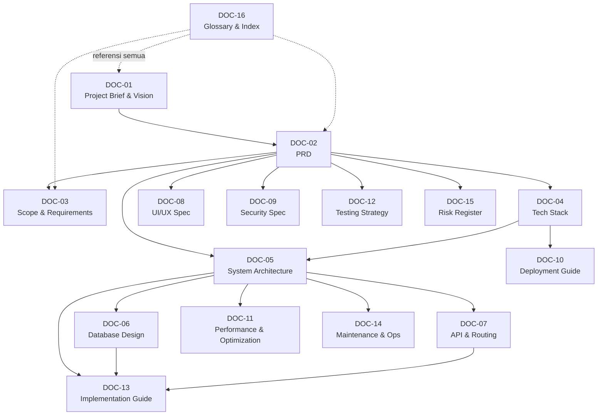
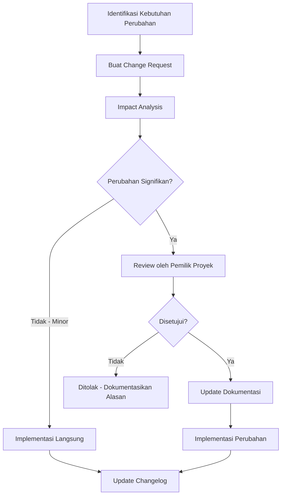

# Spesifikasi Scope & Requirements — LokaTaut

| Atribut | Nilai |
|---|---|
| **Document ID** | DOC-03 |
| **Versi** | 1.0 |
| **Status** | DRAFT |
| **Terakhir Diperbarui** | 2026-10-30 |
| **Penulis** | Tim Dokumentasi LokaTaut |
| **Tujuan** | Mendefinisikan batasan proyek secara eksplisit, mencatat seluruh kebutuhan fungsional dan non-fungsional, serta menyediakan matriks traceability agar setiap requirement dapat dilacak ke arsitektur, database, UI, keamanan, dan test case terkait. |
| **Scope Dokumen** | Dokumen ini mencakup scope statement proyek, daftar lengkap fitur MVP dan Post-MVP, fitur yang secara eksplisit di luar scope, matriks traceability, business rules registry, asumsi & constraint, dependency antar dokumen, serta proses change control. |

## Dependencies

| Dokumen | Relasi |
|---|---|
| DOC-01 — Project Brief & Vision | Input: visi dan konteks proyek |
| DOC-02 — Product Requirements Document (PRD) | Input: seluruh requirement ID (FR-*, NFR-*, BR-*) |
| DOC-04 — Tech Stack & Infrastructure | Output: constraint teknis yang mempengaruhi scope |
| DOC-05 — System Architecture | Output: mapping requirement ke komponen arsitektur |
| DOC-06 — Database Design | Output: mapping requirement ke tabel database |
| DOC-08 — UI/UX Specification | Output: mapping requirement ke halaman UI |
| DOC-09 — Security Specification | Output: mapping requirement ke security requirement |
| DOC-12 — Testing Strategy | Output: mapping requirement ke test case |

## Dokumen Terkait

- [DOC-01 — Project Brief & Vision](./01-project-brief.md)
- [DOC-02 — Product Requirements Document](./02-prd.md)
- [DOC-04 — Tech Stack & Infrastructure](../02-technical/04-tech-stack.md)
- [DOC-05 — System Architecture](../02-technical/05-system-architecture.md)
- [DOC-06 — Database Design](../02-technical/06-database-design.md)
- [DOC-08 — UI/UX Specification](../03-design/08-ui-ux-spec.md)
- [DOC-09 — Security Specification](../02-technical/09-security-spec.md)
- [DOC-12 — Testing Strategy](../04-quality/12-testing-strategy.md)

---

## 1. Project Scope Statement

### 1.1 Definisi LokaTaut

LokaTaut adalah **platform private safelink management** yang digunakan oleh seorang pemilik tunggal untuk mengelola link download dari website-website miliknya. Platform ini memonetisasi traffic melalui ad network (utama: Adsterra) dengan menampilkan iklan pada halaman safelink sebelum pengunjung diarahkan ke URL tujuan.

### 1.2 LokaTaut ADALAH

| Aspek | Deskripsi |
|---|---|
| Private safelink platform | Platform untuk satu pemilik, bukan layanan publik |
| Link management tool | Mengelola dan melacak shortlink/safelink |
| Ad monetization layer | Menampilkan iklan pada halaman safelink untuk monetisasi |
| Single-owner dashboard | Dashboard admin untuk satu pengguna |
| Multi-website support | Mendukung link dari berbagai website milik pemilik |
| Self-hosted solution | Di-host pada shared hosting (WarnaHost) |
| Monolithic Laravel app | Satu aplikasi Laravel 11 modular monolith |

### 1.3 LokaTaut BUKAN

| Aspek | Penjelasan Mengapa Bukan |
|---|---|
| Public URL shortener | Bukan layanan seperti bit.ly; hanya untuk pemilik tunggal |
| SaaS platform | Tidak ada multi-tenant, pricing plan, atau subscription |
| Ad marketplace | Tidak mengelola advertiser; hanya meng-embed kode ad network |
| Content management system | Tidak mengelola konten/artikel; hanya link |
| Social media tool | Tidak ada fitur sharing, comments, atau social integration |
| E-commerce platform | Tidak ada transaksi, pembayaran, atau wallet |
| Public API provider | Tidak menyediakan API untuk pihak ketiga |
| Mobile application | Hanya web-based, diakses via browser |
| Multi-user system | Satu admin, tanpa registrasi pengguna |

---

## 2. Scope Categories

### 2A. MVP Scope (Phase 1–3)

Fitur-fitur berikut merupakan scope MVP yang HARUS diimplementasikan sebelum launch.

| Req ID | Kategori | Fitur | Deskripsi | Priority | PRD Ref | Test Ref |
|---|---|---|---|---|---|---|
| FR-AUTH-001 | Autentikasi | Admin Login | Form login dengan email/password untuk admin tunggal | P0 | DOC-02 §4.1 | TEST-AUTH-001 |
| FR-AUTH-002 | Autentikasi | Admin Logout | Logout dengan invalidasi session | P0 | DOC-02 §4.1 | TEST-AUTH-002 |
| FR-AUTH-003 | Autentikasi | Session Management | Session server-side dengan timeout otomatis, single session enforcement | P0 | DOC-02 §4.1 | TEST-AUTH-003 |
| FR-DASH-001 | Dashboard | Overview Dashboard | Ringkasan statistik: total link, total klik hari ini, link aktif/nonaktif | P0 | DOC-02 §4.2 | TEST-DASH-001 |
| FR-DASH-002 | Dashboard | Quick Stats | Statistik cepat: klik 24 jam terakhir, 7 hari, 30 hari | P1 | DOC-02 §4.2 | TEST-DASH-002 |
| FR-DASH-003 | Dashboard | Quick Actions | Tombol pintas: buat link baru, lihat link terbaru | P2 | DOC-02 §4.2 | TEST-DASH-003 |
| FR-LINK-001 | Shortlink | Random Slug Generation | Generate slug acak (6–8 karakter alfanumerik) untuk shortlink | P0 | DOC-02 §4.3 | TEST-LINK-001 |
| FR-LINK-002 | Shortlink | Custom Slug | Admin dapat menentukan slug kustom untuk shortlink | P1 | DOC-02 §4.3 | TEST-LINK-002 |
| FR-LINK-003 | Shortlink | Slug Uniqueness | Validasi bahwa setiap slug unik dalam sistem | P0 | DOC-02 §4.3 | TEST-LINK-003 |
| FR-LINK-004 | Destination URL | Create URL | Menambahkan destination URL baru dengan validasi format | P0 | DOC-02 §4.4 | TEST-LINK-004 |
| FR-LINK-005 | Destination URL | Read URL | Melihat daftar dan detail destination URL | P0 | DOC-02 §4.4 | TEST-LINK-005 |
| FR-LINK-006 | Destination URL | Update URL | Mengubah destination URL yang sudah ada | P0 | DOC-02 §4.4 | TEST-LINK-006 |
| FR-LINK-007 | Destination URL | Delete URL | Menghapus destination URL (soft delete) | P0 | DOC-02 §4.4 | TEST-LINK-007 |
| FR-SAFE-001 | Safelink | Landing Page | Halaman safelink dengan branding minimal, slot iklan, dan area countdown | P0 | DOC-02 §4.5 | TEST-SAFE-001 |
| FR-SAFE-002 | Safelink | Countdown Timer | Timer countdown (default 10 detik) sebelum tombol redirect muncul | P0 | DOC-02 §4.5 | TEST-SAFE-002 |
| FR-SAFE-003 | Safelink | Turnstile Verification | Verifikasi Cloudflare Turnstile sebelum countdown dimulai | P0 | DOC-02 §4.5 | TEST-SAFE-003 |
| FR-SAFE-004 | Safelink | Redirect to Destination | Redirect ke URL tujuan setelah countdown selesai dan user klik tombol | P0 | DOC-02 §4.5 | TEST-SAFE-004 |
| FR-SAFE-005 | Safelink | Session Validation | Token-based session validation server-side untuk mencegah bypass countdown | P0 | DOC-02 §4.5 | TEST-SAFE-005 |
| FR-CONF-001 | Konfigurasi | Countdown Duration | Durasi countdown dapat dikonfigurasi (default 10 detik) | P1 | DOC-02 §4.6 | TEST-CONF-001 |
| FR-CONF-002 | Konfigurasi | Link Expiration | Link dapat diset tanggal/waktu kedaluwarsa | P1 | DOC-02 §4.6 | TEST-CONF-002 |
| FR-CONF-003 | Konfigurasi | Link Status Toggle | Link dapat diaktifkan/dinonaktifkan (active/inactive) | P0 | DOC-02 §4.6 | TEST-CONF-003 |
| FR-ADS-001 | Iklan | Ad Slot CRUD | Membuat, membaca, mengubah, dan menghapus slot iklan | P0 | DOC-02 §4.7 | TEST-ADS-001 |
| FR-ADS-002 | Iklan | Ad Slot Toggle | Mengaktifkan/menonaktifkan slot iklan | P0 | DOC-02 §4.7 | TEST-ADS-002 |
| FR-ADS-003 | Iklan | Ad Code Configuration | Menempelkan kode iklan dari ad network (HTML/JS) ke slot | P0 | DOC-02 §4.7 | TEST-ADS-003 |
| FR-ADS-004 | Iklan | Ad Slot Positioning | Menentukan posisi slot iklan di halaman safelink (header, sidebar, content, footer) | P1 | DOC-02 §4.7 | TEST-ADS-004 |
| FR-ANAL-001 | Analytics | Click Tracking | Mencatat setiap kunjungan ke shortlink (timestamp, IP hash, user agent, referrer) | P0 | DOC-02 §4.8 | TEST-ANAL-001 |
| FR-ANAL-002 | Analytics | Safelink Completion | Mencatat penyelesaian safelink (pengunjung berhasil sampai redirect) | P0 | DOC-02 §4.8 | TEST-ANAL-002 |
| FR-ANAL-003 | Analytics | Basic Stats Display | Menampilkan jumlah klik per link, per hari, conversion rate | P1 | DOC-02 §4.8 | TEST-ANAL-003 |
| FR-SEC-001 | Keamanan | CSRF Protection | Proteksi CSRF pada semua form submission | P0 | DOC-02 §4.9 | TEST-SEC-001 |
| FR-SEC-002 | Keamanan | XSS Prevention | Sanitasi output dan input untuk mencegah XSS | P0 | DOC-02 §4.9 | TEST-SEC-002 |
| FR-SEC-003 | Keamanan | Rate Limiting | Rate limiting pada endpoint publik (safelink, verification) | P0 | DOC-02 §4.9 | TEST-SEC-003 |
| FR-SET-001 | Settings | General Settings | Konfigurasi nama situs, timezone, default settings | P1 | DOC-02 §4.10 | TEST-SET-001 |
| FR-SET-002 | Settings | Turnstile Configuration | Input dan validasi Turnstile site key & secret key | P0 | DOC-02 §4.10 | TEST-SET-002 |
| FR-TAG-001 | Tagging | Source Website Tag | Menandai link dengan website sumber asal (multi-website support) | P1 | DOC-02 §4.11 | TEST-TAG-001 |
| FR-TAG-002 | Tagging | Source Website CRUD | Mengelola daftar website sumber (tambah, ubah, hapus) | P1 | DOC-02 §4.11 | TEST-TAG-002 |
| FR-TAG-003 | Tagging | Filter by Source | Memfilter link berdasarkan website sumber | P2 | DOC-02 §4.11 | TEST-TAG-003 |

### 2B. Post-MVP Scope (Phase 4+)

Fitur-fitur berikut direncanakan untuk pengembangan setelah MVP stabil dan berjalan di production.

| Req ID | Kategori | Fitur | Deskripsi | Priority | Ketergantungan MVP |
|---|---|---|---|---|---|
| FR-ANAL-010 | Analytics | Country Detection | Deteksi negara pengunjung via IP geolocation | P2 | FR-ANAL-001 |
| FR-ANAL-011 | Analytics | Device Detection | Deteksi jenis perangkat (desktop, mobile, tablet) | P2 | FR-ANAL-001 |
| FR-ANAL-012 | Analytics | Detailed Reporting | Laporan analytics detail dengan filter tanggal, sumber, status | P2 | FR-ANAL-003 |
| FR-LINK-010 | Shortlink | Bulk CSV Import | Import link secara massal melalui file CSV | P2 | FR-LINK-004 |
| FR-ANAL-013 | Analytics | CSV Export | Export data analytics ke file CSV | P2 | FR-ANAL-003 |
| FR-SEC-010 | Keamanan | Advanced Bot Detection | Deteksi bot lanjutan di luar Turnstile (behavioral analysis) | P3 | FR-SEC-003 |
| FR-LINK-011 | Shortlink | Link Grouping | Mengelompokkan link ke dalam kategori/folder | P3 | FR-LINK-004 |
| FR-LINK-012 | Shortlink | QR Code Generation | Generate QR Code untuk setiap shortlink | P3 | FR-LINK-001 |
| FR-ANAL-014 | Analytics | Advanced Dashboard | Dashboard reporting lanjutan dengan chart dan visualisasi | P3 | FR-ANAL-003 |
| FR-ADS-010 | Iklan | A/B Testing Ad Placement | Pengujian posisi iklan untuk optimasi revenue | P3 | FR-ADS-001 |

### 2C. Secara Eksplisit di Luar Scope

> [!CAUTION]
> Fitur-fitur berikut **TIDAK BOLEH** diimplementasikan tanpa persetujuan eksplisit dari pemilik proyek. Implementasi fitur-fitur ini akan mengubah arsitektur dan tujuan fundamental platform.

| No | Fitur | Alasan Dikeluarkan | Risiko Jika Diimplementasikan |
|---|---|---|---|
| 1 | Publisher registration / dashboard | LokaTaut bukan platform multi-publisher | Mengubah arsitektur menjadi multi-tenant |
| 2 | Advertiser management / marketplace | LokaTaut menggunakan ad network eksternal, bukan marketplace sendiri | Kompleksitas berlebihan, di luar core business |
| 3 | Member wallet / payment system | Tidak ada transaksi keuangan dalam platform | Regulasi keuangan, keamanan pembayaran |
| 4 | Referral / affiliate system | Tidak ada sistem referral; single-owner platform | Kompleksitas user management |
| 5 | Revenue sharing | Tidak ada pembagian pendapatan; single-owner | Membutuhkan payment gateway, akuntansi |
| 6 | Public marketplace | LokaTaut bukan marketplace | Mengubah fundamental bisnis model |
| 7 | Multi-tenant SaaS architecture | Platform untuk single-owner saja | Overengineering, biaya infrastruktur meningkat |
| 8 | Public API / API key management | Tidak ada kebutuhan integrasi pihak ketiga | Permukaan serangan meningkat, maintenance cost |
| 9 | Mobile application | Akses cukup melalui browser | Biaya development dan maintenance tinggi |
| 10 | Email marketing integration | Di luar scope manajemen link | Kompleksitas dan biaya tambahan |
| 11 | Social media integration | Tidak diperlukan untuk flow safelink | Dependency pihak ketiga, maintenance |
| 12 | Content management system | LokaTaut mengelola link, bukan konten | Scope creep serius |
| 13 | User comments / ratings | Tidak ada interaksi pengunjung | Moderasi konten, spam management |
| 14 | Multi-language support | UI hanya dalam Bahasa Indonesia | Kompleksitas translation, maintenance |
| 15 | Real-time notifications (WebSocket) | Shared hosting tidak mendukung persistent connection | Infrastruktur tidak kompatibel |
| 16 | Microservices architecture | Menggunakan modular monolith di shared hosting | Infrastruktur tidak mendukung |

---

## 3. Functional Requirements Traceability Matrix

Matriks ini memetakan setiap functional requirement ke komponen arsitektur, tabel database, halaman UI, security requirement, dan test case terkait.

### 3.1 Modul Autentikasi

| Req ID | Requirement | PRD Feature | Architecture Component | Database Table | UI Page | Security Req | Test Case | Priority |
|---|---|---|---|---|---|---|---|---|
| FR-AUTH-001 | Admin login via email/password | DOC-02 §4.1 | Auth Module → LoginController | `admins` | `/login` | NFR-SEC-001, NFR-SEC-003 | TEST-AUTH-001 | P0 |
| FR-AUTH-002 | Admin logout dengan invalidasi session | DOC-02 §4.1 | Auth Module → LogoutController | `sessions` | `/logout` (action) | NFR-SEC-002 | TEST-AUTH-002 | P0 |
| FR-AUTH-003 | Session management server-side | DOC-02 §4.1 | Auth Module → SessionMiddleware | `sessions` | — (middleware) | NFR-SEC-002, NFR-SEC-004 | TEST-AUTH-003 | P0 |

### 3.2 Modul Dashboard

| Req ID | Requirement | PRD Feature | Architecture Component | Database Table | UI Page | Security Req | Test Case | Priority |
|---|---|---|---|---|---|---|---|---|
| FR-DASH-001 | Overview dashboard dengan statistik | DOC-02 §4.2 | Dashboard Module → DashboardController | `links`, `visits` | `/admin/dashboard` | NFR-SEC-002 (auth required) | TEST-DASH-001 | P0 |
| FR-DASH-002 | Quick stats (24h, 7d, 30d) | DOC-02 §4.2 | Dashboard Module → StatsService | `visits` | `/admin/dashboard` | NFR-SEC-002 | TEST-DASH-002 | P1 |
| FR-DASH-003 | Quick action buttons | DOC-02 §4.2 | Dashboard Module → DashboardController | — | `/admin/dashboard` | NFR-SEC-002 | TEST-DASH-003 | P2 |

### 3.3 Modul Shortlink

| Req ID | Requirement | PRD Feature | Architecture Component | Database Table | UI Page | Security Req | Test Case | Priority |
|---|---|---|---|---|---|---|---|---|
| FR-LINK-001 | Random slug generation (6–8 char) | DOC-02 §4.3 | Link Module → SlugGeneratorService | `links` | `/admin/links/create` | NFR-SEC-002 | TEST-LINK-001 | P0 |
| FR-LINK-002 | Custom slug input | DOC-02 §4.3 | Link Module → LinkController@store | `links` | `/admin/links/create` | NFR-SEC-002, NFR-SEC-005 | TEST-LINK-002 | P1 |
| FR-LINK-003 | Slug uniqueness validation | DOC-02 §4.3 | Link Module → SlugGeneratorService | `links` (unique index) | `/admin/links/create` | NFR-SEC-005 | TEST-LINK-003 | P0 |
| FR-LINK-004 | Create destination URL | DOC-02 §4.4 | Link Module → LinkController@store | `links` | `/admin/links/create` | NFR-SEC-002, NFR-SEC-005 | TEST-LINK-004 | P0 |
| FR-LINK-005 | Read/list destination URLs | DOC-02 §4.4 | Link Module → LinkController@index | `links` | `/admin/links` | NFR-SEC-002 | TEST-LINK-005 | P0 |
| FR-LINK-006 | Update destination URL | DOC-02 §4.4 | Link Module → LinkController@update | `links` | `/admin/links/{id}/edit` | NFR-SEC-002, NFR-SEC-005 | TEST-LINK-006 | P0 |
| FR-LINK-007 | Soft delete destination URL | DOC-02 §4.4 | Link Module → LinkController@destroy | `links` | `/admin/links` | NFR-SEC-002 | TEST-LINK-007 | P0 |

### 3.4 Modul Safelink

| Req ID | Requirement | PRD Feature | Architecture Component | Database Table | UI Page | Security Req | Test Case | Priority |
|---|---|---|---|---|---|---|---|---|
| FR-SAFE-001 | Safelink landing page | DOC-02 §4.5 | Safelink Module → SafelinkController@show | `links`, `ad_slots` | `/{slug}` | NFR-SEC-006, NFR-SEC-007 | TEST-SAFE-001 | P0 |
| FR-SAFE-002 | Countdown timer (default 10s) | DOC-02 §4.5 | Safelink Module → countdown.js | `settings` | `/{slug}` | NFR-SEC-006 | TEST-SAFE-002 | P0 |
| FR-SAFE-003 | Cloudflare Turnstile verification | DOC-02 §4.5 | Safelink Module → TurnstileService | `settings` | `/{slug}` | NFR-SEC-006, NFR-SEC-008 | TEST-SAFE-003 | P0 |
| FR-SAFE-004 | Redirect setelah countdown + klik | DOC-02 §4.5 | Safelink Module → SafelinkController@redirect | `links`, `visits` | `/{slug}/go` | NFR-SEC-006, NFR-SEC-009 | TEST-SAFE-004 | P0 |
| FR-SAFE-005 | Token-based session validation | DOC-02 §4.5 | Safelink Module → SessionTokenService | `safelink_sessions` | — (server-side) | NFR-SEC-009 | TEST-SAFE-005 | P0 |

### 3.5 Modul Konfigurasi

| Req ID | Requirement | PRD Feature | Architecture Component | Database Table | UI Page | Security Req | Test Case | Priority |
|---|---|---|---|---|---|---|---|---|
| FR-CONF-001 | Konfigurasi countdown duration | DOC-02 §4.6 | Config Module → SettingsController | `settings` | `/admin/settings` | NFR-SEC-002 | TEST-CONF-001 | P1 |
| FR-CONF-002 | Link expiration date/time | DOC-02 §4.6 | Link Module → ExpirationService | `links` (`expires_at`) | `/admin/links/create`, `/admin/links/{id}/edit` | NFR-SEC-002 | TEST-CONF-002 | P1 |
| FR-CONF-003 | Link status active/inactive | DOC-02 §4.6 | Link Module → LinkController@toggleStatus | `links` (`is_active`) | `/admin/links` | NFR-SEC-002 | TEST-CONF-003 | P0 |

### 3.6 Modul Iklan

| Req ID | Requirement | PRD Feature | Architecture Component | Database Table | UI Page | Security Req | Test Case | Priority |
|---|---|---|---|---|---|---|---|---|
| FR-ADS-001 | Ad slot CRUD | DOC-02 §4.7 | Ad Module → AdSlotController | `ad_slots` | `/admin/ads` | NFR-SEC-002, NFR-SEC-005 | TEST-ADS-001 | P0 |
| FR-ADS-002 | Ad slot toggle enable/disable | DOC-02 §4.7 | Ad Module → AdSlotController@toggle | `ad_slots` (`is_active`) | `/admin/ads` | NFR-SEC-002 | TEST-ADS-002 | P0 |
| FR-ADS-003 | Paste ad network code | DOC-02 §4.7 | Ad Module → AdSlotController@store | `ad_slots` (`ad_code`) | `/admin/ads/create`, `/admin/ads/{id}/edit` | NFR-SEC-002, NFR-SEC-010 | TEST-ADS-003 | P0 |
| FR-ADS-004 | Ad slot positioning | DOC-02 §4.7 | Ad Module → AdSlotController | `ad_slots` (`position`) | `/admin/ads/create` | NFR-SEC-002 | TEST-ADS-004 | P1 |

### 3.7 Modul Analytics

| Req ID | Requirement | PRD Feature | Architecture Component | Database Table | UI Page | Security Req | Test Case | Priority |
|---|---|---|---|---|---|---|---|---|
| FR-ANAL-001 | Click/visit tracking | DOC-02 §4.8 | Analytics Module → VisitTracker | `visits` | — (background) | NFR-SEC-011 | TEST-ANAL-001 | P0 |
| FR-ANAL-002 | Safelink completion tracking | DOC-02 §4.8 | Analytics Module → CompletionTracker | `visits` (`completed_at`) | — (background) | NFR-SEC-011 | TEST-ANAL-002 | P0 |
| FR-ANAL-003 | Basic stats display | DOC-02 §4.8 | Analytics Module → AnalyticsController | `visits`, `links` | `/admin/analytics` | NFR-SEC-002 | TEST-ANAL-003 | P1 |

### 3.8 Modul Keamanan

| Req ID | Requirement | PRD Feature | Architecture Component | Database Table | UI Page | Security Req | Test Case | Priority |
|---|---|---|---|---|---|---|---|---|
| FR-SEC-001 | CSRF protection | DOC-02 §4.9 | Laravel VerifyCsrfToken Middleware | `sessions` | — (semua form) | NFR-SEC-012 | TEST-SEC-001 | P0 |
| FR-SEC-002 | XSS prevention | DOC-02 §4.9 | Blade auto-escaping + input sanitization | — | — (semua output) | NFR-SEC-013 | TEST-SEC-002 | P0 |
| FR-SEC-003 | Rate limiting | DOC-02 §4.9 | Laravel RateLimiter Middleware | `cache` (rate limit store) | — (middleware) | NFR-SEC-014 | TEST-SEC-003 | P0 |

### 3.9 Modul Settings & Tagging

| Req ID | Requirement | PRD Feature | Architecture Component | Database Table | UI Page | Security Req | Test Case | Priority |
|---|---|---|---|---|---|---|---|---|
| FR-SET-001 | General settings | DOC-02 §4.10 | Settings Module → SettingsController | `settings` | `/admin/settings` | NFR-SEC-002 | TEST-SET-001 | P1 |
| FR-SET-002 | Turnstile configuration | DOC-02 §4.10 | Settings Module → SettingsController | `settings` | `/admin/settings` | NFR-SEC-002, NFR-SEC-015 | TEST-SET-002 | P0 |
| FR-TAG-001 | Source website tagging | DOC-02 §4.11 | Tag Module → SourceController | `source_websites`, `links` | `/admin/links/create` | NFR-SEC-002 | TEST-TAG-001 | P1 |
| FR-TAG-002 | Source website CRUD | DOC-02 §4.11 | Tag Module → SourceController | `source_websites` | `/admin/sources` | NFR-SEC-002, NFR-SEC-005 | TEST-TAG-002 | P1 |
| FR-TAG-003 | Filter by source | DOC-02 §4.11 | Tag Module → LinkController@index | `links`, `source_websites` | `/admin/links` | NFR-SEC-002 | TEST-TAG-003 | P2 |

---

## 4. Non-Functional Requirements Traceability

| NFR ID | Requirement | Kategori | Metode Validasi | Target Metrik | Test Case | Priority |
|---|---|---|---|---|---|---|
| NFR-PERF-001 | Safelink page load time | Performance | Load testing (ab/wrk) | ≤ 2 detik (TTFB ≤ 500ms) | TEST-PERF-001 | P0 |
| NFR-PERF-002 | Admin dashboard load time | Performance | Browser DevTools, load test | ≤ 3 detik | TEST-PERF-002 | P1 |
| NFR-PERF-003 | Concurrent visitor handling | Performance | Load testing | 500+ concurrent tanpa error | TEST-PERF-003 | P0 |
| NFR-PERF-004 | Database query optimization | Performance | Query profiling (EXPLAIN) | ≤ 100ms per query | TEST-PERF-004 | P1 |
| NFR-PERF-005 | Page caching (safelink static assets) | Performance | Cache header validation | Cache-Control headers tervalidasi | TEST-PERF-005 | P1 |
| NFR-SEC-001 | Secure login (hashed password) | Security | Code review, penetration test | Bcrypt/Argon2 hashing | TEST-SEC-010 | P0 |
| NFR-SEC-002 | Authentication required untuk admin | Security | Access test tanpa login | 401/302 redirect untuk semua admin route | TEST-SEC-011 | P0 |
| NFR-SEC-003 | Brute-force protection pada login | Security | Repeated login attempts | Lockout setelah 5 failed attempts | TEST-SEC-012 | P0 |
| NFR-SEC-004 | Session fixation prevention | Security | Session ID change test | Session ID berubah setelah login | TEST-SEC-013 | P0 |
| NFR-SEC-005 | Input validation pada semua form | Security | Fuzzing, boundary testing | Semua input tervalidasi, SQL injection blocked | TEST-SEC-014 | P0 |
| NFR-SEC-006 | Safelink tidak bisa di-bypass | Security | Manual bypass attempts | Countdown wajib dilalui, token tervalidasi | TEST-SEC-015 | P0 |
| NFR-SEC-007 | Ad code rendering aman | Security | XSS payload in ad code | Ad code di-sandbox, tidak mengakses data admin | TEST-SEC-016 | P0 |
| NFR-SEC-008 | Turnstile validation server-side | Security | Token replay test | Token hanya valid sekali, validasi di server | TEST-SEC-017 | P0 |
| NFR-SEC-009 | Open redirect prevention | Security | Redirect manipulation test | Hanya redirect ke URL yang terdaftar di database | TEST-SEC-018 | P0 |
| NFR-SEC-010 | Ad code storage safety | Security | Code review | Ad code di-sanitize saat display, stored as-is | TEST-SEC-019 | P1 |
| NFR-SEC-011 | IP hashing untuk privacy | Security | Data audit | IP di-hash, bukan disimpan plaintext | TEST-SEC-020 | P1 |
| NFR-SEC-012 | CSRF token pada semua form | Security | Automated scan | Semua form POST memiliki CSRF token | TEST-SEC-021 | P0 |
| NFR-SEC-013 | XSS prevention via output escaping | Security | XSS payload injection | Semua output ter-escape via Blade `{{ }}` | TEST-SEC-022 | P0 |
| NFR-SEC-014 | Rate limit pada public endpoint | Security | Rate limit testing | ≤ 60 req/menit per IP pada safelink | TEST-SEC-023 | P0 |
| NFR-SEC-015 | Turnstile keys encrypted at rest | Security | Database inspection | Keys terenkripsi dalam `settings` table | TEST-SEC-024 | P0 |
| NFR-REL-001 | System uptime | Reliability | Uptime monitoring | ≥ 99% uptime bulanan | TEST-REL-001 | P0 |
| NFR-REL-002 | Graceful error handling | Reliability | Error scenario testing | Custom error pages (404, 500), no stack trace | TEST-REL-002 | P1 |
| NFR-REL-003 | Database backup | Reliability | Backup verification | Backup harian otomatis via cPanel | TEST-REL-003 | P1 |
| NFR-MAINT-001 | Modular code structure | Maintainability | Code review | Setiap modul memiliki directory tersendiri | TEST-MAINT-001 | P1 |
| NFR-MAINT-002 | Database migration tracking | Maintainability | Migration audit | Semua perubahan DB via Laravel migration | TEST-MAINT-002 | P0 |
| NFR-MAINT-003 | Logging | Maintainability | Log review | Error dan event penting ter-log | TEST-MAINT-003 | P1 |
| NFR-UX-001 | Mobile responsive admin | Usability | Device testing | Admin dashboard responsive di mobile | TEST-UX-001 | P2 |
| NFR-UX-002 | Mobile responsive safelink | Usability | Device testing | Safelink page responsive di semua device | TEST-UX-002 | P0 |
| NFR-UX-003 | Page feedback visual | Usability | UX testing | Loading states, success/error messages jelas | TEST-UX-003 | P1 |
| NFR-SCAL-001 | Handle 10K–50K daily visits | Scalability | Load testing | Stabil pada 50K visits/hari tanpa degradasi | TEST-SCAL-001 | P0 |
| NFR-SCAL-002 | Database indexing | Scalability | Query plan analysis | Index pada kolom yang sering di-query | TEST-SCAL-002 | P0 |

---

## 5. Business Rules Registry

| Rule ID | Aturan Bisnis | Fitur Terpengaruh | Titik Validasi | Priority |
|---|---|---|---|---|
| BR-001 | Setiap link HARUS memiliki slug yang unik dalam sistem | FR-LINK-001, FR-LINK-002, FR-LINK-003 | SlugGeneratorService, database unique constraint | P0 |
| BR-002 | Countdown timer HARUS berjalan minimal selama durasi yang dikonfigurasi (default 10 detik); tidak boleh di-bypass via client-side manipulation | FR-SAFE-002, FR-SAFE-005 | Server-side session token validation | P0 |
| BR-003 | Pengunjung HARUS melewati verifikasi Turnstile sebelum countdown dimulai | FR-SAFE-003 | TurnstileService, SafelinkController | P0 |
| BR-004 | Hanya admin tunggal yang dapat login ke dashboard; tidak ada registrasi pengguna baru | FR-AUTH-001 | Auth middleware, tidak ada route register | P0 |
| BR-005 | Link yang expired HARUS menampilkan halaman informasi "link kedaluwarsa", bukan error 404 | FR-CONF-002, FR-SAFE-001 | ExpirationService, SafelinkController@show | P1 |
| BR-006 | Link yang inactive HARUS menampilkan halaman informasi "link tidak aktif", bukan error 404 | FR-CONF-003, FR-SAFE-001 | SafelinkController@show | P1 |
| BR-007 | Destination URL HARUS valid (format URL, accessible domain); tidak boleh berisi URL ke platform sendiri (self-referencing loop) | FR-LINK-004, FR-LINK-006 | LinkController validation rules | P0 |
| BR-008 | Setiap kunjungan ke safelink HARUS dicatat untuk analytics, termasuk kunjungan yang gagal verifikasi | FR-ANAL-001 | VisitTracker (middleware atau controller) | P0 |
| BR-009 | Ad code dari ad network disimpan apa adanya (as-is) di database, tetapi di-render dalam sandbox yang terisolasi di halaman safelink | FR-ADS-003, FR-SAFE-001 | AdSlotController (store), Blade view (render) | P0 |
| BR-010 | Soft delete digunakan untuk link yang dihapus; data tidak dihapus secara permanen dari database | FR-LINK-007 | Laravel SoftDeletes trait pada model Link | P1 |
| BR-011 | IP address pengunjung HARUS di-hash sebelum disimpan ke database untuk menjaga privasi | FR-ANAL-001 | VisitTracker, hashing di service layer | P1 |
| BR-012 | Session token safelink memiliki masa berlaku terbatas (sama dengan countdown duration + buffer) dan hanya valid untuk satu kali penggunaan | FR-SAFE-005 | SessionTokenService | P0 |
| BR-013 | Rate limiting pada halaman safelink: maksimal 60 request per menit per IP | FR-SEC-003 | RateLimiter middleware | P0 |
| BR-014 | Login gagal sebanyak 5 kali berturut-turut akan mengunci akun selama 15 menit | FR-AUTH-001, FR-SEC-003 | Laravel built-in throttle | P0 |
| BR-015 | Google AdSense TIDAK BOLEH digunakan sebagai ad network pada halaman safelink | FR-ADS-003 | Dokumentasi dan panduan admin | P0 |
| BR-016 | Slug yang valid hanya mengandung karakter alfanumerik dan tanda hubung (a-z, 0-9, hyphen) | FR-LINK-001, FR-LINK-002 | SlugGeneratorService, validation rules | P0 |
| BR-017 | Setiap link HARUS dikaitkan dengan satu source website (wajib) | FR-TAG-001, FR-LINK-004 | LinkController validation, `links.source_website_id` NOT NULL | P1 |
| BR-018 | Turnstile site key dan secret key HARUS diisi sebelum safelink dapat berfungsi | FR-SET-002, FR-SAFE-003 | SettingsController validation, SafelinkController check | P0 |
| BR-019 | Halaman safelink HARUS menampilkan branding minimal/netral; tidak boleh menampilkan brand pemilik yang mencolok | FR-SAFE-001 | UI design constraint (Blade template) | P1 |
| BR-020 | Semua halaman yang diakses pengunjung (safelink) HARUS dalam Bahasa Indonesia | FR-SAFE-001 | Blade templates, language files | P1 |

---

## 6. Asumsi & Constraint

### 6.1 Technical Assumptions

| ID | Asumsi | Status Verifikasi | Dampak Jika Salah | Mitigasi |
|---|---|---|---|---|
| TA-001 | WarnaHost Starter mendukung PHP 8.3 CLI | **NEEDS VERIFICATION** | Laravel 11 membutuhkan PHP 8.2+; jika tidak tersedia, harus downgrade atau ganti hosting | Cek via cPanel → Select PHP Version, atau buka ticket support |
| TA-002 | MySQL 8.x tersedia di WarnaHost | **NEEDS VERIFICATION** | Jika hanya MySQL 5.7, beberapa fitur MySQL 8 (JSON, CTE) tidak tersedia | Pastikan tidak menggunakan fitur MySQL 8 exclusive, atau ganti hosting |
| TA-003 | Cron job interval minimum 1 menit | **NEEDS VERIFICATION** | Jika interval minimum lebih tinggi (5 menit), scheduled tasks akan delay | Desain system agar tidak bergantung pada cron real-time |
| TA-004 | LiteSpeed web server kompatibel dengan Laravel routing | **ASSUMED TRUE** | Jika `.htaccess` tidak diproses, routing gagal | WarnaHost menggunakan LiteSpeed yang kompatibel dengan `.htaccess` |
| TA-005 | Terminal/SSH access tersedia via cPanel | **NEEDS VERIFICATION** | Jika tidak ada SSH, deployment dan artisan commands harus via alternatif | Gunakan cPanel Terminal atau Web-based artisan runner |
| TA-006 | Composer dapat dijalankan di shared hosting | **ASSUMED TRUE** | Jika Composer tidak bisa dijalankan, dependency install via alternatif | Upload vendor folder dari lokal, atau install Composer secara lokal di hosting |
| TA-007 | File storage cukup untuk log dan upload | **ASSUMED TRUE** | Jika storage penuh, aplikasi error | Unlimited storage pada paket WarnaHost Starter |
| TA-008 | Cloudflare free plan cukup untuk traffic 50K/hari | **ASSUMED TRUE** | Jika ada limit, perlu upgrade | Cloudflare free plan mendukung traffic tinggi |

### 6.2 Business Constraints

| ID | Constraint | Implikasi | Dampak pada Desain |
|---|---|---|---|
| BC-001 | Single owner only | Tidak ada multi-user auth, role management, atau user registration | Arsitektur auth disederhanakan; 1 record di tabel `admins` |
| BC-002 | Budget hosting < Rp 100.000/bulan | Harus menggunakan shared hosting | Optimasi untuk shared hosting (file-based cache, queue via database) |
| BC-003 | No Google AdSense | Tidak bisa menggunakan AdSense pada safelink | Menggunakan Adsterra sebagai ad network utama |
| BC-004 | UI dalam Bahasa Indonesia | Semua teks UI dalam Bahasa Indonesia | Laravel localization dengan satu bahasa |
| BC-005 | Minimal branding pada halaman safelink | Safelink page tidak boleh terlihat branded | Desain UI netral, generic, tanpa logo mencolok |
| BC-006 | Traffic target 10.000–50.000 visits/hari | Harus mampu handle high traffic di shared hosting | Query optimization, caching, Cloudflare CDN |

### 6.3 Technical Constraints

| ID | Constraint | Implikasi | Workaround |
|---|---|---|---|
| TC-001 | Shared hosting (1 Core, 2 GB RAM) | Sumber daya terbatas; tidak ada vertical scaling | Query optimization, efficient caching, Cloudflare |
| TC-002 | No root access | Tidak bisa install system packages atau konfigurasi server | Gunakan fitur PHP/MySQL bawaan; konfigurasi via `.htaccess` |
| TC-003 | No Redis | Tidak bisa menggunakan Redis untuk cache/queue/session | Gunakan file cache, database queue, database session |
| TC-004 | No Docker di production | Development environment berbeda dari production | Pastikan kompatibilitas; testing di environment serupa |
| TC-005 | No Node.js backend | Tidak ada server-side JavaScript | Vanilla JS di client-side; semua backend logic via PHP/Laravel |
| TC-006 | Composer via local install | Composer mungkin tidak pre-installed di hosting | Install Composer secara manual atau upload vendor dari lokal |
| TC-007 | No persistent WebSocket connections | LiteSpeed shared hosting tidak mendukung persistent WS | Tidak menggunakan real-time features; polling jika diperlukan |
| TC-008 | Limited PHP memory (biasanya 256MB) | **NEEDS VERIFICATION** | Proses berat harus di-chunk, tidak load semua data ke memory |

---

## 7. Dependency Matrix

Diagram berikut menunjukkan hubungan ketergantungan antar dokumen dalam proyek LokaTaut.

### Tabel Dependency Antar Dokumen

| Dokumen | Depends On | Depended By |
|---|---|---|
| DOC-01 Project Brief | — | DOC-02 |
| DOC-02 PRD | DOC-01 | DOC-03, DOC-04, DOC-05, DOC-08, DOC-09, DOC-12, DOC-15 |
| DOC-03 Scope & Requirements | DOC-02 | DOC-05, DOC-06, DOC-08, DOC-09, DOC-12, DOC-13 |
| DOC-04 Tech Stack | DOC-02 | DOC-05, DOC-10 |
| DOC-05 System Architecture | DOC-02, DOC-04 | DOC-06, DOC-07, DOC-11, DOC-13, DOC-14 |
| DOC-06 Database Design | DOC-05 | DOC-13 |
| DOC-07 API & Routing | DOC-05 | DOC-13 |
| DOC-08 UI/UX Spec | DOC-02 | DOC-13 |
| DOC-09 Security Spec | DOC-02 | DOC-13 |
| DOC-10 Deployment Guide | DOC-04 | DOC-14 |
| DOC-11 Performance & Optimization | DOC-05 | DOC-14 |
| DOC-12 Testing Strategy | DOC-02 | DOC-13 |
| DOC-13 Implementation Guide | DOC-05, DOC-06, DOC-07, DOC-08, DOC-09, DOC-12 | DOC-14 |
| DOC-14 Maintenance & Ops | DOC-05, DOC-10, DOC-11, DOC-13 | — |
| DOC-15 Risk Register | DOC-02 | — |
| DOC-16 Glossary & Index | Semua dokumen | — |

---

## 8. Change Control Process

### 8.1 Proses Perubahan Scope

Setiap perubahan terhadap scope yang telah didefinisikan dalam dokumen ini HARUS melalui proses berikut:

### 8.2 Format Change Request

Setiap change request HARUS mengandung informasi berikut:

| Field | Deskripsi |
|---|---|
| **CR-ID** | Identifier unik (format: CR-YYYY-NNN, contoh: CR-2026-001) |
| **Tanggal** | Tanggal pengajuan |
| **Judul** | Nama singkat perubahan |
| **Deskripsi** | Penjelasan detail perubahan yang diminta |
| **Alasan** | Mengapa perubahan diperlukan |
| **Scope Impact** | Fitur/modul yang terpengaruh |
| **Dokumen Terpengaruh** | Daftar dokumen yang perlu diupdate |
| **Estimasi Effort** | Perkiraan waktu implementasi |
| **Prioritas** | P0–P3 |
| **Status** | Diajukan / Dalam Review / Disetujui / Ditolak |

### 8.3 Klasifikasi Perubahan

| Tipe | Contoh | Proses |
|---|---|---|
| **Cosmetic** | Perubahan teks UI, warna | Langsung implementasi, update changelog |
| **Minor** | Penambahan field baru pada form yang ada | Impact analysis ringkas, update dokumen terkait |
| **Major** | Penambahan modul baru, perubahan flow | Full impact analysis, persetujuan pemilik, update semua dokumen terkait |
| **Critical** | Perubahan arsitektur, penambahan fitur dari Out of Scope | Impact analysis mendalam, persetujuan eksplisit, review seluruh dokumen |

### 8.4 Documentation Update Requirement

Setiap perubahan scope yang disetujui HARUS diikuti dengan:

1. **Update DOC-03** — Tambahkan requirement baru atau ubah yang ada
2. **Update Traceability Matrix** — Pastikan mapping ke arsitektur, DB, UI, security, dan test
3. **Update dokumen terkait** — Sesuai impact analysis
4. **Increment versi dokumen** — Semua dokumen yang berubah
5. **Catat di changelog** — Format: tanggal, CR-ID, ringkasan perubahan

---

## 9. Acceptance Criteria per Scope Area

### 9.1 Autentikasi (FR-AUTH-*)

| AC ID | Acceptance Criteria | Metode Verifikasi |
|---|---|---|
| AC-AUTH-01 | Admin dapat login dengan email dan password yang benar | Manual test: input credential valid → redirect ke dashboard |
| AC-AUTH-02 | Login gagal menampilkan pesan error yang jelas tanpa membocorkan informasi | Manual test: input credential salah → pesan "Email atau password salah" |
| AC-AUTH-03 | Akun terkunci setelah 5 kali percobaan gagal berturut-turut | Automated test: 5x login gagal → response 429/lockout message |
| AC-AUTH-04 | Logout menghapus session dan redirect ke halaman login | Manual test: klik logout → session dihapus, akses dashboard → redirect ke login |
| AC-AUTH-05 | Halaman admin tidak dapat diakses tanpa login | Automated test: akses `/admin/*` tanpa session → redirect 302 ke `/login` |

### 9.2 Dashboard (FR-DASH-*)

| AC ID | Acceptance Criteria | Metode Verifikasi |
|---|---|---|
| AC-DASH-01 | Dashboard menampilkan total link, total klik hari ini, dan jumlah link aktif/nonaktif | Manual test: buat link dan klik, verifikasi angka di dashboard |
| AC-DASH-02 | Quick stats menampilkan data 24 jam, 7 hari, dan 30 hari | Automated test: insert data visits, verifikasi aggregate stats |
| AC-DASH-03 | Quick action button "Buat Link Baru" mengarah ke form pembuatan link | Manual test: klik tombol → navigasi ke `/admin/links/create` |
| AC-DASH-04 | Dashboard load time ≤ 3 detik | Performance test: measure TTFB dan full load |

### 9.3 Shortlink Management (FR-LINK-*)

| AC ID | Acceptance Criteria | Metode Verifikasi |
|---|---|---|
| AC-LINK-01 | Sistem generate slug acak 6–8 karakter alfanumerik yang unik | Automated test: generate 1000 slug, verifikasi format dan uniqueness |
| AC-LINK-02 | Admin dapat input custom slug dan sistem memvalidasi uniqueness | Manual test: input custom slug yang sudah ada → error; slug baru → berhasil |
| AC-LINK-03 | Custom slug hanya menerima karakter alfanumerik dan hyphen | Automated test: input slug dengan karakter spesial → validation error |
| AC-LINK-04 | CRUD destination URL berfungsi lengkap (create, read, update, delete) | Automated test: create → read → update → soft-delete → verify |
| AC-LINK-05 | Destination URL divalidasi formatnya (harus URL valid, tidak self-referencing) | Automated test: input URL invalid → error; URL valid → berhasil |
| AC-LINK-06 | Soft delete tidak menghapus data dari database | Automated test: delete link → query `withTrashed()` masih mengembalikan data |
| AC-LINK-07 | Daftar link dapat dipaginasi dan diurutkan | Manual test: buat 50+ link, verifikasi pagination dan sorting berfungsi |

### 9.4 Safelink Flow (FR-SAFE-*)

| AC ID | Acceptance Criteria | Metode Verifikasi |
|---|---|---|
| AC-SAFE-01 | Akses `/{slug}` menampilkan halaman safelink dengan branding minimal | Manual test: buka shortlink → halaman safelink tampil dengan desain netral |
| AC-SAFE-02 | Widget Turnstile ditampilkan dan harus diverifikasi sebelum countdown mulai | Manual test: halaman muncul → Turnstile widget tampil → countdown belum mulai |
| AC-SAFE-03 | Setelah Turnstile verified, countdown 10 detik berjalan | Manual test: selesaikan Turnstile → countdown mulai dari angka yang dikonfigurasi |
| AC-SAFE-04 | Tombol redirect muncul setelah countdown selesai | Manual test: tunggu countdown habis → tombol "Lanjutkan" muncul |
| AC-SAFE-05 | Klik tombol redirect mengarahkan ke destination URL | Manual test: klik tombol → redirect ke URL tujuan |
| AC-SAFE-06 | Bypass countdown via developer tools tidak dimungkinkan | Security test: manipulasi timer client-side → server menolak jika token belum valid |
| AC-SAFE-07 | Link expired menampilkan halaman informasi, bukan error | Manual test: buat link dengan expiry di masa lalu → buka → halaman "Link Kedaluwarsa" |
| AC-SAFE-08 | Link inactive menampilkan halaman informasi, bukan error | Manual test: nonaktifkan link → buka → halaman "Link Tidak Aktif" |
| AC-SAFE-09 | Slot iklan ditampilkan pada posisi yang dikonfigurasi | Manual test: buat ad slot aktif → buka safelink → iklan muncul di posisi yang benar |

### 9.5 Konfigurasi (FR-CONF-*)

| AC ID | Acceptance Criteria | Metode Verifikasi |
|---|---|---|
| AC-CONF-01 | Countdown duration dapat diubah dan berlaku untuk semua safelink baru | Manual test: ubah ke 15 detik → buka safelink → countdown mulai dari 15 |
| AC-CONF-02 | Link expiration date/time dapat diset pada pembuatan dan edit link | Manual test: set expiry → verifikasi tersimpan → setelah expired, link menampilkan halaman informasi |
| AC-CONF-03 | Toggle status aktif/nonaktif berfungsi | Manual test: toggle → verifikasi status berubah → akses safelink sesuai status |

### 9.6 Manajemen Iklan (FR-ADS-*)

| AC ID | Acceptance Criteria | Metode Verifikasi |
|---|---|---|
| AC-ADS-01 | CRUD ad slot berfungsi lengkap | Automated test: create → read → update → delete ad slot |
| AC-ADS-02 | Ad slot dapat di-enable/disable | Manual test: disable slot → slot tidak muncul di safelink |
| AC-ADS-03 | Ad code (HTML/JS) dari ad network dapat di-paste dan tersimpan | Manual test: paste kode Adsterra → simpan → kode muncul di halaman safelink |
| AC-ADS-04 | Posisi slot iklan (header, sidebar, content, footer) dapat dipilih | Manual test: buat slot dengan posisi berbeda → verifikasi muncul di posisi yang benar |
| AC-ADS-05 | Ad code di-render dengan aman tanpa mengakses data admin | Security test: inject malicious script di ad code → verifikasi tidak ada data leak |

### 9.7 Analytics (FR-ANAL-*)

| AC ID | Acceptance Criteria | Metode Verifikasi |
|---|---|---|
| AC-ANAL-01 | Setiap kunjungan ke shortlink tercatat di database | Automated test: visit link → verifikasi record baru di tabel `visits` |
| AC-ANAL-02 | Penyelesaian safelink (sampai redirect) tercatat | Automated test: complete safelink flow → verifikasi `completed_at` terisi |
| AC-ANAL-03 | Statistik per link menampilkan total klik dan conversion rate | Manual test: buat link, generate visits, verifikasi stats |
| AC-ANAL-04 | IP address disimpan dalam bentuk hash, bukan plaintext | Automated test: visit link → query database → verifikasi IP ter-hash |

### 9.8 Keamanan (FR-SEC-*)

| AC ID | Acceptance Criteria | Metode Verifikasi |
|---|---|---|
| AC-SEC-01 | Semua form POST memiliki CSRF token | Automated test: submit form tanpa CSRF token → 419 error |
| AC-SEC-02 | Output HTML ter-escape untuk mencegah XSS | Automated test: input `` → output ter-escape |
| AC-SEC-03 | Rate limiting aktif pada halaman safelink | Automated test: 100 request dalam 1 menit → setelah 60 mendapat 429 |
| AC-SEC-04 | Rate limiting aktif pada halaman login | Automated test: 10 login attempts cepat → throttled |

### 9.9 Settings & Source Tagging (FR-SET-*, FR-TAG-*)

| AC ID | Acceptance Criteria | Metode Verifikasi |
|---|---|---|
| AC-SET-01 | General settings (nama situs, timezone) dapat disimpan dan berlaku | Manual test: ubah nama situs → verifikasi tampil di dashboard |
| AC-SET-02 | Turnstile site key dan secret key tersimpan terenkripsi | Automated test: simpan keys → query database → verifikasi terenkripsi |
| AC-SET-03 | Safelink tidak berfungsi jika Turnstile belum dikonfigurasi | Manual test: hapus Turnstile config → buka safelink → tampil pesan konfigurasi |
| AC-TAG-01 | Source website CRUD berfungsi | Automated test: create → read → update → delete source website |
| AC-TAG-02 | Link wajib dikaitkan dengan source website | Automated test: create link tanpa source → validation error |
| AC-TAG-03 | Daftar link dapat difilter berdasarkan source website | Manual test: buat link dari 2 source → filter → verifikasi hasil filter |

---

## Changelog

| Tanggal | Versi | Perubahan | Penulis |
|---|---|---|---|
| 2026-10-30 | 1.0 | Pembuatan dokumen awal | Tim Dokumentasi LokaTaut |
