# User Flow & System Flow — LokaTaut

| Field | Value |
|---|---|
| **Document ID** | DOC-04 |
| **Versi** | 1.0 |
| **Status** | DRAFT |
| **Terakhir Diperbarui** | 2026-10-30 |
| **Dibuat Oleh** | Tim Dokumentasi LokaTaut |
| **Tujuan** | Mendokumentasikan seluruh alur pengguna (user flow) dan alur sistem (system flow) pada platform LokaTaut secara komprehensif menggunakan diagram Mermaid |
| **Cakupan** | Seluruh interaksi admin dan pengunjung, termasuk alur autentikasi, manajemen link, proses safelink, validasi keamanan, pencatatan analitik, serta penanganan error |

## Dependensi Dokumen

| Dokumen | ID | Keterangan |
|---|---|---|
| Spesifikasi Fitur & Kebutuhan | DOC-02 | Referensi ID fitur (FR-xxx, NFR-xxx) |
| Spesifikasi Keamanan | DOC-09 | Referensi persyaratan keamanan |
| Arsitektur Sistem | DOC-03 | Referensi arsitektur teknis dan komponen |

## Dokumen Terkait

- DOC-02: Spesifikasi Fitur & Kebutuhan Fungsional
- DOC-03: Arsitektur Sistem & Stack Teknologi
- DOC-05: Desain Database & ERD
- DOC-09: Spesifikasi Keamanan & Proteksi

---

## Daftar Isi

1. [Admin Login Flow](#1-admin-login-flow)
2. [Admin Dashboard Flow](#2-admin-dashboard-flow)
3. [Create Shortlink Flow](#3-create-shortlink-flow)
4. [Edit Shortlink Flow](#4-edit-shortlink-flow)
5. [Delete/Deactivate Link Flow](#5-deletedeactivate-link-flow)
6. [Visitor Access Flow (Critical)](#6-visitor-access-flow-critical)
7. [Safelink Countdown Flow](#7-safelink-countdown-flow)
8. [Session Validation Flow](#8-session-validation-flow)
9. [Final Redirect Flow](#9-final-redirect-flow)
10. [Link Expiration Flow](#10-link-expiration-flow)
11. [Error Handling Flow](#11-error-handling-flow)
12. [Analytics Recording Flow](#12-analytics-recording-flow)
13. [System Context Diagram](#13-system-context-diagram)
14. [Data Flow Summary](#14-data-flow-summary)

---

## 1. Admin Login Flow

**Deskripsi:**
Alur autentikasi admin dimulai ketika admin mengakses halaman login. Sistem menerapkan rate limiting untuk mencegah brute force, memvalidasi kredensial terhadap database, dan membuat session Laravel jika berhasil. Setiap percobaan login yang gagal dicatat untuk tujuan audit keamanan.

**Referensi:** FR-AUTH-001, NFR-SEC-001

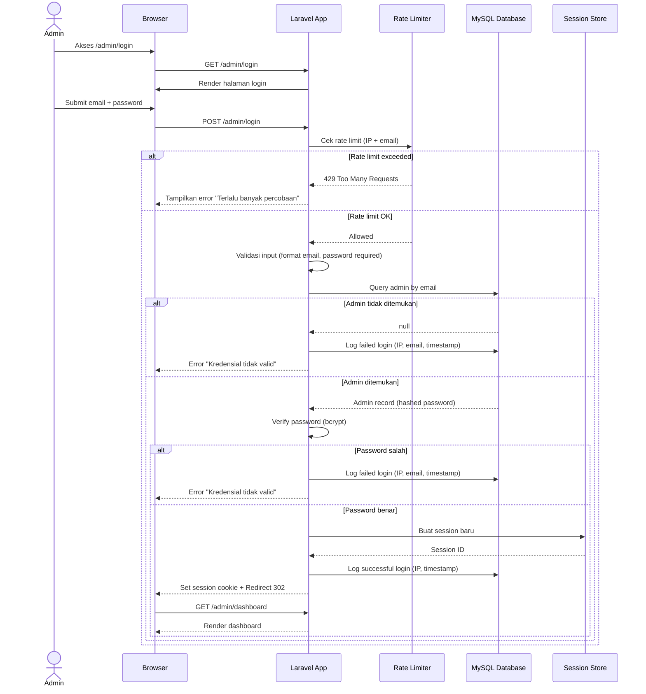

**Catatan Penting:**
- Rate limiting: maksimum 5 percobaan per menit per kombinasi IP + email
- Password di-hash menggunakan bcrypt (default Laravel)
- Pesan error bersifat generik ("Kredensial tidak valid") untuk mencegah user enumeration
- Setiap percobaan login dicatat di tabel `admin_login_logs`

---

## 2. Admin Dashboard Flow

**Deskripsi:**
Setelah login berhasil, admin diarahkan ke dashboard utama. Dashboard menampilkan ringkasan statistik yang di-query dari database. Data ditampilkan melalui widget yang menunjukkan total link, kunjungan hari ini, link aktif, dan aktivitas terbaru.

**Referensi:** FR-DASH-001, FR-DASH-002

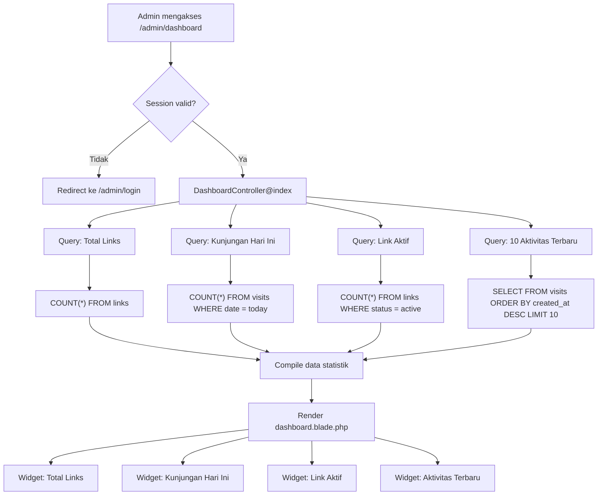

**Catatan Penting:**
- Semua query dashboard dilindungi oleh middleware `auth`
- Query statistik menggunakan query yang di-optimize dengan index yang tepat
- Aktivitas terbaru menampilkan: slug, URL tujuan, waktu akses, status kunjungan

---

## 3. Create Shortlink Flow

**Deskripsi:**
Admin membuat shortlink baru melalui form di panel admin. Proses ini mencakup validasi URL tujuan, pengecekan duplikasi slug, pembuatan slug (acak atau kustom), penandaan sumber website, dan penyimpanan ke database. Admin dapat mengatur tanggal kadaluarsa secara opsional.

**Referensi:** FR-LINK-001, FR-LINK-002, FR-LINK-003

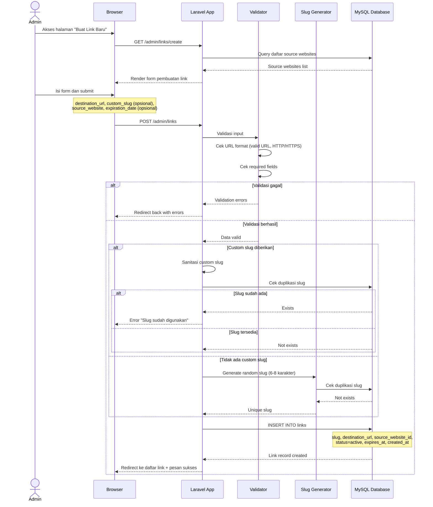

**Catatan Penting:**
- Slug acak menggunakan karakter alfanumerik (a-z, 0-9), panjang 6-8 karakter
- Slug kustom hanya boleh mengandung: huruf kecil, angka, dan tanda hubung (-)
- URL tujuan harus diawali dengan `http://` atau `https://`
- Jika `expires_at` diisi, link akan otomatis tidak dapat diakses setelah tanggal tersebut
- Source website digunakan untuk grouping dan filtering di analitik

---

## 4. Edit Shortlink Flow

**Deskripsi:**
Admin dapat mengedit shortlink yang sudah ada. Perubahan dicatat dalam audit log untuk keperluan tracking. Slug tidak dapat diubah setelah dibuat untuk menjaga konsistensi URL yang sudah tersebar.

**Referensi:** FR-LINK-004

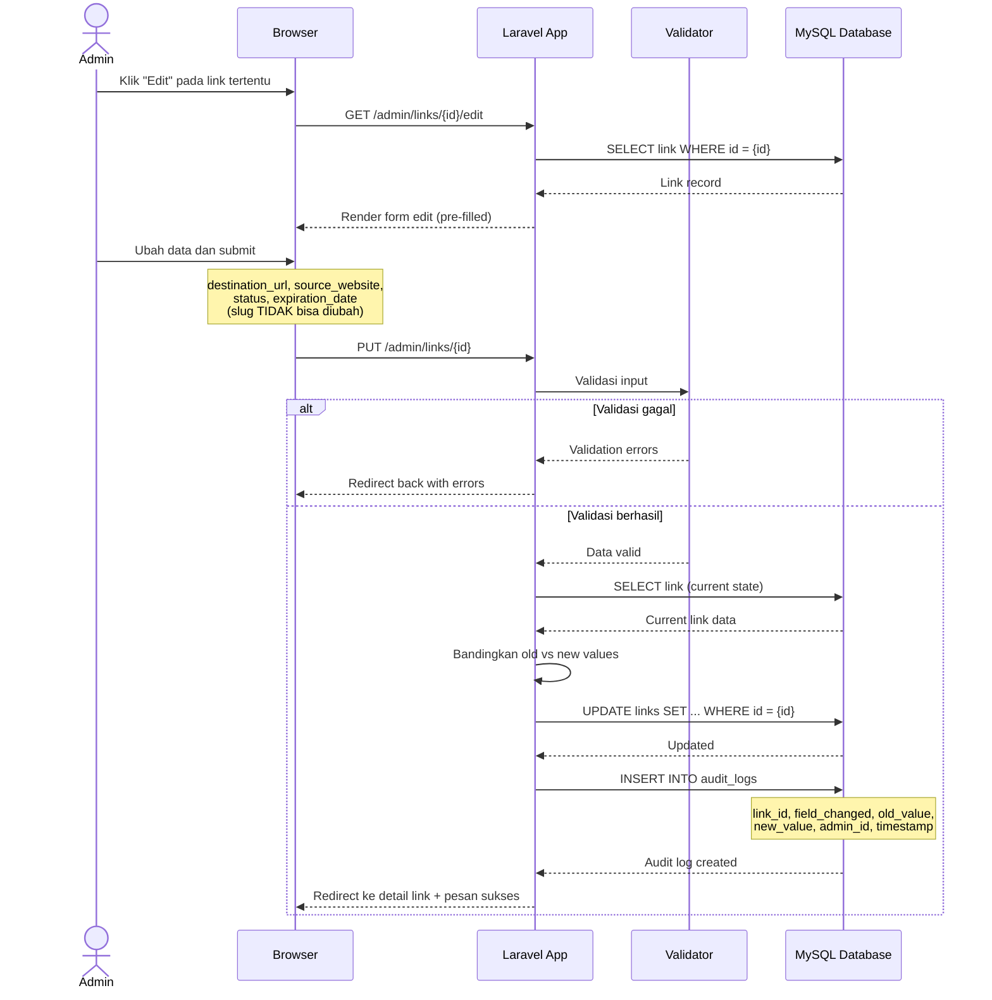

**Catatan Penting:**
- Slug bersifat immutable setelah dibuat — tidak dapat diubah
- Setiap perubahan field dicatat secara individual di `audit_logs`
- Admin dapat mengubah: `destination_url`, `status`, `source_website_id`, `expires_at`
- Perubahan status (active ↔ inactive) juga dicatat

---

## 5. Delete/Deactivate Link Flow

**Deskripsi:**
Admin dapat menonaktifkan atau menghapus link. Penghapusan menggunakan mekanisme soft delete untuk mempertahankan data analitik. Penonaktifan mengubah status link menjadi `inactive` sehingga link tidak dapat diakses pengunjung tetapi data tetap tersimpan.

**Referensi:** FR-LINK-005

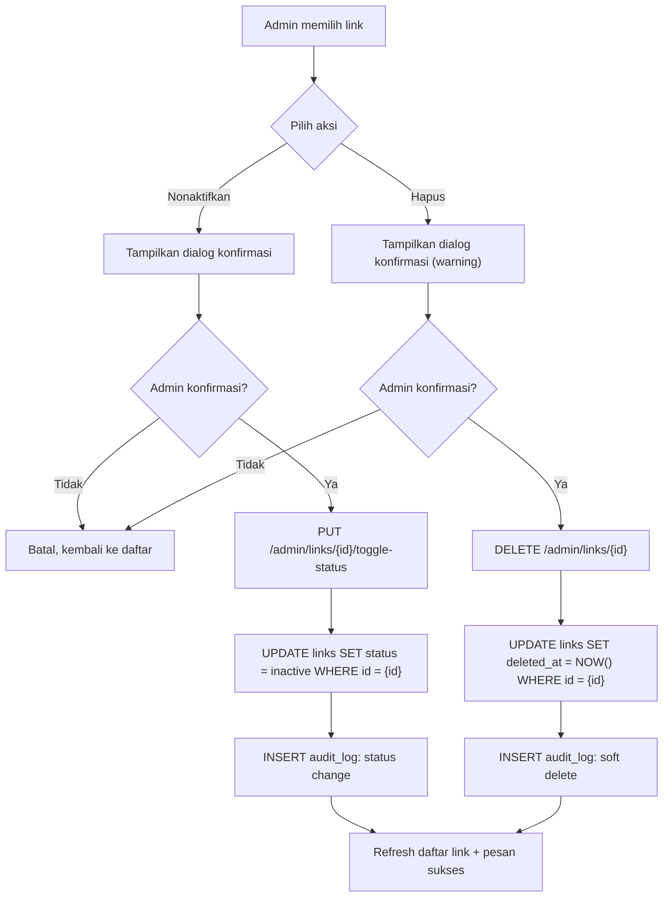

**Catatan Penting:**
- Soft delete: record tetap ada di database, hanya ditandai dengan `deleted_at`
- Link yang di-soft-delete tidak muncul di daftar default admin (perlu filter khusus)
- Link yang dinonaktifkan masih terlihat di daftar admin tetapi tidak dapat diakses pengunjung
- Dialog konfirmasi penghapusan menampilkan jumlah kunjungan yang akan terpengaruh
- Data analitik terkait link yang dihapus tetap dipertahankan

---

## 6. Visitor Access Flow (Critical)

**Deskripsi:**
Ini adalah alur paling kritis dalam sistem LokaTaut — perjalanan lengkap pengunjung dari mengklik link di website sumber hingga mencapai URL tujuan. Alur ini mencakup validasi link, pembuatan session token kriptografis, verifikasi Turnstile, countdown timer, validasi server-side, dan pencatatan analitik.

**Referensi:** FR-SAFE-001, FR-SAFE-002, FR-SAFE-003, FR-SAFE-004, NFR-SEC-001, NFR-SEC-002

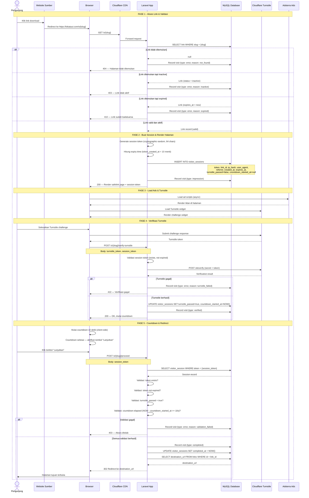

**Catatan Penting:**

1. **Session Token:** Dibuat menggunakan `Str::random(64)` atau `bin2hex(random_bytes(32))` — kriptografis, time-bound (10 menit)
2. **Validasi Server-Side:** Countdown diverifikasi di sisi server dengan membandingkan `countdown_started_at` + 10 detik terhadap waktu sekarang. Client-side countdown hanya untuk UX
3. **IP Hashing:** IP pengunjung di-hash menggunakan SHA-256 sebelum disimpan (privasi)
4. **Session Expiry:** Token session berlaku 10 menit dari pembuatan — mencegah reuse
5. **Sekali Pakai:** Setiap session token hanya bisa digunakan untuk satu kali redirect (`completed_at` diisi)
6. **Ad Loading:** Iklan Adsterra dimuat secara asinkron agar tidak memblokir halaman
7. **Referrer Tracking:** Referrer dari website sumber dicatat untuk analitik

---

## 7. Safelink Countdown Flow

**Deskripsi:**
Diagram state ini menunjukkan semua kemungkinan state yang dialami halaman safelink, mulai dari state awal hingga redirect berhasil. Termasuk state error yang mungkin terjadi di setiap tahap.

**Referensi:** FR-SAFE-002, FR-SAFE-003

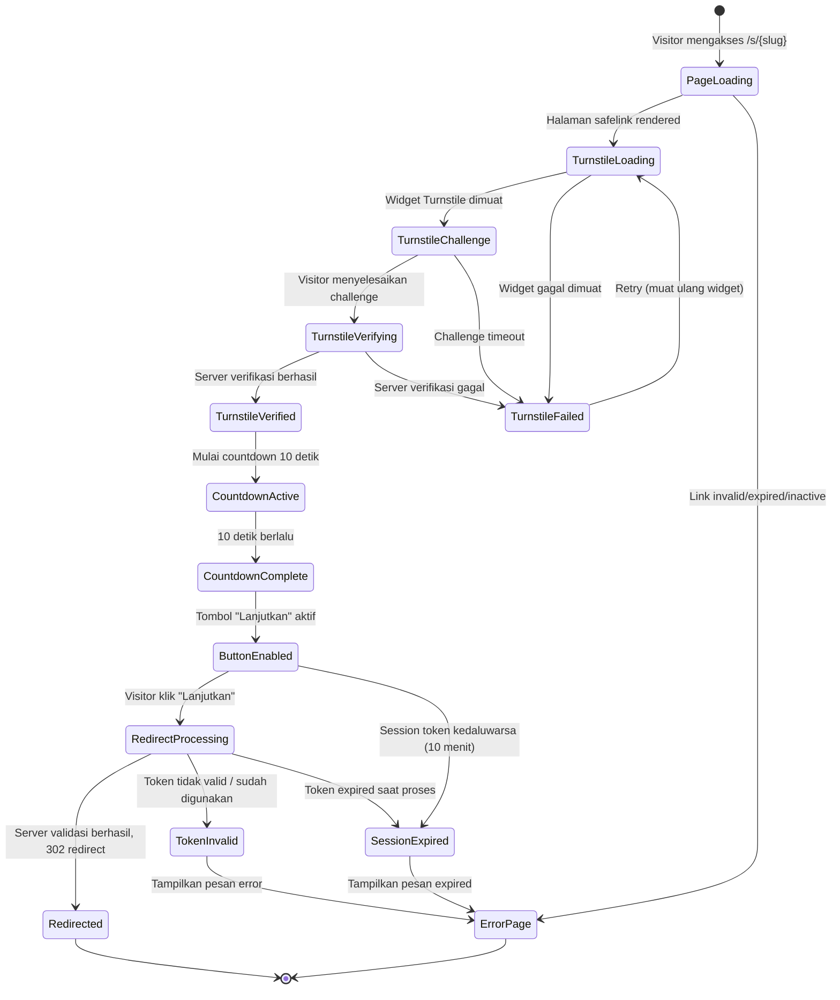

**Penjelasan State:**

| State | Deskripsi |
|---|---|
| **PageLoading** | Halaman safelink sedang dimuat oleh server |
| **TurnstileLoading** | Widget Cloudflare Turnstile sedang dimuat |
| **TurnstileChallenge** | Challenge Turnstile ditampilkan ke pengunjung |
| **TurnstileVerifying** | Token Turnstile sedang diverifikasi oleh server |
| **TurnstileVerified** | Verifikasi Turnstile berhasil |
| **TurnstileFailed** | Verifikasi Turnstile gagal (bisa retry) |
| **CountdownActive** | Countdown 10 detik sedang berjalan |
| **CountdownComplete** | Countdown telah selesai |
| **ButtonEnabled** | Tombol "Lanjutkan" aktif dan bisa diklik |
| **RedirectProcessing** | Server sedang memvalidasi request redirect |
| **Redirected** | Pengunjung berhasil di-redirect ke URL tujuan |
| **SessionExpired** | Session token sudah kedaluwarsa (> 10 menit) |
| **TokenInvalid** | Token tidak valid atau sudah pernah digunakan |
| **ErrorPage** | Halaman error ditampilkan |

---

## 8. Session Validation Flow

**Deskripsi:**
Alur validasi session yang dijalankan setiap kali pengunjung mengirim request `/proceed`. Setiap langkah validasi harus berhasil sebelum redirect diizinkan. Ini adalah pertahanan server-side terhadap bypass dan manipulasi.

**Referensi:** NFR-SEC-001, NFR-SEC-002, FR-SAFE-004

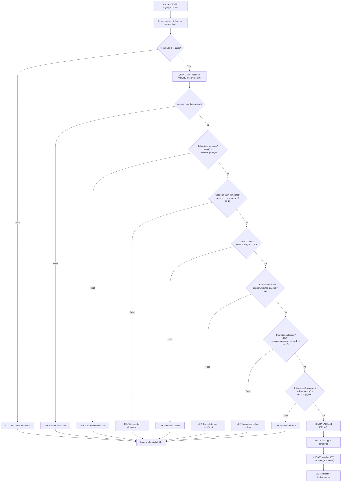

**Urutan Validasi (wajib berurutan):**

| # | Validasi | Gagal → HTTP Code | Alasan |
|---|---|---|---|
| 1 | Token ada di request | 403 | Mencegah request tanpa token |
| 2 | Session record ada di database | 403 | Mencegah token palsu |
| 3 | Token belum expired | 403 | Mencegah reuse setelah timeout |
| 4 | Token belum digunakan (completed_at IS NULL) | 403 | Mencegah double redirect |
| 5 | Link ID cocok dengan slug di URL | 403 | Mencegah token hijacking |
| 6 | Turnstile sudah passed | 422 | Memastikan verifikasi bot |
| 7 | Countdown sudah berlalu (>= 10 detik) | 422 | Memastikan ad impression |
| 8 | IP konsisten (opsional) | 403 | Mencegah token sharing |

> **Catatan:** Validasi IP (langkah 8) bersifat opsional karena bisa bermasalah dengan pengguna di belakang proxy atau mobile network yang sering berganti IP. Dapat dikonfigurasi melalui `config('lokataut.enforce_ip_consistency')`.

---

## 9. Final Redirect Flow

**Deskripsi:**
Detail proses redirect akhir setelah semua validasi berhasil. Proses ini mencakup pencatatan analitik yang lengkap dan pengambilan URL tujuan dari database sebelum mengirim HTTP 302 redirect.

**Referensi:** FR-SAFE-004, FR-ANAL-001

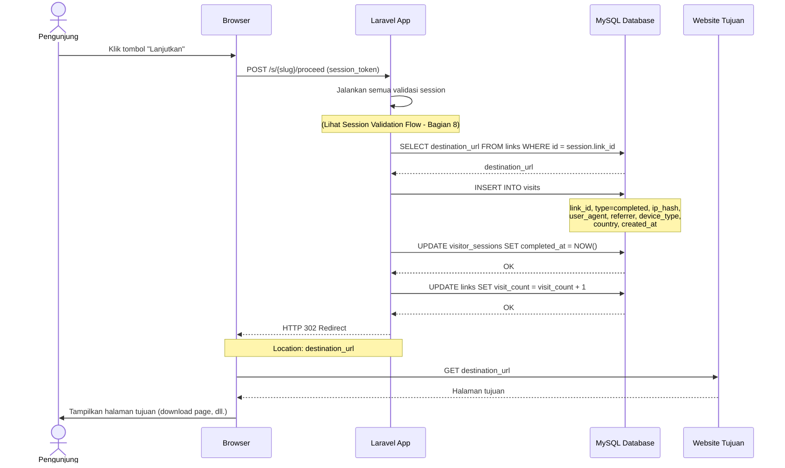

**Catatan Penting:**
- Redirect menggunakan HTTP 302 (temporary redirect) bukan 301 — agar browser tidak meng-cache redirect
- `visit_count` pada tabel `links` di-update secara atomik menggunakan `INCREMENT`
- Semua operasi database setelah validasi dibungkus dalam database transaction
- URL tujuan TIDAK pernah di-expose di halaman safelink (hanya tersimpan di server)

---

## 10. Link Expiration Flow

**Deskripsi:**
Alur penanganan link yang memiliki tanggal kadaluarsa. Pengecekan dilakukan secara real-time saat pengunjung mengakses link, serta melalui scheduled task untuk keperluan reporting.

**Referensi:** FR-LINK-003

```mermaid
flowchart TD
    subgraph RealTime ["Pengecekan Real-Time (Saat Akses)"]
        A["Visitor mengakses /s/{slug}"] --> B["Query link dari database"]
        B --> C{"Link memiliki expires_at?"}
        C -- Tidak --> D["Lanjutkan ke safelink flow"]
        C -- Ya --> E{"NOW() > expires_at?"}
        E -- Tidak --> D
        E -- Ya --> F["Record visit type: error, reason: expired"]
        F --> G["Tampilkan halaman expired"]
        G --> H["Informasi: Link sudah kadaluarsa"]
        H --> I["Tampilkan tanggal kadaluarsa"]
    end

    subgraph Scheduled ["Scheduled Task (Harian)"]
        J["Artisan schedule: daily at 00:00"] --> K["Query links yang baru expired"]
        K --> L["SELECT links WHERE expires_at < NOW()<br/>AND expires_at >= NOW() - 24h<br/>AND notified = false"]
        L --> M{"Ada link yang baru expired?"}
        M -- Tidak --> N["Selesai, tidak ada aksi"]
        M -- Ya --> O["Update status links ke expired"]
        O --> P["Catat di log: expired links summary"]
        P --> Q["UPDATE links SET notified = true"]
    end
```

**Catatan Penting:**
- Expired link TIDAK dihapus dari database — hanya ditandai dan ditolak aksesnya
- Pengecekan utama terjadi secara real-time saat pengunjung mengakses link
- Scheduled task bersifat tambahan untuk keperluan reporting dan maintenance
- Halaman expired menampilkan pesan informatif tanpa URL tujuan
- Admin dapat memperpanjang expiration date melalui panel admin (edit link)

---

## 11. Error Handling Flow

**Deskripsi:**
Semua skenario error yang mungkin terjadi dalam sistem LokaTaut dan halaman error yang sesuai. Setiap error di-mapping ke HTTP status code yang tepat dengan pesan yang informatif namun tidak membocorkan detail teknis.

**Referensi:** NFR-SEC-003

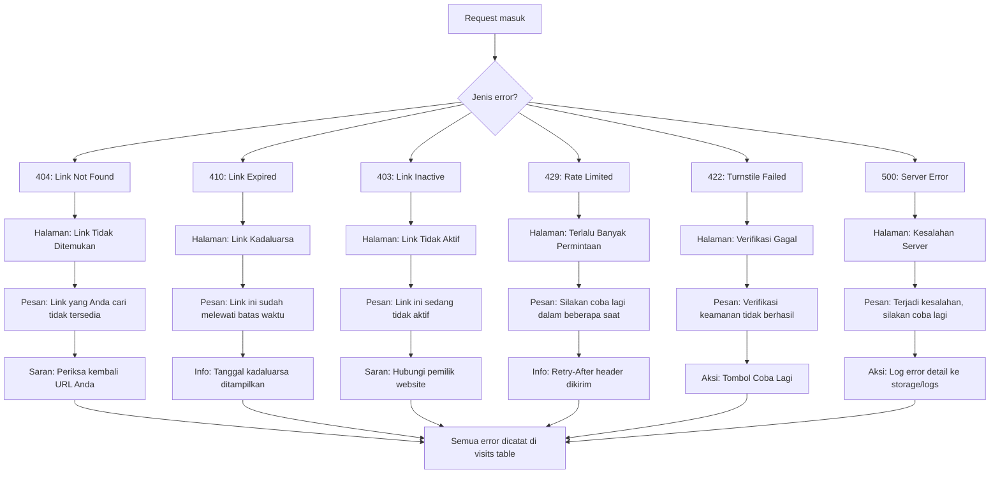

**Mapping Error ke HTTP Status:**

| HTTP Code | Kondisi | Halaman Error | Pesan (Bahasa Indonesia) | Catatan |
|---|---|---|---|---|
| **404** | Slug tidak ditemukan di database | `errors/404.blade.php` | "Link yang Anda cari tidak tersedia" | Tidak membocorkan apakah slug pernah ada |
| **410** | Link sudah melewati `expires_at` | `errors/410.blade.php` | "Link ini sudah melewati batas waktu" | Menampilkan tanggal kadaluarsa |
| **403** | Link berstatus `inactive` atau akses ditolak | `errors/403.blade.php` | "Link ini sedang tidak aktif" | Pesan generik, tidak membedakan alasan |
| **429** | Rate limit terlampaui | `errors/429.blade.php` | "Terlalu banyak permintaan, silakan tunggu" | Menyertakan `Retry-After` header |
| **422** | Turnstile gagal atau countdown belum selesai | `errors/422.blade.php` | "Verifikasi keamanan tidak berhasil" | Menyediakan tombol retry |
| **500** | Error internal server | `errors/500.blade.php` | "Terjadi kesalahan pada server" | Detail error hanya di log, bukan di halaman |

---

## 12. Analytics Recording Flow

**Deskripsi:**
Setiap event signifikan dalam perjalanan pengunjung dicatat untuk keperluan analitik. Data yang ditangkap mencakup informasi teknis dan kontekstual yang dibutuhkan untuk memahami perilaku pengunjung dan performa monetisasi.

**Referensi:** FR-ANAL-001, FR-ANAL-002

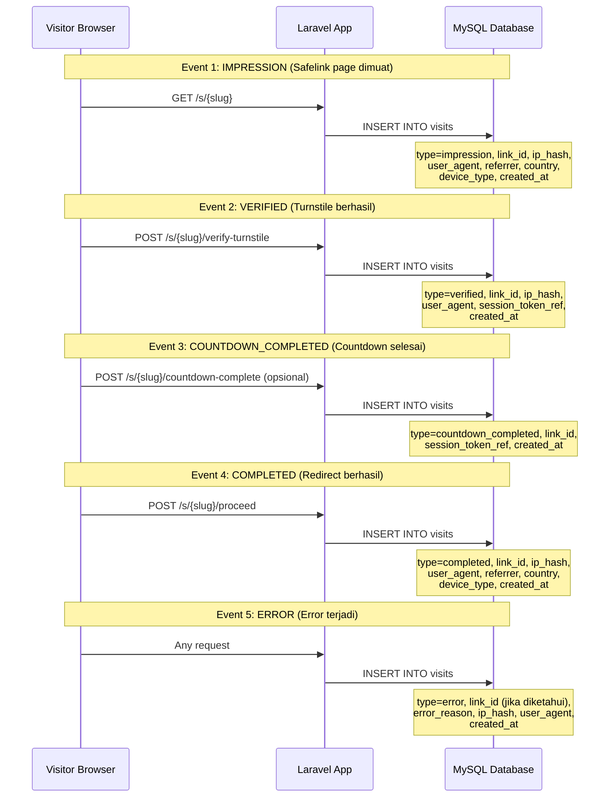

**Data yang Ditangkap per Event:**

| Field | Deskripsi | Contoh | Disimpan Sebagai |
|---|---|---|---|
| `type` | Jenis event | impression, verified, completed, error | ENUM string |
| `link_id` | ID link terkait | 42 | Foreign key |
| `ip_hash` | Hash SHA-256 dari IP pengunjung | `a3f2b8c9...` | VARCHAR(64) |
| `user_agent` | User agent browser | `Mozilla/5.0 ...` | TEXT |
| `referrer` | URL halaman sumber | `https://source-site.com/post` | VARCHAR(500) |
| `country` | Negara pengunjung (dari Cloudflare header) | `ID` | CHAR(2) |
| `device_type` | Jenis perangkat (parsed dari UA) | `mobile`, `desktop`, `tablet` | VARCHAR(20) |
| `error_reason` | Alasan error (jika type = error) | `not_found`, `expired`, `turnstile_failed` | VARCHAR(50) |
| `created_at` | Timestamp event | `2026-10-30 14:30:00` | TIMESTAMP |

**Funnel Analitik:**

```
Impression → Verified → Countdown Completed → Completed
   100%        ~85%          ~80%               ~70%
```

> **Catatan:** Persentase di atas adalah estimasi. Funnel ini memungkinkan admin mengidentifikasi di titik mana pengunjung paling banyak berhenti (drop-off analysis).

---

## 13. System Context Diagram

**Deskripsi:**
Diagram konteks menunjukkan semua aktor eksternal dan sistem yang berinteraksi dengan LokaTaut. Ini memberikan gambaran tingkat tinggi tentang batas sistem dan dependensi eksternal.

**Referensi:** DOC-03

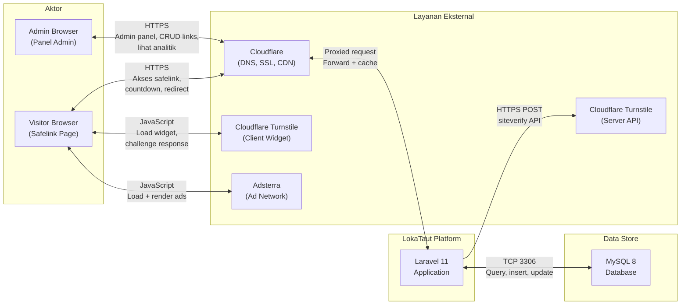

**Penjelasan Interaksi:**

| Koneksi | Protokol | Deskripsi |
|---|---|---|
| Admin ↔ Cloudflare | HTTPS | Semua request admin melalui Cloudflare proxy |
| Visitor ↔ Cloudflare | HTTPS | Semua request pengunjung melalui Cloudflare proxy |
| Cloudflare ↔ Laravel App | HTTP(S) | Cloudflare mem-forward request ke origin server |
| Laravel App ↔ MySQL | TCP 3306 | Koneksi database internal |
| Visitor ↔ Turnstile Client | JavaScript | Widget Turnstile dimuat dan dijalankan di browser |
| Laravel App → Turnstile Server API | HTTPS POST | Verifikasi token Turnstile di sisi server |
| Visitor ↔ Adsterra | JavaScript | Script iklan dimuat dan di-render di browser |

---

## 14. Data Flow Summary

**Deskripsi:**
Tabel ringkasan yang memetakan setiap alur utama dengan trigger, input, proses, output, data yang ditulis, dan pengecekan keamanan yang diterapkan.

### 14.1 Alur Admin

| Alur | Trigger | Input | Proses | Output | Data Written | Security Check |
|---|---|---|---|---|---|---|
| **Admin Login** | Admin submit form login | email, password | Rate limit check → Credential validation → Session creation | Dashboard redirect / Error message | `admin_login_logs`, session data | Rate limiting (5/menit), bcrypt verification, CSRF token |
| **Dashboard Load** | Admin akses /admin/dashboard | Session cookie | Query statistics → Compile widgets | Rendered dashboard page | - (read only) | Auth middleware, session validation |
| **Create Link** | Admin submit form buat link | destination_url, slug, source_website, expires_at | Validate → Generate/check slug → Insert | Success message + redirect | `links` record | Auth, CSRF, input validation, URL format check |
| **Edit Link** | Admin submit form edit | destination_url, source_website, status, expires_at | Validate → Compare changes → Update → Audit log | Success message + redirect | `links` update, `audit_logs` insert | Auth, CSRF, input validation, ownership check |
| **Delete Link** | Admin klik hapus + konfirmasi | link_id | Confirm → Soft delete → Audit log | Success message + refresh | `links.deleted_at`, `audit_logs` | Auth, CSRF, confirmation required |
| **Toggle Status** | Admin klik aktifkan/nonaktifkan | link_id | Confirm → Toggle status → Audit log | Success message + refresh | `links.status`, `audit_logs` | Auth, CSRF, confirmation required |

### 14.2 Alur Pengunjung

| Alur | Trigger | Input | Proses | Output | Data Written | Security Check |
|---|---|---|---|---|---|---|
| **Access Safelink** | Visitor klik link di website sumber | slug (URL path) | Validate slug → Check status → Check expiry → Generate session token → Render page | Safelink page / Error page | `visitor_sessions`, `visits` (impression) | Slug validation, status check, expiry check |
| **Verify Turnstile** | Turnstile challenge selesai | turnstile_token, session_token | Validate session → Verify Turnstile API → Update session | OK / Error | `visitor_sessions.turnstile_passed`, `visits` (verified) | Session token validation, Turnstile API verification |
| **Countdown Complete** | Timer client-side selesai | session_token | Validate session → Record event | OK | `visits` (countdown_completed) | Session token validation |
| **Proceed / Redirect** | Visitor klik "Lanjutkan" | session_token | Full session validation chain → Record analytics → Fetch destination → 302 redirect | Redirect to destination / Error | `visits` (completed), `visitor_sessions.completed_at`, `links.visit_count` | Token valid, not expired, not used, Turnstile passed, countdown elapsed, IP consistency |
| **Error Access** | Visitor akses link invalid | slug (URL path) | Identify error type → Show appropriate error page | Error page (404/410/403) | `visits` (error) | - |

### 14.3 Alur Sistem (Background)

| Alur | Trigger | Input | Proses | Output | Data Written | Security Check |
|---|---|---|---|---|---|---|
| **Expiration Check** | Scheduled task (harian) | - | Query newly expired links → Update status → Log | Log summary | `links.status`, log file | - (internal task) |
| **Session Cleanup** | Scheduled task (per jam) | - | DELETE visitor_sessions WHERE expires_at < NOW() - 24h | Cleaned records | `visitor_sessions` (delete) | - (internal task) |
| **Log Rotation** | Scheduled task (mingguan) | - | Rotate application logs | Archived log files | Log files | - (internal task) |

---

## Catatan Penutup

### Prioritas Implementasi Alur

| Prioritas | Alur | Alasan |
|---|---|---|
| **P0** | Visitor Access Flow (Bagian 6) | Core business flow — monetisasi bergantung pada alur ini |
| **P0** | Session Validation Flow (Bagian 8) | Keamanan inti — mencegah bypass |
| **P0** | Safelink Countdown Flow (Bagian 7) | Memastikan ad impression yang valid |
| **P1** | Admin Login Flow (Bagian 1) | Diperlukan untuk manajemen link |
| **P1** | Create Shortlink Flow (Bagian 3) | Diperlukan untuk membuat konten |
| **P1** | Analytics Recording Flow (Bagian 12) | Monitoring performa monetisasi |
| **P2** | Admin Dashboard Flow (Bagian 2) | UX admin, bisa sederhana dulu |
| **P2** | Edit/Delete Flow (Bagian 4, 5) | Manajemen link lanjutan |
| **P2** | Error Handling Flow (Bagian 11) | Penting tapi bisa iteratif |
| **P3** | Link Expiration Flow (Bagian 10) | Fitur opsional |

### Asumsi

1. **Shared hosting** tidak mendukung WebSocket — semua komunikasi menggunakan HTTP request standar
2. **Cloudflare** menangani SSL termination dan basic DDoS protection
3. **Country detection** menggunakan header `CF-IPCountry` dari Cloudflare (gratis)
4. **Device type detection** dilakukan melalui parsing User-Agent di server (menggunakan library seperti `jenssegers/agent`)
5. **Session cleanup** menggunakan Laravel Task Scheduling yang dikonfigurasi via cPanel cron job

### Rekomendasi

1. **Implementasikan Visitor Access Flow terlebih dahulu** — ini adalah alur paling kritis dan paling kompleks
2. **Gunakan database transaction** pada semua operasi write yang melibatkan multiple table
3. **Tambahkan monitoring** pada funnel analitik untuk mendeteksi anomali (misalnya: terlalu banyak error type dibanding impression)
4. **Pertimbangkan queue** untuk pencatatan analitik jika traffic tinggi (Laravel Queue dengan database driver cocok untuk shared hosting)

---

*Dokumen ini adalah referensi utama untuk implementasi alur sistem LokaTaut. Setiap perubahan pada alur harus didokumentasikan dan di-review sebelum implementasi.*
