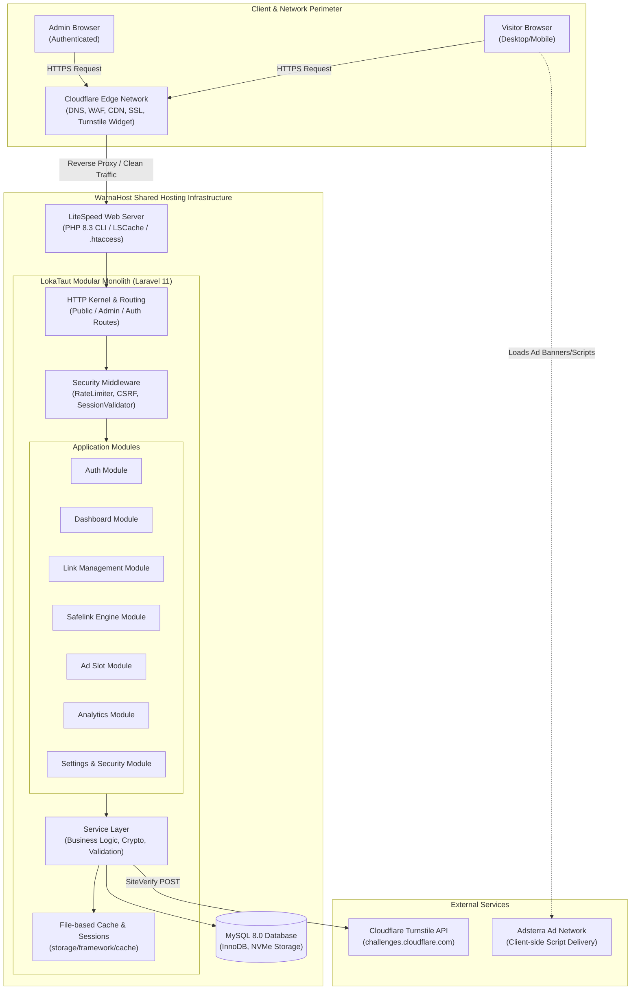
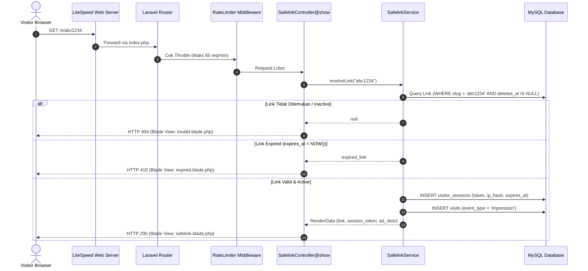
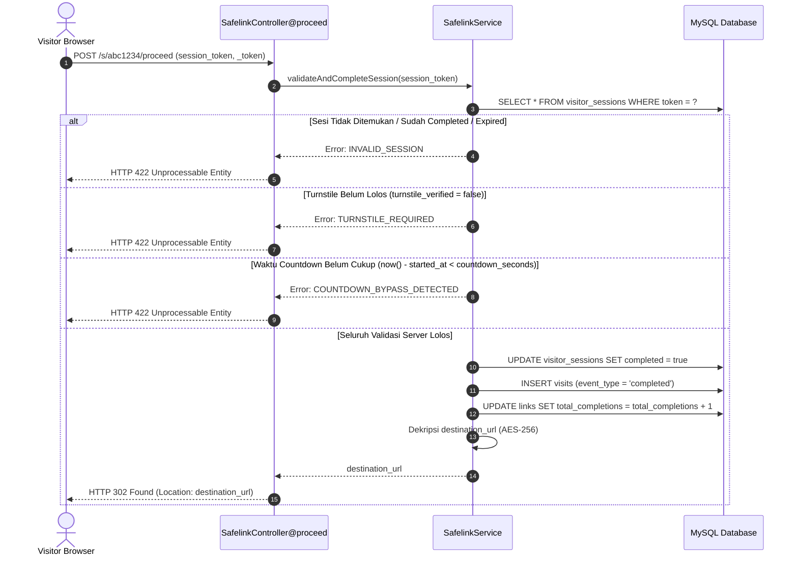

# Software Architecture Specification — LokaTaut

| Atribut | Nilai |
|---|---|
| **Document ID** | DOC-05 |
| **Versi** | 1.0 |
| **Status** | DRAFT |
| **Terakhir Diperbarui** | 2026-10-30 |
| **Penulis** | Senior Software Architect / Senior Laravel Architect |
| **Target Pembaca** | AI Coding Agent, DevOps Engineer, Technical Lead |
| **Tujuan** | Memberikan panduan arsitektur sistem modular monolith yang komprehensif, efisien, dan siap diimplementasikan pada lingkungan shared hosting. |

---

## Dependensi Dokumen

| Dokumen | Relasi |
|---|---|
| [DOC-01 — Product Vision & Strategy](../01-product/01-product-vision.md) | Visi produk dan batasan biaya operasional |
| [DOC-02 — Product Requirements Document](../01-product/02-prd.md) | Spesifikasi fungsional dan aturan bisnis (BR) |
| [DOC-03 — Scope & Requirements](../01-product/03-scope-requirements.md) | Batasan scope dan matriks ketertelusuran |
| [DOC-04 — User Flow & System Flow](../02-analysis/04-user-system-flow.md) | Alur interaksi sistem dan transisi state |
| [DOC-06 — Database Design](./06-database-design.md) | Skema data dan strategi indexing |
| [DOC-07 — Technical Specification](./07-technical-specification.md) | Standar teknis implementasi dan konvensi kode |
| [DOC-09 — Security & Privacy](../05-security-monetization/09-security-privacy.md) | Proteksi keamanan arsitektural |

---

## 1. Architecture Overview

LokaTaut dirancang menggunakan gaya arsitektur **Modular Monolith** berbasis framework **Laravel 11 (PHP 8.3+)**. Sistem ini dioptimalkan secara khusus untuk berjalan di atas infrastruktur **Shared Hosting WarnaHost Starter Unlimited (1 vCPU, 2 GB RAM, cPanel/LiteSpeed Web Server)** dengan integrasi **Cloudflare** di layer terdepan sebagai reverse proxy, DNS, CDN, dan WAF.

Arsitektur ini sengaja menghindari kompleksitas berlebih seperti microservices, containerization produksi (Docker/Kubernetes), message broker eksternal (RabbitMQ/Kafka), atau in-memory database berbayar (Redis) demi mempertahankan prinsip **Zero License Cost, Low Resource Footprint, dan High Maintainability**.



---

## 2. Architecture Principles

1. **Simplicity over Overengineering (KISS):** Menggunakan fitur bawaan Laravel dan standar PHP murni. Hindari dependensi package pihak ketiga jika solusi native mencukupi.
2. **Stateless Public Requests & Server-Side Integrity:** Halaman publik safelink dapat diakses cepat, namun keputusan kelayakan redirect sepenuhnya ditentukan oleh catatan sesi kriptografis di server database.
3. **Defense-in-Depth:** Keamanan diterapkan berlapis: Cloudflare di edge, HTTP security headers di web server, middleware throttling di aplikasi, dan sanitasi input/output di layer kode.
4. **Shared Hosting Resilience:** Beban database ditekan seminimal mungkin melalui agregasi analitik berkala, indexing yang presisi, dan pembersihan data usang via cron.
5. **Decoupled Frontend:** Tidak menggunakan framework JavaScript reaktif (React/Vue) pada halaman publik demi mempertahankan skor performa Google Core Web Vitals dan kecepatan rendering iklan.

---

## 3. Container & Component Decomposition

### 3.1 Component Diagram

```mermaid
flowchart TD
    subgraph PresentationLayer ["1. Presentation Layer (Blade Views & Assets)"]
        V_Pub["Public Views\n(safelink.blade.php, expired.blade.php)"]
        V_Adm["Admin Views\n(dashboard, links, ads, analytics, settings)"]
        V_Comp["Blade Components\n(ad-slot, countdown, stats-card, table)"]
        Assets["Static Assets\n(Vanilla JS, Native CSS)"]
    end

    subgraph HTTPLayer ["2. HTTP / Controller Layer"]
        C_Safe["Public\\SafelinkController"]
        C_Auth["Auth\\LoginController"]
        C_Dash["Admin\\DashboardController"]
        C_Link["Admin\\LinkController"]
        C_Ads["Admin\\AdSlotController"]
        C_Anal["Admin\\AnalyticsController"]
        C_Set["Admin\\SettingsController"]
    end

    subgraph ServiceLayer ["3. Business Logic / Service Layer"]
        S_Safe["SafelinkService"]
        S_Tok["TokenService (Crypto Random)"]
        S_Turn["TurnstileService (HTTP Client)"]
        S_Slug["SlugGeneratorService"]
        S_Anal["AnalyticsService & VisitRecorder"]
        S_Ad["AdSlotService"]
        S_Set["SettingsService (Cached)"]
    end

    subgraph DataAccessLayer ["4. Data Access Layer (Eloquent Models & Queries)"]
        M_Admin["Admin Model"]
        M_Link["Link Model"]
        M_Sess["VisitorSession Model"]
        M_Visit["Visit Model"]
        M_Daily["DailyStat Model"]
        M_Ad["AdSlot Model"]
        M_Set["Setting Model"]
        M_Sec["SecurityLog Model"]
    end

    subgraph StorageLayer ["5. Storage & Persistence"]
        MySQL_DB[("MySQL 8.0 Engine\n(InnoDB Table Engine)")]
        LocalDisk[("Local Storage\n(storage/app, storage/logs)")]
    end

    PresentationLayer --> HTTPLayer
    HTTPLayer --> ServiceLayer
    ServiceLayer --> DataAccessLayer
    DataAccessLayer --> StorageLayer
```



---

## 4. Application Modules & Responsibilities

### 4.1 Authentication Module (`App\Http\Controllers\Auth`)
- **Tanggung Jawab:** Mengautentikasi satu-satunya administrator sistem.
- **Karakteristik:** Menggunakan session bawaan Laravel dengan proteksi *RateLimiter* (maks 5 login gagal per menit). Mengunci regenerasi ID sesi pada saat login/logout untuk mencegah *session fixation*.

### 4.2 Link Management Module (`App\Http\Controllers\Admin\LinkController`)
- **Tanggung Jawab:** Menyediakan operasi CRUD untuk tautan, membuat slug unik (acak atau kustom), mengenkripsi URL tujuan (`destination_url`), dan mengelola status aktif/kadaluwarsa.
- **Service Pendukung:** `SlugGeneratorService` (menghasilkan string alfanumerik acak 6–8 karakter dan memverifikasi keunikan di basis data).

### 4.3 Safelink Engine Module (`App\Http\Controllers\Public\SafelinkController`)
- **Tanggung Jawab:** Inti fungsionalitas publik LokaTaut.
- **Sub-komponen:**
  1. **Session Initializer:** Membuat token sesi kriptografis 64 karakter heksadesimal (`bin2hex(random_bytes(32))`) pada tabel `visitor_sessions`.
  2. **Turnstile Verifier:** Memanggil API Cloudflare SiteVerify menggunakan Laravel HTTP Client untuk memvalidasi token bot.
  3. **Countdown Validator:** Memastikan bahwa timestamp eksekusi redirect berselisih minimal `countdown_seconds` sejak verifikasi Turnstile disetujui.
  4. **Redirect Dispatcher:** Mengirimkan respon HTTP 302 Foundation Redirect ke destination URL asli.

### 4.4 Advertising Module (`App\Http\Controllers\Admin\AdSlotController`)
- **Tanggung Jawab:** Mengelola konfigurasi slot iklan (Header, Sidebar, Above Timer, Below Timer, Footer).
- **Mekanisme Render:** Kode iklan disimpan dalam bentuk teks mentah pada database dan disajikan langsung ke Blade component `<x-ad-slot position="..." />`. Iklan dieksekusi secara asinkron di browser pengunjung.

### 4.5 Analytics & Traffic Module (`App\Services\AnalyticsService`)
- **Tanggung Jawab:** Pencatatan analitik dengan overhead seminimal mungkin.
- **Event yang Dicatat:**
  - `impression`: Saat halaman safelink pertama kali dimuat.
  - `verified`: Saat pengunjung lolos verifikasi Turnstile.
  - `completed`: Saat pengunjung sukses diarahkan ke URL tujuan final.
- **Strategi Agregasi:** Data mentah pada tabel `visits` diagregasikan setiap malam melalui command `lokataut:aggregate-stats` ke tabel `daily_stats` untuk mempercepat query dashboard dari rentang waktu mingguan/bulanan.

### 4.6 Settings & Security Module (`App\Services\SettingsService`)
- **Tanggung Jawab:** Mengelola nilai konfigurasi global (nama situs, default countdown, Turnstile keys) menggunakan tabel key-value `settings`. Data di-cache dalam memori file untuk menghindari query berulang ke database pada setiap request publik.

---

## 5. Request Lifecycle & Execution Paths

### 5.1 Public Safelink Request Lifecycle (GET `/s/{slug}`)



### 5.2 Redirect Finalization Lifecycle (POST `/s/{slug}/proceed`)



---

## 6. Frontend Architecture

### 6.1 Public Safelink Frontend
- **Zero Framework Dependency:** Murni menggunakan Semantic HTML5, Native CSS3 (CSS Variables, Flexbox, CSS Grid), dan Vanilla JavaScript ES6+.
- **Asset Size Budget:**
  - CSS Total < 20 KB (uncompressed).
  - JS Total < 15 KB (uncompressed, di luar script Turnstile & Adsterra).
- **Rendering Isolation:** Slot iklan dibungkus dalam container dengan dimensi tetap (*fixed aspect ratio*) untuk mencegah pergeseran tata letak (*Cumulative Layout Shift / CLS*).

### 6.2 Administrator Dashboard Frontend
- Menggunakan layout Blade berbasis komponen (`<x-admin.sidebar>`, `<x-admin.header>`, `<x-admin.stats-card>`).
- Interaktivitas ringan (modal konfirmasi, dropdown toggle, salin tautan ke clipboard) dikelola menggunakan script Vanilla JS modular tanpa memerlukan compile step (Vite/Webpack) di lingkungan produksi.

---

## 7. Caching & Persistence Strategy (Shared Hosting Optimized)

Mengingat ketiadaan daemon in-memory seperti Redis pada Shared Hosting WarnaHost Starter, strategi caching dirancang sebagai berikut:

| Kategori Data | Media Cache | Durasi TTL | Mekanisme Invalidasi |
|---|---|---|---|
| **System Settings** | File Cache (`storage/framework/cache`) | 24 Jam (1440 min) | Dihapus otomatis saat Admin menyimpan pengaturan baru di dashboard. |
| **Active Ad Slots** | File Cache (`storage/framework/cache`) | 1 Jam (60 min) | Dihapus saat Admin mengubah, mengaktifkan, atau menonaktifkan slot iklan. |
| **Aggregated Daily Stats** | Database Cache Table (`daily_stats`) | Permanen | Diperbarui secara incremental via Cron Job tengah malam. |
| **Static Assets (CSS/JS)** | Cloudflare CDN & Browser Cache | 30 Hari | Penggunaan cache-busting versioning (misal: `safelink.css?v=1.0.1`). |
| **Halaman Safelink** | **NO CACHE (DYNAMIC)** | 0 Detik | Wajib dinamis karena memerlukan token sesi unik dan validasi CSRF/Turnstile pada setiap pengunjung. |

---

## 8. Logging, Monitoring & Background Processing

### 8.1 Logging Architecture
- **Application Logs:** Menggunakan channel `daily` (`storage/logs/laravel-YYYY-MM-DD.log`) dengan retensi rotasi 14 hari. Level produksi diatur ke `warning` dan `error`.
- **Security Audit Logs:** Disimpan langsung ke tabel `security_logs` pada basis data untuk peristiwa berisiko tinggi (login gagal berulang, bypass token, upaya manipulasi URL).

### 8.2 Background Task Execution via cPanel Cron
Karena shared hosting tidak mengizinkan supervisor daemon persisten, seluruh proses latar belakang dikelola menggunakan satu entri Cron Job cPanel yang memicu Laravel Scheduler:

```bash
* * * * * /opt/alt/php83/usr/bin/php -d register_argc_argv=On /home/username/lokataut/artisan schedule:run >> /dev/null 2>&1
```

Tugas-tugas yang dijalankan terjadwal di `routes/console.php`:
1. `lokataut:prune-sessions`: Dijalankan setiap jam untuk menghapus sesi pengunjung yang kadaluwarsa > 24 jam.
2. `lokataut:aggregate-stats`: Dijalankan setiap hari pukul 00:05 untuk mengagregasi data kunjungan hari sebelumnya.
3. `lokataut:prune-visit-logs`: Dijalankan setiap minggu untuk membersihkan data mentah `visits` yang lebih tua dari 90 hari.

---

## 9. Shared Hosting Bottlenecks & Architectural Mitigations

| Keterbatasan Shared Hosting | Potensi Risiko | Mitigasi Arsitektur LokaTaut |
|---|---|---|
| **1 vCPU / 2 GB RAM Limit** | *Out of Memory* saat traffic spike 50.000/hari | - Mengoptimalkan query database dengan index komposit.<br>- Tidak memuat relasi Eloquent yang tidak perlu (hindari N+1 query).<br>- Menyerahkan kompresi gzip/brotli dan proteksi DDOS ke Cloudflare. |
| **Batas Waktu Eksekusi PHP (Max Execution 30-60s)** | Timeout saat agregasi data besar | Gunakan batching (`chunk(500)`) pada artisan command agregasi dan pruning data. |
| **Ketiadaan Redis / Memcached** | File I/O tinggi untuk sesi default | Pisahkan sesi pengunjung ke database tabel ringan dengan index memori, gunakan session file hanya untuk admin tunggal. |
| **Ketidakpastian Akses SSH Eksternal** | Kendala deployment manual | Sediakan struktur direktori yang ramah cPanel File Manager dan script migrasi artisan via web controller darurat jika CLI dibatasi. |

---

## 10. Architectural Decision Summary

Arsitektur LokaTaut berhasil menyeimbangkan **keamanan tinggi**, **performa responsif**, dan **biaya operasional minimal**. Dengan memposisikan Cloudflare di edge network dan menjaga kode aplikasi tetap modular, platform ini siap menangani lonjakan 50.000 kunjungan harian tanpa melampaui alokasi sumber daya shared hosting WarnaHost Starter.

