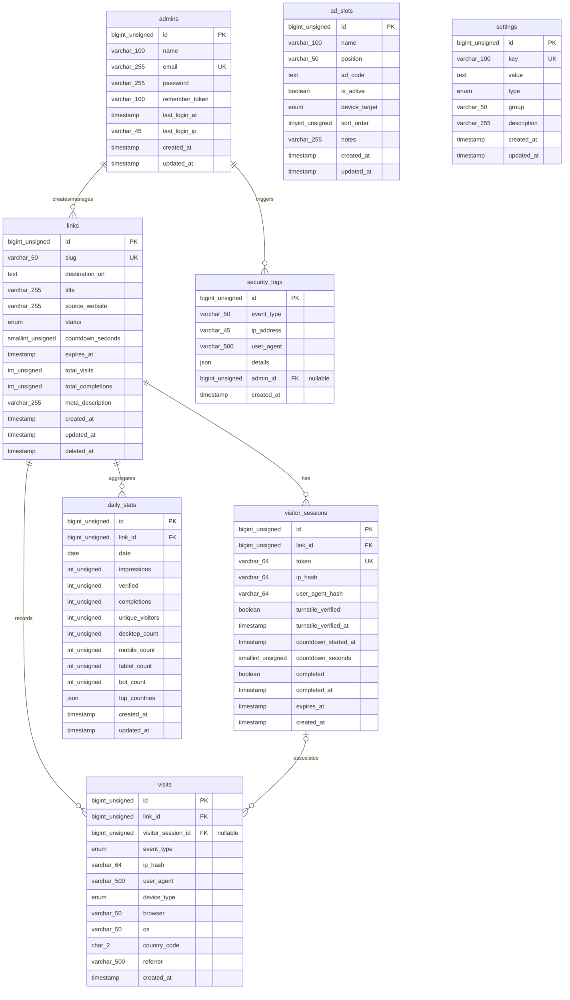

# Database Design & Data Dictionary — LokaTaut

| Atribut | Nilai |
|---|---|
| **Document ID** | DOC-06 |
| **Versi** | 1.0 |
| **Status** | DRAFT |
| **Terakhir Diperbarui** | 2026-10-30 |
| **Penulis** | Senior Database Architect |
| **Target Pembaca** | AI Coding Agent, Backend Engineer, DBA |
| **Tujuan** | Merancang skema basis data MySQL 8 yang teroptimasi, efisien dalam penggunaan ruang disk, memiliki performa indexing tinggi, dan mematuhi batasan shared hosting. |

---

## Dependensi Dokumen

| Dokumen | Relasi |
|---|---|
| [DOC-02 — Product Requirements Document](../01-product/02-prd.md) | Kebutuhan data fitur (FR-*) dan aturan bisnis (BR-*) |
| [DOC-03 — Scope & Requirements](../01-product/03-scope-requirements.md) | Batasan data retention dan scope MVP |
| [DOC-05 — Software Architecture](./05-system-architecture.md) | Pola akses data dan layer persistensi |
| [DOC-07 — Technical Specification](./07-technical-specification.md) | Konvensi penamaan model dan casting data Laravel |
| [DOC-09 — Security & Privacy](../05-security-monetization/09-security-privacy.md) | Enkripsi kolom sensitif dan hashing IP |

---

## 1. Entity Relationship Diagram (ERD)



---

## 2. Definisi Skema Tabel (Data Dictionary)

### 2.1 Tabel `admins`
Menyimpan akun administrator tunggal pemilik platform.

| Kolom | Tipe Data | Nullable | Default | Keterangan & Aturan |
|---|---|---|---|---|
| `id` | BIGINT UNSIGNED | NO | AUTO_INCREMENT | Primary Key |
| `name` | VARCHAR(100) | NO | - | Nama lengkap / tampilan admin |
| `email` | VARCHAR(255) | NO | - | Alamat email login (Unique Index) |
| `password` | VARCHAR(255) | NO | - | Bcrypt / Argon2id password hash |
| `remember_token` | VARCHAR(100) | YES | NULL | Token Laravel "Remember Me" |
| `last_login_at` | TIMESTAMP | YES | NULL | Waktu terakhir login sukses |
| `last_login_ip` | VARCHAR(45) | YES | NULL | Alamat IP login terakhir (IPv4/IPv6) |
| `created_at` | TIMESTAMP | YES | NULL | Timestamp pembuatan record |
| `updated_at` | TIMESTAMP | YES | NULL | Timestamp pembaruan record |

- **Primary Key:** `PRIMARY KEY (id)`
- **Unique Indexes:** `UNIQUE KEY admins_email_unique (email)`

---

### 2.2 Tabel `links`
Menyimpan data tautan unduhan, konfigurasi safelink, dan agregat counter sederhana.

| Kolom | Tipe Data | Nullable | Default | Keterangan & Aturan |
|---|---|---|---|---|
| `id` | BIGINT UNSIGNED | NO | AUTO_INCREMENT | Primary Key |
| `slug` | VARCHAR(50) | NO | - | String pengenal URL unik (`/s/{slug}`) |
| `destination_url` | TEXT | NO | - | URL tujuan download (Terenkripsi AES-256) |
| `title` | VARCHAR(255) | YES | NULL | Judul / label link untuk kemudahan admin |
| `source_website` | VARCHAR(255) | YES | NULL | Domain web asal (misal: `apkgames.id`) |
| `status` | ENUM('active','inactive') | NO | 'active' | Status ketersediaan tautan |
| `countdown_seconds` | SMALLINT UNSIGNED | NO | 10 | Durasi hitung mundur halaman safelink |
| `expires_at` | TIMESTAMP | YES | NULL | Tanggal kadaluwarsa tautan |
| `total_visits` | INT UNSIGNED | NO | 0 | Counter denormalisasi: Total impressions |
| `total_completions` | INT UNSIGNED | NO | 0 | Counter denormalisasi: Total redirect sukses |
| `meta_description` | VARCHAR(255) | YES | NULL | Deskripsi ringkas untuk meta tag HTML |
| `created_at` | TIMESTAMP | YES | NULL | Timestamp pembuatan link |
| `updated_at` | TIMESTAMP | YES | NULL | Timestamp perubahan terakhir |
| `deleted_at` | TIMESTAMP | YES | NULL | Soft delete flag |

- **Primary Key:** `PRIMARY KEY (id)`
- **Unique Indexes:** `UNIQUE KEY links_slug_unique (slug)`
- **Composite & Normal Indexes:**
  - `KEY links_status_deleted_at_index (status, deleted_at)`: Mempercepat lookup filter aktif.
  - `KEY links_source_website_index (source_website)`: Filter agregasi per website sumber.
  - `KEY links_expires_at_index (expires_at)`: Pengecekan status kedaluwarsa.
  - `KEY links_created_at_index (created_at)`: Pengurutan link terbaru di dashboard.

---

### 2.3 Tabel `visitor_sessions`
Mencatat sesi aktif pengunjung di halaman safelink untuk validasi keamanan server-side.

| Kolom | Tipe Data | Nullable | Default | Keterangan & Aturan |
|---|---|---|---|---|
| `id` | BIGINT UNSIGNED | NO | AUTO_INCREMENT | Primary Key |
| `link_id` | BIGINT UNSIGNED | NO | - | Foreign Key ke `links.id` (ON DELETE CASCADE) |
| `token` | VARCHAR(64) | NO | - | Kriptografis token acak (SHA-256 / Hex) |
| `ip_hash` | VARCHAR(64) | NO | - | Hash SHA-256 dari IP pengunjung untuk session binding |
| `user_agent_hash` | VARCHAR(64) | YES | NULL | Hash SHA-256 dari header User-Agent |
| `turnstile_verified` | BOOLEAN | NO | FALSE | Status lolos verifikasi Cloudflare Turnstile |
| `turnstile_verified_at`| TIMESTAMP | YES | NULL | Timestamp verifikasi bot disetujui |
| `countdown_started_at` | TIMESTAMP | YES | NULL | Timestamp saat hitung mundur resmi dimulai |
| `countdown_seconds` | SMALLINT UNSIGNED | NO | 10 | Durasi countdown yang wajib dipenuhi |
| `completed` | BOOLEAN | NO | FALSE | Flag apakah sesi sudah pernah digunakan redirect |
| `completed_at` | TIMESTAMP | YES | NULL | Timestamp saat redirect 302 dieksekusi |
| `expires_at` | TIMESTAMP | NO | - | Batas waktu validitas sesi (created_at + 30m) |
| `created_at` | TIMESTAMP | YES | NULL | Waktu inisiasi sesi |

- **Primary Key:** `PRIMARY KEY (id)`
- **Unique Indexes:** `UNIQUE KEY visitor_sessions_token_unique (token)`
- **Indexes:**
  - `KEY visitor_sessions_link_id_created_at_index (link_id, created_at)`
  - `KEY visitor_sessions_expires_at_completed_index (expires_at, completed)`: Digunakan oleh artisan prune command untuk pembersihan massal.

---

### 2.4 Tabel `visits` (Event Logs Kunjungan)
Mencatat setiap event interaksi pengunjung untuk keperluan analitik. **Tabel dengan volume tertinggi.**

| Kolom | Tipe Data | Nullable | Default | Keterangan & Aturan |
|---|---|---|---|---|
| `id` | BIGINT UNSIGNED | NO | AUTO_INCREMENT | Primary Key |
| `link_id` | BIGINT UNSIGNED | NO | - | Foreign Key ke `links.id` |
| `visitor_session_id` | BIGINT UNSIGNED | YES | NULL | Foreign Key ke `visitor_sessions.id` |
| `event_type` | ENUM | NO | - | `impression`, `verified`, `completed`, `error` |
| `ip_hash` | VARCHAR(64) | NO | - | Hash SHA-256 IP pengunjung |
| `user_agent` | VARCHAR(500) | YES | NULL | Raw user agent untuk parsing browser & OS |
| `device_type` | ENUM | NO | 'unknown' | `desktop`, `mobile`, `tablet`, `bot`, `unknown` |
| `browser` | VARCHAR(50) | YES | NULL | Nama browser (Chrome, Firefox, Safari, dll.) |
| `os` | VARCHAR(50) | YES | NULL | Sistem operasi (Windows, Android, iOS, dll.) |
| `country_code` | CHAR(2) | YES | NULL | Kode ISO-3166-1 alpha-2 (dari header Cloudflare) |
| `referrer` | VARCHAR(500) | YES | NULL | URL perujuk (truncated) |
| `created_at` | TIMESTAMP | YES | NULL | Timestamp kejadian |

- **Primary Key:** `PRIMARY KEY (id)`
- **Composite Indexes:**
  - `KEY visits_link_event_created_index (link_id, event_type, created_at)`: Kueri filter performa per link.
  - `KEY visits_created_at_index (created_at)`: Kueri agregasi cron dan pruning.
  - `KEY visits_country_code_index (country_code)`
  - `KEY visits_device_type_index (device_type)`

---

### 2.5 Tabel `daily_stats` (Agregat Analitik Harian)
Tabel ringkasan performa link per hari untuk menyajikan grafik dashboard instan tanpa scan tabel `visits`.

| Kolom | Tipe Data | Nullable | Default | Keterangan & Aturan |
|---|---|---|---|---|
| `id` | BIGINT UNSIGNED | NO | AUTO_INCREMENT | Primary Key |
| `link_id` | BIGINT UNSIGNED | NO | - | Foreign Key ke `links.id` |
| `date` | DATE | NO | - | Tanggal rekap data (YYYY-MM-DD) |
| `impressions` | INT UNSIGNED | NO | 0 | Total tayangan halaman safelink |
| `verified` | INT UNSIGNED | NO | 0 | Total lolos Turnstile |
| `completions` | INT UNSIGNED | NO | 0 | Total redirect sukses ke destination URL |
| `unique_visitors` | INT UNSIGNED | NO | 0 | Jumlah `ip_hash` unik |
| `desktop_count` | INT UNSIGNED | NO | 0 | Jumlah kunjungan dari desktop |
| `mobile_count` | INT UNSIGNED | NO | 0 | Jumlah kunjungan dari smartphone |
| `tablet_count` | INT UNSIGNED | NO | 0 | Jumlah kunjungan dari tablet |
| `bot_count` | INT UNSIGNED | NO | 0 | Jumlah kunjungan terdeteksi bot |
| `top_countries` | JSON | YES | NULL | Rekap 10 negara teratas, format: `{"ID": 450, "US": 50}` |
| `created_at` | TIMESTAMP | YES | NULL | Timestamp pembuatan record |
| `updated_at` | TIMESTAMP | YES | NULL | Timestamp perubahan record |

- **Primary Key:** `PRIMARY KEY (id)`
- **Unique Indexes:** `UNIQUE KEY daily_stats_link_date_unique (link_id, date)`
- **Indexes:** `KEY daily_stats_date_index (date)`

---

### 2.6 Tabel `ad_slots`
Mengelola slot penempatan kode iklan dari ad network.

| Kolom | Tipe Data | Nullable | Default | Keterangan & Aturan |
|---|---|---|---|---|
| `id` | BIGINT UNSIGNED | NO | AUTO_INCREMENT | Primary Key |
| `name` | VARCHAR(100) | NO | - | Nama pengenal slot (misal: "Banner Atas Timer") |
| `position` | VARCHAR(50) | NO | - | Posisi: `header`, `above_timer`, `below_timer`, `footer` |
| `ad_code` | TEXT | YES | NULL | Kode script HTML/JS mentah dari ad network |
| `is_active` | BOOLEAN | NO | TRUE | Status aktif slot |
| `device_target` | ENUM | NO | 'all' | `all`, `desktop`, `mobile` |
| `sort_order` | TINYINT UNSIGNED | NO | 0 | Urutan render jika dalam 1 posisi ada > 1 iklan |
| `notes` | VARCHAR(255) | YES | NULL | Catatan admin mengenai slot iklan |
| `created_at` | TIMESTAMP | YES | NULL | Timestamp pembuatan |
| `updated_at` | TIMESTAMP | YES | NULL | Timestamp perubahan |

- **Primary Key:** `PRIMARY KEY (id)`
- **Indexes:** `KEY ad_slots_pos_active_dev_index (position, is_active, device_target)`

---

### 2.7 Tabel `settings`
Menyimpan parameter konfigurasi aplikasi dalam pola key-value.

| Kolom | Tipe Data | Nullable | Default | Keterangan & Aturan |
|---|---|---|---|---|
| `id` | BIGINT UNSIGNED | NO | AUTO_INCREMENT | Primary Key |
| `key` | VARCHAR(100) | NO | - | Kunci konfigurasi (Unique) |
| `value` | TEXT | YES | NULL | Nilai konfigurasi |
| `type` | ENUM | NO | 'string' | Casting type: `string`, `integer`, `boolean`, `json` |
| `group` | VARCHAR(50) | NO | 'general' | Kategori: `general`, `turnstile`, `security`, `ads` |
| `description` | VARCHAR(255) | YES | NULL | Keterangan penjelasan pengaturan |
| `created_at` | TIMESTAMP | YES | NULL | Timestamp pembuatan |
| `updated_at` | TIMESTAMP | YES | NULL | Timestamp pembaruan |

- **Primary Key:** `PRIMARY KEY (id)`
- **Unique Indexes:** `UNIQUE KEY settings_key_unique (`key`)`
- **Indexes:** `KEY settings_group_index (`group`)`

---

### 2.8 Tabel `security_logs`
Mencatat aktivitas mencurigakan dan audit trail autentikasi.

| Kolom | Tipe Data | Nullable | Default | Keterangan & Aturan |
|---|---|---|---|---|
| `id` | BIGINT UNSIGNED | NO | AUTO_INCREMENT | Primary Key |
| `event_type` | VARCHAR(50) | NO | - | Misal: `login_failed`, `bypass_attempt`, `rate_limited` |
| `ip_address` | VARCHAR(45) | NO | - | Alamat IP penyerang / request (IPv4/IPv6) |
| `user_agent` | VARCHAR(500) | YES | NULL | User-Agent pengirim request |
| `details` | JSON | YES | NULL | Data kontekstual tambahan (parameter yang dimanipulasi) |
| `admin_id` | BIGINT UNSIGNED | YES | NULL | Foreign Key ke `admins.id` (nullable) |
| `created_at` | TIMESTAMP | YES | NULL | Waktu terjadinya insiden |

- **Primary Key:** `PRIMARY KEY (id)`
- **Indexes:**
  - `KEY security_logs_event_created_index (event_type, created_at)`
  - `KEY security_logs_ip_created_index (ip_address, created_at)`

---

## 3. Estimasi Kapasitas & Strategi Retensi Data

### 3.1 Proyeksi Pertumbuhan Data pada 50.000 Kunjungan/Hari

| Tabel | Ukuran Record Rata-rata | Baris per Hari | Pertumbuhan Ukuran per Bulan | Kebijakan Retensi |
|---|---|---|---|---|
| `links` | ~600 bytes | ~10 link | ~180 KB / bulan | Permanen (Soft delete) |
| `visitor_sessions` | ~250 bytes | 50.000 baris | ~375 MB / bulan (jika tidak dihapus) | **Dibersihkan setiap jam (Hapus jika > 24 jam)**. Ukuran stabil: < 20 MB. |
| `visits` (Mentah) | ~350 bytes | 100.000 event (2 event/sesi) | ~1.05 GB / bulan | **Maksimal disimpan 90 hari**, dipruning mingguan. Ukuran maks: ~3.1 GB. |
| `daily_stats` | ~200 bytes | 50 baris (link aktif) | ~300 KB / bulan | **Permanen** (10 tahun hanya butuh ~36 MB). |
| `security_logs` | ~300 bytes | ~100 baris | ~900 KB / bulan | **Dibersihkan setelah 90 hari**. |

> **Kesimpulan Kapasitas Shared Hosting WarnaHost Starter:**  
> Dengan kuota penyimpanan shared hosting berbasis NVMe (biasanya 20 GB s/d Unlimited), total beban penyimpanan database LokaTaut berada pada kisaran **1.5 GB hingga maksimal 4 GB** dalam mode operasional penuh dengan traffic 50.000 kunjungan per hari. Hal ini sangat aman dan tidak melanggar batas *inodes* hosting.

---

## 4. Sample Records (Data Ilustrasi)

### Sample `links`
```sql
INSERT INTO links (id, slug, destination_url, title, source_website, status, countdown_seconds, expires_at, total_visits, total_completions, meta_description, created_at, updated_at) VALUES
(1, 'coreldraw-2026', 'eyJpdiI6Ijc2Y...==', 'CorelDraw Graphics Suite 2026', 'softwaredownload.id', 'active', 10, NULL, 1250, 980, 'Download CorelDraw 2026 Full Version Gratis', NOW(), NOW()),
(2, 'subway-surfers-mod', 'eyJpdiI6IjMyYS...==', 'Subway Surfers MOD APK Unlimited Money', 'apkzone.net', 'active', 10, '2026-12-31 23:59:59', 4200, 3650, 'Download Subway Surfers MOD APK Android', NOW(), NOW());
```

### Sample `ad_slots`
```sql
INSERT INTO ad_slots (id, name, position, ad_code, is_active, device_target, sort_order, notes, created_at, updated_at) VALUES
(1, 'Banner Header 728x90', 'header', '<script type="text/javascript" src="//pl12345.adsterra.com/banner.js"></script>', 1, 'desktop', 1, 'Adsterra Desktop Header', NOW(), NOW()),
(2, 'Banner Mobile 300x250', 'above_timer', '<script type="text/javascript" src="//pl67890.adsterra.com/box.js"></script>', 1, 'all', 1, 'Adsterra 300x250 Box di atas timer', NOW(), NOW());
```

### Sample `settings`
```sql
INSERT INTO settings (`key`, `value`, `type`, `group`, `description`, created_at, updated_at) VALUES
('site_name', 'LokaTaut', 'string', 'general', 'Nama platform yang digunakan pada title', NOW(), NOW()),
('default_countdown', '10', 'integer', 'general', 'Durasi hitung mundur default (detik)', NOW(), NOW()),
('turnstile_site_key', '0x4AAAAAAA...', 'string', 'turnstile', 'Cloudflare Turnstile Site Key Publik', NOW(), NOW()),
('turnstile_secret_key', '0x4AAAAAAA...', 'string', 'turnstile', 'Cloudflare Turnstile Secret Key Private', NOW(), NOW()),
('session_ttl_minutes', '30', 'integer', 'security', 'Masa aktif token sesi safelink', NOW(), NOW());
```

