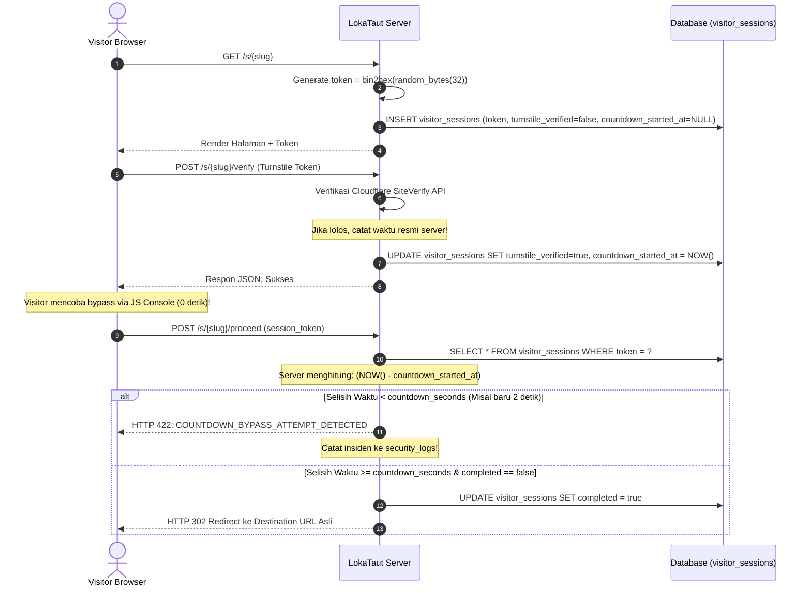

# Security & Privacy Specification — LokaTaut

| Atribut | Nilai |
|---|---|
| **Document ID** | DOC-09 |
| **Versi** | 1.0 |
| **Status** | DRAFT |
| **Terakhir Diperbarui** | 2026-10-30 |
| **Penulis** | Application Security Engineer & Data Privacy Specialist |
| **Target Pembaca** | AI Coding Agent, Security Auditor, DevOps Engineer |
| **Tujuan** | Menetapkan model ancaman (threat model), standar pengamanan kriptografis, pencegahan eksploitasi safelink, serta kebijakan privasi data pengunjung. |

---

## Dependensi Dokumen

| Dokumen | Relasi |
|---|---|
| [DOC-02 — Product Requirements Document](../01-product/02-prd.md) | Kebutuhan keamanan fungsional dan aturan bisnis (BR) |
| [DOC-05 — Software Architecture](../03-architecture/05-system-architecture.md) | Proteksi layer arsitektur dan lifecycle request |
| [DOC-06 — Database Design](../03-architecture/06-database-design.md) | Enkripsi kolom database dan hashing data privasi |
| [DOC-07 — Technical Specification](../03-architecture/07-technical-specification.md) | Konfigurasi middleware keamanan dan service layer |
| [AGENTS.md](../../AGENTS.md) | Larangan keras bagi Coding Agent terkait celah keamanan |

---

## 1. Threat Modeling (STRIDE Analysis)

Platform safelink merupakan target favorit bagi bot scraper, bot pengklik iklan (*click fraud*), dan pengguna yang berusaha mem-bypass halaman tunggu untuk langsung mengunduh file. Berikut adalah pemodelan ancaman STRIDE:

```
┌────────────────────────────────────────────────────────────────────────┐
│                        STRIDE Threat Matrix                            │
├───────────────┬───────────────────────────────┬────────────────────────┤
│ Kategori      │ Potensi Ancaman pada Safelink │ Mitigasi LokaTaut      │
├───────────────┼───────────────────────────────┼────────────────────────┤
│ Spoofing      │ Bot meniru identitas visitor  │ Cloudflare Turnstile   │
│               │ atau memalsukan session token │ + Token Kriptografis   │
├───────────────┼───────────────────────────────┼────────────────────────┤
│ Tampering     │ Mengubah countdown timer via  │ Validasi timestamp     │
│               │ JavaScript console di browser │ wajib di server-side   │
├───────────────┼───────────────────────────────┼────────────────────────┤
│ Repudiation   │ Manipulasi log kunjungan      │ Hash IP + Audit Log DB │
├───────────────┼───────────────────────────────┼────────────────────────┤
│ Information   │ URL tujuan bocor di HTML/JS   │ Destination URL di-    │
│ Disclosure    │ sebelum countdown selesai     │ simpan aman di server  │
├───────────────┼───────────────────────────────┼────────────────────────┤
│ Denial of     │ Flooding request ke /s/{slug} │ Rate Limiter (60/min)  │
│ Service (DoS) │ untuk menghabiskan CPU server │ + Cloudflare Edge WAF  │
├───────────────┼───────────────────────────────┼────────────────────────┤
│ Elevation of  │ Mengakses panel admin         │ Proteksi Session Admin │
│ Privilege     │ tanpa kredensial sah          │ + Brute-force throttle │
└───────────────┴───────────────────────────────┴────────────────────────┘
```

---

## 2. Mekanisme Kriptografis & Integritas Safelink (Core Security)

### 2.1 Prinsip Kerahasiaan URL Tujuan (Destination URL Concealment)
> **ATURAN MUTLAK:** URL tujuan unduhan yang sebenarnya **TIDAK PERNAH** dikirimkan ke peramban pengunjung dalam bentuk apapun (HTML tag, JSON atribut, atribut data, komentar kode, atau variabel JavaScript) sebelum seluruh proses safelink tervalidasi sukses di server.

1. **Enkripsi saat Disimpan:** Kolom `destination_url` di tabel `links` disimpan dalam bentuk ciphertext terenkripsi simetris menggunakan algoritma **AES-256-CBC** melalui class `Illuminate\Support\Facades\Crypt` bawaan Laravel dengan salt dari `APP_KEY`.
2. **Dekripsi Just-in-Time:** URL tujuan hanya didekripsi di memori PHP pada saat method `SafelinkController@proceed` berhasil memvalidasi token sesi dan waktu countdown.
3. **Respon HTTP 302 Found:** Browser menerima respon header `Location: https://download-url.com/file.zip` yang langsung memicu unduhan tanpa mengekspos tautan di history DOM halaman.

### 2.2 Arsitektur Validasi Sesi & Anti-Bypass
Banyak script safelink publik gagal karena hanya mengandalkan hitung mundur JavaScript di browser yang sangat mudah di-bypass menggunakan perintah `timer = 0` atau memicu submit tombol secara instan. LokaTaut menerapkan **Server-Side Elapsed Time Enforcement**:



### 2.3 Pencegahan Serangan Pemutaran Ulang (Replay Attack Prevention)
- Setiap token sesi pada tabel `visitor_sessions` memiliki flag `completed`.
- Sekali token berhasil digunakan untuk memicu redirect 302, flag `completed` langsung diubah menjadi `true`.
- Jika token yang sama dikirim ulang untuk kedua kalinya, server akan menolak request dengan kode HTTP 422 (*Token Has Already Been Used*).

---

## 3. Pencegahan Celah Keamanan Standar Web (OWASP Top 10)

### 3.1 Cross-Site Request Forgery (CSRF)
- Seluruh endpoint non-GET (termasuk verifikasi Turnstile dan eksekusi redirect) wajib menyertakan token CSRF (`X-CSRF-TOKEN` via AJAX header atau field `_token` pada form submission).
- Middleware `ValidateCsrfToken` bawaan Laravel aktif secara default.

### 3.2 Cross-Site Scripting (XSS)
- Seluruh output dinamis pada Blade views diwajibkan menggunakan sintaks auto-escaping `{{ $variabel }}`.
- Tag unescaped `{!! $adSlot->ad_code !!}` **HANYA** diizinkan khusus pada komponen render iklan `<x-ad-slot>`, di mana kode iklan hanya dapat dimasukkan dan diperbarui oleh administrator terautentikasi tunggal.

### 3.3 SQL Injection
- 100% kueri basis data memanfaatkan Eloquent ORM atau Query Builder dengan parameter binding berbasis PDO.
- Dilarang keras menggabungkan variabel mentah pengguna ke dalam klausa SQL via `DB::raw()`.

### 3.4 Open Redirect & Server-Side Request Forgery (SSRF)
- Ketika admin memasukkan `destination_url` baru di dashboard, input wajib lolos validasi:
  - Protokol wajib menggunakan skema aman: `starts_with:http://,https://`.
  - Dilarang mengarahkan ke IP loopback lokal / privat (`127.0.0.1`, `localhost`, subnet `10.0.0.0/8`, `192.168.0.0/16`, `172.16.0.0/12`) untuk mencegah SSRF ke infrastruktur hosting internal cPanel.

### 3.5 Rate Limiting & Proteksi Brute-Force
Dikonfigurasi pada `app/Providers/AppServiceProvider.php` atau `bootstrap/app.php`:
1. **Endpoint Safelink Publik (`/s/{slug}`):** Dibatasi maksimal **60 request per menit per alamat IP**.
2. **Form Login Admin (`/login`):** Dibatasi maksimal **5 percobaan login gagal per menit per alamat IP**. Pelanggaran menghasilkan respon HTTP 429 dengan delay progresif.

---

## 4. Keamanan Autentikasi & Sesi Admin

1. **Hashing Kredensial:** Password administrator di-hash menggunakan algoritma **Bcrypt** (work factor 12) atau **Argon2id**.
2. **Enforce Single Session:** Administrator hanya diizinkan memiliki satu sesi aktif pada satu waktu. Saat admin login dari perangkat baru, sesi lama di perangkat lain otomatis di-terminate.
3. **Session Cookies Configuration:**
   - `cookie_secure = true`: Cookie sesi hanya dikirim melalui koneksi HTTPS terenkripsi.
   - `cookie_httponly = true`: Cookie sesi tidak dapat diakses melalui JavaScript peramban (mitigasi pencurian cookie via XSS).
   - `cookie_samesite = lax`: Mencegah pengiriman cookie lintas situs pada request berbahaya.

---

## 5. Perlindungan Privasi Data Pengunjung (Privacy by Design)

LokaTaut mematuhi prinsip privasi modern dengan meminimalkan pengumpulan data pribadi (*Data Minimization*):

### 5.1 Penyamaran Alamat IP (IP Address Hashing)
- Alamat IP asli pengunjung **TIDAK PERNAH** disimpan dalam bentuk plain text pada tabel analitik `visits` maupun `visitor_sessions`.
- Sebelum disimpan ke basis data, alamat IP di-hash secara satu arah menggunakan algoritma SHA-256 yang digabungkan dengan secret key aplikasi:
```php
$ipHash = hash('sha256', $request->ip() . config('app.key'));
```
- Hal ini memungkinkan sistem menghitung metrik pengunjung unik (*Unique Visitors*) secara akurat tanpa melanggar regulasi privasi atau menyimpan informasi yang dapat mengidentifikasi individu (*Personally Identifiable Information / PII*).

### 5.2 Bebas Cookie Pelacak Pihak Ketiga (No Third-Party Tracking Cookies)
- LokaTaut tidak menanamkan cookie pelacak, piksel retargeting, atau sidik jari browser (*canvas fingerprinting*) pada peramban pengunjung.
- Pelacakan kunjungan murni berbasis event logging internal di server.

### 5.3 Retensi & Penghapusan Data Otomatis
- Data sesi pengunjung (`visitor_sessions`) otomatis dihapus setiap jam jika telah berusia lebih dari 24 jam.
- Data mentah log kunjungan (`visits`) yang telah berusia lebih dari **90 hari** otomatis dihapus secara berkala oleh sistem setelah ringkasan statistik diagregasikan ke tabel `daily_stats`.

---

## 6. Protokol Respons Insiden Keamanan (Incident Response)

Jika terdeteksi anomali keamanan (seperti lonjakan request bypass countdown, brute-force admin, atau upaya injeksi URL berbahaya):

1. **Logging Otomatis:** Sistem secara otomatis mencatat detail request (IP, User-Agent, payload yang dicoba) ke tabel `security_logs`.
2. **Temporary IP Ban:** Middleware keamanan dapat memblokir sementara IP yang terbukti melakukan percobaan bypass terstruktur.
3. **Admin Alert:** Administrator dapat memantau insiden keamanan langsung dari menu **Security Logs** di dashboard untuk mengambil tindakan pemblokiran IP di level Cloudflare WAF.

