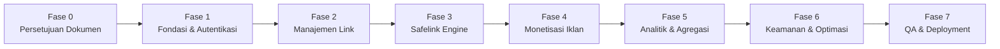

# Implementation Roadmap & Task Backlog — LokaTaut

| Atribut | Nilai |
|---|---|
| **Document ID** | DOC-16 |
| **Versi** | 1.0 |
| **Status** | DRAFT |
| **Terakhir Diperbarui** | 2026-10-30 |
| **Penulis** | Lead Project Manager & Technical Architect |
| **Target Pembaca** | Product Owner, AI Coding Agent, QA Engineer |
| **Tujuan** | Menyusun tahapan pengembangan terstruktur (*Phase-by-Phase Roadmap*) dan backlog tugas teknis berurutan agar AI Coding Agent mengimplementasikan sistem secara konsisten dan teruji tanpa melompati fondasi dasar. |

---

## Dependensi Dokumen

| Dokumen | Relasi |
|---|---|
| [DOC-02 — Product Requirements Document](../01-product/02-prd.md) | Sumber kebutuhan fitur dan prioritas |
| [DOC-03 — Scope & Requirements Specification](../01-product/03-scope-requirements.md) | Batasan fitur MVP vs Post-MVP |
| [DOC-07 — Technical Specification](../03-architecture/07-technical-specification.md) | Struktur folder dan standar koding implementasi |
| [DOC-12 — Testing Strategy & QA Plan](../06-quality/12-testing-qa.md) | Kriteria kelulusan pengujian pada setiap task |
| [AGENTS.md](../../AGENTS.md) | Kewajiban mematuhi urutan roadmap pengembangan |

---

## 1. Ikhtisar Fase Implementasi (Implementation Phases)

Pengembangan LokaTaut dipecah menjadi **8 Fase Berurutan**. AI Coding Agent **DILARANG** mengerjakan tugas pada fase berikutnya sebelum seluruh kriteria penerimaan fase sebelumnya berstatus **SELESAI (DONE)** dan lolos pengujian otomatis.

---

## 2. Rincian Task Backlog Per Fase

---

### FASE 0: Persetujuan Dokumentasi & Pre-Flight Checklist
- **Tujuan:** Memastikan seluruh spesifikasi disetujui Product Owner sebelum penulisan kode sumber.

| Task ID | Modul | Deskripsi Tugas | Dependensi | Prioritas | Dokumen Rujukan |
|---|---|---|---|:---:|---|
| **TASK-001** | Documentation | Verifikasi kelengkapan 16 dokumen dan file `AGENTS.md` | - | P0 | DOC-01 s/d DOC-16 |
| **TASK-002** | Governance | Peninjauan dan persetujuan (APPROVAL) dari Product Owner | TASK-001 | P0 | AGENTS.md |

---

### FASE 1: Fondasi Proyek & Autentikasi Admin Tunggal
- **Tujuan:** Menyiapkan kerangka kerja Laravel 11, skema database awal, konfigurasi `.env`, dan login admin yang aman.

| Task ID | Modul | Deskripsi Tugas | Dependensi | Prioritas | Acceptance Criteria |
|---|---|---|---|:---:|---|
| **TASK-101** | Foundation | Inisialisasi proyek Laravel 11.x, konfigurasi `.env.example`, setup `.gitignore`, dan konfigurasi MySQL | TASK-002 | P0 | Laravel fresh install berjalan di PHP 8.3 |
| **TASK-102** | Database | Migrasi tabel `admins` dan pembuatan `AdminSeeder` | TASK-101 | P0 | Tabel `admins` terbentuk dengan index unik email |
| **TASK-103** | Auth | Implementasi `LoginController`, `AdminLoginRequest`, view `login.blade.php`, dan logout | TASK-102 | P0 | Admin sukses login/logout; password ter-hash Bcrypt |
| **TASK-104** | Security | Terapkan rate limiting pada login (maks 5 percobaan/menit) dan proteksi single session | TASK-103 | P0 | Percobaan ke-6 gagal menghasilkan HTTP 429 |
| **TASK-105** | Testing | Tulis dan eksekusi `AdminAuthTest` (PHPUnit/Pest) | TASK-104 | P0 | Seluruh skenario `TEST-AUTH-*` berstatus PASS |

---

### FASE 2: Modul Manajemen Link (Link Management)
- **Tujuan:** Admin dapat membuat, mengubah, menonaktifkan, dan menghapus tautan unduhan dengan slug unik.

| Task ID | Modul | Deskripsi Tugas | Dependensi | Prioritas | Acceptance Criteria |
|---|---|---|---|:---:|---|
| **TASK-201** | Database | Migrasi tabel `links` dengan enkripsi simetris pada kolom `destination_url` | TASK-105 | P0 | Model `Link` memiliki attribute casting encrypt/decrypt |
| **TASK-202** | Service | Implementasi `SlugGeneratorService` (6–8 karakter acak alfanumerik unik) | TASK-201 | P0 | Generator menghasilkan slug acak dan memverifikasi keunikan |
| **TASK-203** | Controller | Implementasi `LinkController` (CRUD: index, create, store, edit, update, destroy) | TASK-202 | P0 | Form request memvalidasi format URL dan custom slug |
| **TASK-204** | UI/UX | Implementasi Blade views manajemen link (`index`, `create`, `edit`) dengan Native CSS | TASK-203 | P0 | Tampilan responsif mobile/desktop, tombol copy link aktif |
| **TASK-205** | Feature | Fitur toggle status link (Active/Inactive) via AJAX/PATCH dan tagging website sumber | TASK-204 | P1 | Status link dapat diubah instan tanpa reload halaman |
| **TASK-206** | Testing | Tulis dan eksekusi `LinkManagementTest` | TASK-205 | P0 | Seluruh skenario `TEST-LINK-*` berstatus PASS |

---

### FASE 3: Safelink Engine & Alur Verifikasi Pengunjung (Core Safelink)
- **Tujuan:** Menampilkan halaman safelink yang memuat Turnstile, countdown 10 detik, dan redirect aman anti-bypass.

| Task ID | Modul | Deskripsi Tugas | Dependensi | Prioritas | Acceptance Criteria |
|---|---|---|---|:---:|---|
| **TASK-301** | Database | Migrasi tabel `visitor_sessions` untuk pencatatan token sesi pengunjung | TASK-206 | P0 | Tabel terbuat dengan index token unik dan TTL expires_at |
| **TASK-302** | Service | Implementasi `TokenService` (kriptografi token 64 hex & SHA-256 IP hasher) | TASK-301 | P0 | Token acak kriptografis terbuat tanpa kebocoran IP plain |
| **TASK-303** | Service | Implementasi `TurnstileService` (integrasi HTTP Client ke Cloudflare SiteVerify) | TASK-302 | P0 | API verifikasi mengembalikan status valid/invalid |
| **TASK-304** | Controller | Implementasi `SafelinkController@show` dan view `safelink.blade.php` | TASK-303 | P0 | Halaman publik safelink dimuat dengan status tombol disabled |
| **TASK-305** | Controller | Implementasi `SafelinkController@verify` (AJAX Turnstile callback handler) | TASK-304 | P0 | Verifikasi Turnstile mencatat `countdown_started_at = now()` |
| **TASK-306** | Controller | Implementasi `SafelinkController@proceed` dengan **Server-Side Elapsed Time Enforcement** | TASK-305 | P0 | Redirect 302 ke URL asli; menolak bypass waktu dengan HTTP 422 |
| **TASK-307** | UI/UX | View khusus link kedaluwarsa (`expired.blade.php`) dan tidak valid (`invalid.blade.php`) | TASK-306 | P0 | Respon HTTP 410 dan 404 menampilkan UI ramah pengguna |
| **TASK-308** | Testing | Tulis dan eksekusi `SafelinkFlowTest` (mencakup simulasi curang bypass JS) | TASK-307 | P0 | Seluruh skenario `TEST-SAFE-*` berstatus PASS |

---

### FASE 4: Manajemen Slot Iklan (Monetization Engine)
- **Tujuan:** Admin dapat mengelola penempatan kode iklan Adsterra secara dinamis di halaman safelink.

| Task ID | Modul | Deskripsi Tugas | Dependensi | Prioritas | Acceptance Criteria |
|---|---|---|---|:---:|---|
| **TASK-401** | Database | Migrasi tabel `ad_slots` (posisi: header, above_timer, below_timer, footer) | TASK-308 | P0 | Skema slot iklan siap menampung kode HTML/JS mentah |
| **TASK-402** | Controller | Implementasi `AdSlotController` di panel admin untuk CRUD slot iklan | TASK-401 | P0 | Admin dapat menempelkan script Adsterra dan toggle aktif/mati |
| **TASK-403** | UI/UX | Pembuatan Blade Component `<x-public.ad-slot>` dengan container pencegah CLS | TASK-402 | P0 | Iklan termuat asinkron tanpa menggeser tombol countdown |
| **TASK-404** | Testing | Tulis dan eksekusi `AdSlotManagementTest` | TASK-403 | P1 | Seluruh skenario `TEST-ADS-*` berstatus PASS |

---

### FASE 5: Analitik Trafik & Agregasi Data
- **Tujuan:** Mencatat impresi dan completion rate serta menyajikan grafik performa di dashboard.

| Task ID | Modul | Deskripsi Tugas | Dependensi | Prioritas | Acceptance Criteria |
|---|---|---|---|:---:|---|
| **TASK-501** | Database | Migrasi tabel `visits` dan tabel agregat `daily_stats` | TASK-404 | P0 | Skema event logging kunjungan dan agregat harian siap |
| **TASK-502** | Service | Implementasi `VisitRecorderService` untuk mencatat event `impression` & `completed` | TASK-501 | P0 | Event tercatat dengan hash IP dan parsing perangkat/browser |
| **TASK-503** | Console | Pembuatan artisan command `lokataut:aggregate-stats` | TASK-502 | P1 | Data kemarin terekap ke `daily_stats` via satu eksekusi |
| **TASK-504** | Controller | Implementasi `DashboardController` dan view metrik (Total Klik, Completion Rate, Tren) | TASK-503 | P0 | Dashboard admin menampilkan 4 kartu statistik dan grafik mingguan |
| **TASK-505** | Testing | Pengujian fungsional analitik dan agregasi | TASK-504 | P1 | Kueri dashboard dieksekusi < 100ms |

---

### FASE 6: Pengerasan Keamanan, Optimasi & Cron Job
- **Tujuan:** Memastikan aplikasi tahan serangan, ramah kuota disk shared hosting, dan cron job berjalan lancar.

| Task ID | Modul | Deskripsi Tugas | Dependensi | Prioritas | Acceptance Criteria |
|---|---|---|---|:---:|---|
| **TASK-601** | Security | Migrasi tabel `security_logs` dan pembuatan `SecurityLogService` | TASK-505 | P1 | Percobaan bypass token otomatis dicatat ke database |
| **TASK-602** | Middleware | Terapkan `SecurityHeadersMiddleware` (CSP, X-Robots-Tag noindex, X-Frame-Options) | TASK-601 | P0 | Header respon HTTP menyertakan instruksi noindex |
| **TASK-603** | Console | Pembuatan artisan command `lokataut:prune-sessions` dan `lokataut:prune-visit-logs` | TASK-602 | P0 | Sesi > 24 jam dan log mentah > 90 hari otomatis terhapus |
| **TASK-604** | Scheduler | Pendaftaran jadwal tugas di `routes/console.php` | TASK-603 | P0 | `schedule:run` mengeksekusi tugas pruning dan agregasi |
| **TASK-605** | Optimization| Audit performa kueri database (EXPLAIN query) dan optimasi cache file | TASK-604 | P0 | Seluruh kueri publik lolos evaluasi performa |

---

### FASE 7: Full QA, UAT & Panduan Deployment Produksi
- **Tujuan:** Verifikasi akhir seluruh skenario dan panduan instalasi ke cPanel WarnaHost.

| Task ID | Modul | Deskripsi Tugas | Dependensi | Prioritas | Acceptance Criteria |
|---|---|---|---|:---:|---|
| **TASK-701** | Quality | Eksekusi seluruh automated test suite (`php artisan test`) | TASK-605 | P0 | **100% test case PASS (Coverage P0/P1 hijau)** |
| **TASK-702** | UAT | Manual User Acceptance Testing alur pengunjung pada perangkat mobile fisik | TASK-701 | P0 | Safelink berjalan mulus di browser Android/iOS |
| **TASK-703** | Deployment| Deployment ke Shared Hosting WarnaHost sesuai panduan DOC-13 (struktur folder aman di luar `public_html`) | TASK-702 | P0 | Aplikasi live di `lokataut.com` dengan SSL Full Strict |
| **TASK-704** | Operations| Setup Cron Job cPanel `schedule:run` dan pengujian di server live | TASK-703 | P0 | Cron berjalan otomatis setiap menit |

---

## 3. Aturan Pelaksanaan Bagi AI Coding Agent

1. **Satu Task dalam Satu Waktu:** Selesaikan task secara berurutan berdasarkan nomor ID (`TASK-101`, lalu `TASK-102`, dst.).
2. **Jangan Melompati Fase:** Dilarang mengerjakan Fase 3 (Safelink Engine) jika Fase 2 (Link Management) belum memiliki test suite yang lolos.
3. **Konfirmasi Setiap Penyelesaian:** Setelah menyelesaikan satu task, jalankan automated test terkait dan laporkan hasilnya sebelum meminta izin melanjutkan ke task berikutnya.

